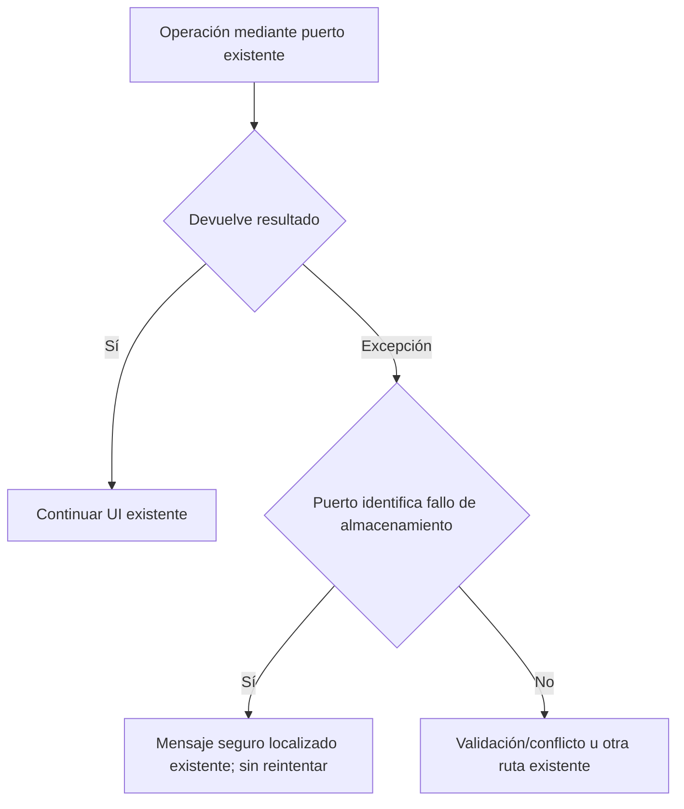

# Frontera de errores de almacenamiento

## Contrato de cambio

Seis consumidores Blazor conocen Microsoft.Data.Sqlite.SqliteException pese a
recibir puertos de aplicación. La UI todavía necesita el proveedor concreto para
preservar mensajes seguros; cambiar persistencia exige editar sus filtros.

- **Responsabilidad:** identificar errores de almacenamiento del adaptador local.
  Nuevo puerto IStorageFailureClassifier en Application, implementado por
  SqliteFailureClassifier en Infrastructure y compuesto por LocalPromptLibrary.
- **Consumidores:** Home/Assist y cuatro controles de organización/transferencias.
  Un singleton puro, sin DB, caché, excepciones nuevas ni estado por petición.
- **Invariantes:** clasifica exactamente la misma familia de tipos que los filtros
  anteriores. No clasifica por texto, código escrito por el usuario o intención.
  No desenvuelve excepciones; validación, conflicto y otros fallos mantienen rutas.
  No lanza, consume o modifica la excepción, ni ejecuta reintentos/IO/autorización.
- **Mensajes:** pertenecen a la UI y conservan sus textos/localización. El puerto
  devuelve bool, nunca mensajes del motor o rutas privadas.
- **Alternativas:** conservar el tipo concreto contradice la frontera migrada;
  envolver cada método de persistencia añade proxies/forwarding y cambia excepciones
  públicas. Un puerto pequeño de clasificación preserva los contratos actuales y
  protege una dependencia real de seis consumidores.
- **Compatibilidad:** cambios aditivos C#/DI; sin cambios HTTP, SQLite o modelo.
  La fábrica del host Blazor publica el mismo adaptador del módulo compartido.
  Reversión conjunta de inyección, filtros y registro; fuentes previas inventariadas.
- **Verificación:** clasificación de tipos positivos/negativos sin mensajes;
  compilación de Razor; regresión compartida y fallos reales de motor en una base
  sintética desde UI, con rollback de escritura y recuperación tras retirar el fallo.
  No corresponde repetir corpus semánticos por este cambio técnico.



```text
registrar un clasificador de errores del proveedor junto a la biblioteca
inyectarlo en consumidores UI; eliminar su referencia al tipo SQLite
al capturar una excepción:
    preservar los tipos de validación, conflicto e IO del filtro anterior
    sustituir sólo el test de tipo SQLite por el puerto de almacenamiento
    mostrar el mismo mensaje según la misma condición
    no reintentar, mutar registros o cambiar aprobaciones desde el clasificador
```

## Resultado ejecutado

IMPLEMENTADO Y VALIDADO PARA ESTA FRONTERA. No declara cierre de versión/agente.

- **168/168 compartidas PASS**, cero omitidas, incluyendo clasificación por tipo
  y fallo real del motor que revierte plantilla/versión y permite recuperación.
- API y Blazor compilan sin warnings/errores; sus tres DLL compartidas son idénticas.
- **Seis checks Edge/SQLite PASS**: fallo de creación de plantilla/versión, grupo e
  instrucción; mensaje seguro sin marcador técnico; rollback y recuperación desde
  el mismo formulario con una sola versión. Cero errores de página/peticiones externas.
- **Doce controles estáticos PASS**, incluyendo ausencia de tipos SQLite en los
  componentes. Seis comparaciones exactas con fuentes previas verifican que sólo
  cambian inyección y predicados técnicos; mensajes y caminos de éxito permanecen.

Evidencias: [verification.json](../evidence/storage-failure-20261020/verification.json),
[recorridos UI](../evidence/storage-failure-ui-1792512968916/results.json) y
[transformaciones preservadas](../evidence/storage-failure-20261020/consumer-transformations.json).
El harness `Tests/nova/storage-failure-ports.cjs` usa triggers de aborto en una base
propia, retirados al terminar; no cambia esquema de aplicación ni bases personales.
Su primera ejecución falló antes de actuar por una invocación incorrecta de Python
mediante uv; la corrección sólo del harness y el intento fallido se conservan.

No se afirma recuperación de todos los errores/operaciones: se verificaron tres
creaciones y sus versiones. No se reejecutaron React ni corpus semánticos porque
esta frontera es Blazor/persistencia. La campaña separada de recursos de autoría
quedó rechazada y retirada; estos PASS no compensan sus fallos. La validación MAUI
continúa pendiente de herramientas/autorización, y la matriz conserva 34/54.
