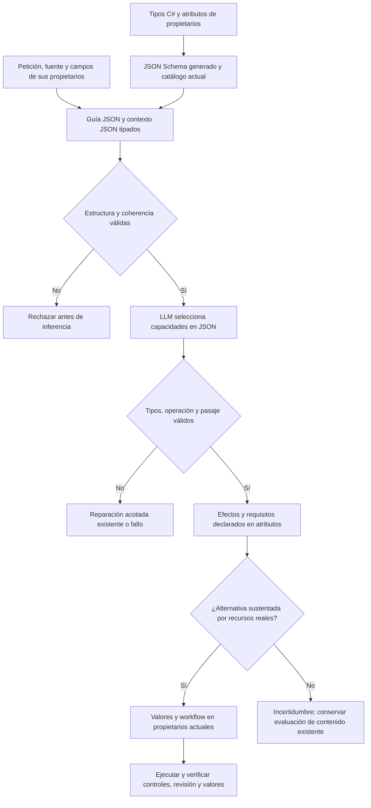

# Contexto JSON tipado y capacidades reflejadas de NOVA

## Qué se implementó

La entrada de selección inicial de capacidades usa tipos C# explícitos. `ValidatedAgentJson` genera JSON Schema con el SDK ya instalado, serializa con configuración estricta, vuelve a deserializar contra el mismo tipo y ejecuta comprobaciones de coherencia del propietario **antes de llamar al modelo**. No se instala un framework ni un modelo nuevo.

Los archivos [context.schema.json](contracts/instruction-scope-v3/context.schema.json), [guide.schema.json](contracts/instruction-scope-v3/guide.schema.json), [response.schema.json](contracts/instruction-scope-v3/response.schema.json) y [capabilities.json](contracts/instruction-scope-v3/capabilities.json) son exportaciones del código y sus atributos; no contratos mantenidos manualmente. La guía de sistema también es JSON tipado, separada de los datos del usuario.

Esto no convierte automáticamente cada mensaje legacy de generación al nuevo formato. Es una frontera reutilizable aplicada al propietario de la confusión autoría/datos/workflow. La petición original y su autoridad permanecen en los propietarios de tarea/sesión; la proyección de este paso excluye el material literal de campos de los pasajes de autoridad.

## Propietarios y flujo

| Parte | Propietario | Comprobación |
|---|---|---|
| Definiciones de objetos | `AgentRepresentationAttribute` existente | Reflection sobre tipos confiables, sin leer instancias |
| Operaciones reales | `AgentOperationAttribute` / `SemanticCapabilityCatalog` | Descripción, herramientas, `Writes` y `Requires` |
| JSON de entrada y guía | `InstructionScopeContext` / `ScopeGuide` | Campos obligatorios, tipos, nullabilidad, propiedades desconocidas/duplicadas, presupuesto |
| Coherencia del contexto | `ReviewAuthoringScope` | Campos pertenecen a fuente, revisión válida, origen de pasajes y catálogo idéntico al propietario |
| Interpretación | Qwen local | Selecciona operaciones registradas y un pasaje real por cada una |
| Efectos de representación | Catálogo reflejado | Código deriva si se escribe definición, valores o instancia; no reinterpreta frases |
| Ejecución y cierre | Propietarios actuales de valores/workflow/UI | Argumentos, fuente/revisión, aprobación y efectos realmente observados |



```text
obtener catálogo desde atributos actuales
construir contexto desde petición, referencia resuelta y hechos de campos
generar esquema desde el tipo C# y validar la representación JSON
comprobar coherencia de fuente, pasajes y catálogo contra sus propietarios
enviar guía y datos como documentos JSON separados por rol
validar JSON de respuesta contra el tipo generado y su evidencia
derivar efectos desde Writes, nunca desde keywords, regex o similitud
si una alternativa necesita recursos ausentes, conservar incertidumbre
continuar sólo con reglas, autorización y verificadores existentes
```

Una declaración de completar campos sin valores disponibles no demuestra que no exista una edición independiente. `Requires` hace explícita esa precondición; la falta de recursos produce incertidumbre, no un cambio de intención inventado. La selección de capacidades no concede permisos ni ejecuta herramientas. El tipo y las comprobaciones de coherencia protegen la frontera; no se afirma que un JSON estructuralmente válido sea semánticamente correcto.

## Ejemplo de respuesta

```json
{
  "requestedOperations": [
    { "operation": "FILL_VARIABLES", "supportingPassage": 0 },
    { "operation": "COPY_PROMPT", "supportingPassage": 0 }
  ]
}
```

El ejemplo ilustra el formato. Las solicitudes admitidas proceden del enum/catálogo real y los índices deben existir en los pasajes de la petición actual o su continuación autorizada. La aplicación valida ambas cosas. El LLM no proporciona `Writes`, `Requires`, permisos, IDs nuevos ni aprobación.

## Base vectorial y herramientas de IA

El proyecto **ya contiene** `CapabilityVectorStore` (SQLite separada, vectores con versión/hash/perfil) y `VectorCapabilityKnowledge` con embeddings locales Nomic. No se añadió otra base ni se cambió su configuración. El contexto tipado admite `retrievedKnowledge` cuando el proveedor existente está configurado; el catálogo autoritativo sigue proviniendo de reflection.

La recuperación vectorial encuentra documentación pertinente. No produce el esquema, no valida JSON, no convierte semejanza en intención y no concede permisos. En estas comprobaciones reales de corrección se usó el catálogo reflejado completo y Qwen; no se activó ni se atribuyó fiabilidad nueva a Nomic/RAG. Las pruebas dirigidas incluyen la persistencia y aislamiento del componente vectorial con embeddings controlados.

## Exportación y mantenimiento

```powershell
dotnet backend/QuickPrompt.Evaluation/bin/Debug/net8.0/QuickPrompt.Evaluation.dll --instruction-contracts docs/nova/contracts/NUEVA_VERSION
```

El exportador sólo acepta un directorio nuevo dentro de `docs/nova/contracts`; conserva exportaciones anteriores. Para extender una operación se modifica su declaración en el propietario: su descripción, herramientas, representaciones escritas y requisitos pasan al JSON automáticamente. Una nueva clase de recurso necesita observaciones de su propietario; reflection no inventa su disponibilidad.

## Validación

Resultados y límites de la campaña se registran en [INSTRUCTION_USE_GROUNDING.md](INSTRUCTION_USE_GROUNDING.md). Los ensayos rechazados y la evidencia previa se conservan. La aceptación del formato y la corrección de completar/copiar no equivalen al cierre de la versión ni a fiabilidad general para cualquier petición.

## Ampliación de aceptación del candidato final

La [campaña integral posterior](RELEASE_VALIDATION_20261020.md) conserva el PASS de las dos peticiones libres de completar/copiar, pero detecta una pregunta explicativa rechazada por vínculo inválido de capacidades y otros fallos fuera de esta frontera. La evidencia general queda PARTIAL; los controles JSON estrictos siguen siendo una garantía estructural, no de comprensión universal. El contenido contaminado de una adaptación real se rechaza mediante revisión independiente aunque el modelo y la igualdad de campos lo acepten. La versión sigue NO CERRADA.
