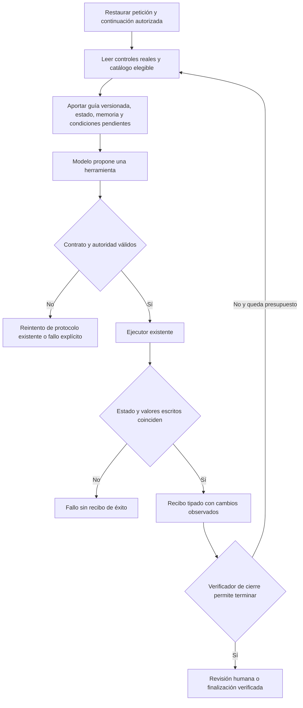

# NOVA: recursos del bucle de interfaz

2026-10-20. Incremento sobre `RunVisible` y `PreparationInference.Decide`. No sustituye todavía el intérprete semántico ni cualifica autoría.

## Contrato de cambio

- **Capacidad y propietario:** el ejecutor `AgentOrchestrator.RunVisible` aporta memoria de la tarea y observaciones comprobadas; `PreparationInference.Decide` compone el contexto del modelo. `SemanticSystemKnowledge` conserva la única definición de representaciones; `UiToolCatalog` conserva herramientas, permisos y esquemas; `GoalCompletionValidator` conserva el cierre.
- **Entradas/salidas:** petición original y aclaración autorizada, estado observado con identidad/revisión, herramientas elegibles, valores autorizados, historial acotado de resultados y comprobación de condiciones pendientes → exactamente una propuesta de herramienta del catálogo actual.
- **Invariantes:** una propuesta no es un efecto; datos y borradores no son permisos; memoria no sustituye el estado actual; campos escritos se comparan literalmente tras ejecutar; guardado/eliminación siguen requiriendo aprobación. Ningún recurso habilita nuevas herramientas. Sin reglas de intención por frases/regex.
- **Estado y retención:** memoria dentro de la ejecución existente; máximo 12 recibos recientes, con cantidad omitida explícita. `UiObservedEffect` es una proyección para el modelo de los resultados ya comprobados, distinta del recibo HTTP `UiActionReceipt` que sigue perteneciendo al dispatcher. No se añade almacén, persistencia, memoria entre usuarios ni registro de cuerpos en telemetría. La continuación usa exclusivamente `AuthorizedPendingRequest`, que ya decide el propietario de sesión; nunca se arrastra una petición anterior por defecto. Aprobación y efecto persistido proceden de `LiveRuns`, no del modelo; la verificación previa expresa preparación para revisión, no guardado.
- **Presupuesto:** sin nuevas llamadas LLM; misma cancelación, plazo de etapa, máximo de pasos y único reintento de protocolo. El paquete conserva el límite de 32 KB y falla explícitamente si no cabe. Extractos se marcan truncados; valores y peticiones no se recortan.
- **Dependencias:** Application declara/proyecta recursos; Infrastructure serializa y llama al proveedor. Sin nuevos paquetes, modelos, controlador UI ni registro de operaciones.
- **Alternativas:** extender estos propietarios requiere sólo un recurso y recibos tipados. Una nueva estrategia no tiene segundo consumidor necesario; otro subsistema duplicaría estado y validación. Se elige extensión local.
- **Compatibilidad:** parámetro opcional interno en `UiDecisionContext`; no cambia HTTP, SQLite ni aprobación. Revertir este incremento retira el contexto y los recibos sin migración.

## Algoritmo



```text
para cada paso permitido, respetando cancelación:
    leer estado actual, revisar identidad/revisión y filtrar catálogo existente
    componer guía desde atributos existentes (sin datos de instancia)
    aportar original/continuación autorizada, recibos recientes y condiciones pendientes
    solicitar un paso; aplicar validación y reintento acotado existentes
    ejecutar en el propietario actual
    verificar estado y, para escritura de campo, igualdad literal del valor
    sólo después registrar cambios observados; nunca copiar una propuesta como resultado
    permitir terminar únicamente mediante los verificadores actuales
```

| Recurso | Fuente | Límite de confianza |
|---|---|---|
| Guía | Atributos existentes de representaciones y etapa | Documentación, no permiso ni instrucción del usuario |
| Estado | `UiVisibleState` recién observado | Dato; extractos con marca y hash del texto completo |
| Catálogo | `context.Tools` filtrado por dominio | Esquemas nativos y permisos; no catálogo paralelo |
| Memoria | Petición/continuación autorizada y efectos comprobados de este run | No atribuye efectos no ejecutados ni recupera tareas ajenas |
| Verificación | `GoalCompletionValidator`, igualdad de campos y comprobación visible existentes | El modelo no autocertifica la tarea ni aprueba persistencia |

## Aceptación prevista

Transporte: guía metadata-only, campos/revisión actuales, catálogo exacto con permisos, peticiones completas, recibos separados, truncamiento explícito y rechazo de sobrepresupuesto. Ejecutores: un campo ignorado no produce recibo de éxito; un resultado correcto llega al siguiente paso; tareas nuevas no heredan órdenes ajenas. Regresión: protocolo y caché no reutilizan decisiones al cambiar memoria/estado. Modelo local y UI reales: campaña focalizada, preservando fallos y separando selección de herramientas de éxito global.

## Resultado ejecutado

**Incremento parcial integrado en el bucle UI; núcleo semántico inicial no sustituido.**

- 101 controles dirigidos PASS en `ui-agent-resources-qualified-boundaries.trx`: transporte, representaciones, memoria, continuación autorizada, aislamiento de tarea nueva, escritura ignorada, caché, dispatcher y cierre. No se repitieron frontend ni backend completos. La primera compilación detectó una colisión con el nombre del recibo HTTP existente; se corrigió la proyección sin cambiar ese contrato público.
- API compilada sin advertencias/errores. Pruebas ejecutadas con el mismo código de producto que la segunda campaña UI. Sin dependencias, modelos o configuración productiva nuevos.
- **UI real / acción rápida `quickVariables`: PASS**, Qwen3:8b, 15.296 ms, cinco llamadas (incluido el único reintento permitido por omisión de llamada nativa inicial). La UI construye su comando tipado; Qwen elige buscar, abrir, escribir y terminar. El último paquete contiene tres recibos anteriores y el valor exacto escrito. Fuente/revisión/plantilla conservadas, preview determinista exacto y copia manual comprobada mediante captura aislada del portapapeles del navegador. Sólo la copia manual incrementa usos; el agente no persiste contenido. Captura visual inspeccionada. Esto acredita ese recorrido, no todas las peticiones libres.
- **UI real / petición libre `boundVariables`: FAIL**, 156.805 ms / 19 llamadas / `INVALID_DECISION`. En el candidato previo a añadir los campos informativos de aprobación, la decisión inicial de autoría devolvió `REVISION_REQUEST` e incorporó `[Preparado para copiar]` al contenido. El catálogo posterior sólo ofrecía edición/aclaración y el modelo siguió ese plan. La revisión posterior además exigió incluir el dato de caso en la definición. El campo quedó vacío; no se guardó contenido. Fallo retenido y no repetido para buscar un resultado favorable. La guía UI no corrige retrospectivamente esa interpretación anterior.

Evidencia: [101 controles](../evidence/closure-20261020/tests/ui-agent-resources-qualified-boundaries.trx), [petición libre fallida](../evidence/latency-1792484501499/measurements.json), [acción rápida correcta](../evidence/latency-1792484718655/measurements.json), [aceptación focalizada](../evidence/latency-1792484718655/validation.json).

Los dos tiempos son observaciones de tareas/entradas diferentes; no prueban una mejora de latencia ni p50/p95. No se ejecutó creación, guardado, eliminación, holdout ni una campaña general de semántica. No se cierra ningún requisito de versión por estos resultados. El siguiente incremento debe corregir la distinción autoría/datos/workflow en su propietario inicial y consumir el mismo contexto autorizado; no añadir manejadores de frases ni nuevos ejecutores de acciones.

## Incremento posterior: JSON tipado y alcance de efectos

La evidencia anterior se conserva como historia del candidato rechazado. El incremento [TYPED_AGENT_CONTEXT.md](TYPED_AGENT_CONTEXT.md) extiende el propietario inicial existente con guía/contexto/respuesta JSON tipados, esquemas derivados de C# y atributos `Writes`/`Requires`. No activa el prototipo de núcleo alternativo ni añade ejecutores o un árbitro.

El candidato final acredita 194 controles dirigidos, tres regresiones de planificación con Qwen y las dos peticiones libres originales de completar/copiar en UI: todas PASS en ese alcance. La fuente, revisión, plantilla, valores literales, preview y copia capturada en el navegador coinciden; la edición legítima se conserva. Resultados, hashes y experimentos rechazados: [INSTRUCTION_USE_GROUNDING.md](INSTRUCTION_USE_GROUNDING.md). No se acredita fiabilidad semántica general, creación/fidelidad, holdout, portapapeles nativo ni latencia global; la versión sigue abierta.
