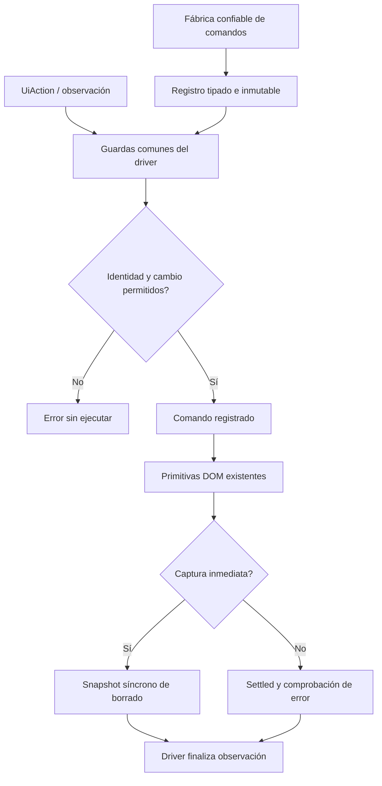

# Despacho modular de comandos UI

## Auditoría y contrato

AgentUiDriver contiene las primitivas de interacción DOM y una cadena de despacho
de 21 identificadores técnicos. Su execute también mantiene listas separadas de
exenciones de identidad/cambio observado. La composición de acciones no tiene un
contrato sustituible: cambiar acciones obliga a editar el mismo método que escribe
campos, revalida nodos y gestiona cancelación/cursor.

Se elige un registro tipado de comandos, construido por una fábrica de UI sobre un
puerto estrecho de operaciones existentes. El driver conserva mecánica, validación
común y observaciones; la fábrica de comandos posee sus acciones y estado técnico
por driver (petición de edición, destino y borrador de trabajo). Las excepciones de
identidad se declaran en los descriptores confiables de cada acción, con defaults
restrictivos. No son permisos nuevos ni datos aceptados desde el modelo.

Alternativas: mantener la cadena conserva el acoplamiento; una clase/archivo por
comando introduce demasiadas piezas sin variación real. Una fábrica cohesiva y un
registro pequeño separan las responsabilidades sin framework ni dispatcher natural.
Los IDs exactos del protocolo son identidades de herramientas, no keywords de
peticiones. No se introducen regex/similitud para elegir acciones.

Entradas: UiAction existente, estado observado y comandos suministrados por código.
Salida: misma UiState o error existente. Host de comandos expone sólo lectura,
marcadores y primitivas DOM; nunca persistencia/aprobación directa ni recibos.
Nombres únicos/no vacíos y una operación por descriptor; rechazo de registro
inválido antes de ejecutar. Descriptores copiados/inmutables, estado por instancia.

Invariantes: revalidar identidad y cambios manuales antes de invocar; desconocido
falla explícitamente; escritura/cursor/pausa/cancelación y timeouts iguales. Ningún
comando puede declarar su propio recibo o modificar previous. La habilitación de
borrado captura su estado sin await antes de permitir interacción humana, como hoy;
el driver finaliza ese resultado por su ruta inmediata existente. Resto de acciones
espera settled y valida errores igual. El backend conserva toda autoridad de dominio.



```text
construir registro único por driver con fábrica confiable y host de operaciones
validar descriptores y nombres al construir, sin efectos DOM
leer observación y buscar ID exacto de comando
aplicar mismas guardas con defaults restrictivos y excepciones explícitas del catálogo
si comando desconocido, rechazar antes de invocar cualquier acción
captura inmediata: ejecutar sin await y conservar snapshot antes de finalizar
acción normal: await ejecución, boundary, settled y comprobación de error
driver actualiza previous, cursor y progreso; no delegar autoridad de recibo
```

Compatibilidad: constructor conserva dos argumentos, tercero opcional permite
composición confiable de otro registro sobre el mismo host. Sin cambio HTTP/BD,
capacidad de modelo, selectores, paquetes ni promesas de fidelidad semántica.
Estado técnico vive en la fábrica de comandos por driver; no se duplica con sesiones
de dominio ni AgentProposalSession. No se afirma aislamiento DOM/window múltiple.

Aceptación: baseline existente, comparación AST de cuerpos/guardas migrados,
registro inválido/inmutabilidad/sustitución, verificaciones reales de campos,
revisión/borrado/ejecución, suite frontend, typecheck/build y browser. Backend sólo
como host compilado si no cambia lógica C#. Conservar fallos, sin rebajar criterios.
Rollback conjunto desde before.json; meta web activa, MAUI excluido.

## Resultado ejecutado

IMPLEMENTADO. AgentUiDriver compone AgentUiCommandRegistry mediante una fábrica
confiable y conserva guardas/finalización. AgentUiCommands contiene las acciones,
políticas técnicas y estado por driver. No hay una clase por frase ni registro
global. Los descriptores se copian y congelan; las funciones conservan su receptor
de proveedor cuando se suministra una implementación con métodos de clase.

- Cohorte original 39/39 PASS antes y después. Suite final **189/189** frontend en
  32 archivos, cero omitidas; nueve casos nuevos de registro, inmutabilidad,
  sustitución por primitivas reales, guardas comunes y aislamiento entre drivers.
- AST conserva las once primitivas, readUiState, cuerpos de 19 IDs de acción y
  dos observaciones, exenciones de guardas y finalización común. Literales y
  operadores se comparan como nodos AST, sin normalizar texto del usuario.
- TypeScript PASS. Build PASS con advertencia de chunk >500 kB conservada:
  578,38 kB / 178,52 kB gzip. Sin paquetes o CSS nuevos.
- Edge headed con App/driver reales ejecuta ui_prepare_creation mediante el
  registro en modo normal/rápido: texto Unicode exacto, dos destinos y escritura
  fragmentada/rápida comprobadas. Una muestra medida más calentamiento por modo;
  **smoke de despacho, no aceptación de latencia ni inferencia**.
- Quince controles Edge/HTTP sobre el build productivo PASS: host normal,
  desactivado y sustituido; CRUD, revisiones, cancelación/borrado y error explícito.
  Captura verified-editor.png inspeccionada. Treinta controles estáticos PASS.
- Backend congelado previo reutilizado por hashes; no se ejecuta otra matriz ni
  build C# al no cambiar lógica backend. OpenAPI y matriz canónica idénticos.

Se conservan incidencias de harness: el primer extractor CJS declaró module,
nombre ya reservado, y terminó al parsear antes de editar producto; luego se corrigió.
El primer it.each expandió arrays de alias como argumentos (7 PASS/2 fallos del
fixture y typecheck fallido); corregido a objetos de filas, sin cambiar criterios.
El actualizador de documentación también tuvo un paréntesis extra y terminó antes
de mutar; corregido y matrices revalidadas.
La prueba de benchmark admite ahora build explícito y 1–30 muestras, manteniendo
30 por defecto y etiquetando las tandas cortas sin aceptación de latencia.

[Verificación y provenance](../evidence/ui-command-registry-20261020/verification.json).
Los hosts QA propios cerrados; servicios personales intactos. No se promueve ningún
algoritmo/modelo ni se afirma fidelidad semántica, latencia general o aislamiento
DOM/window completo. Meta activa y versión abierta; 34/54 sin cambios.
