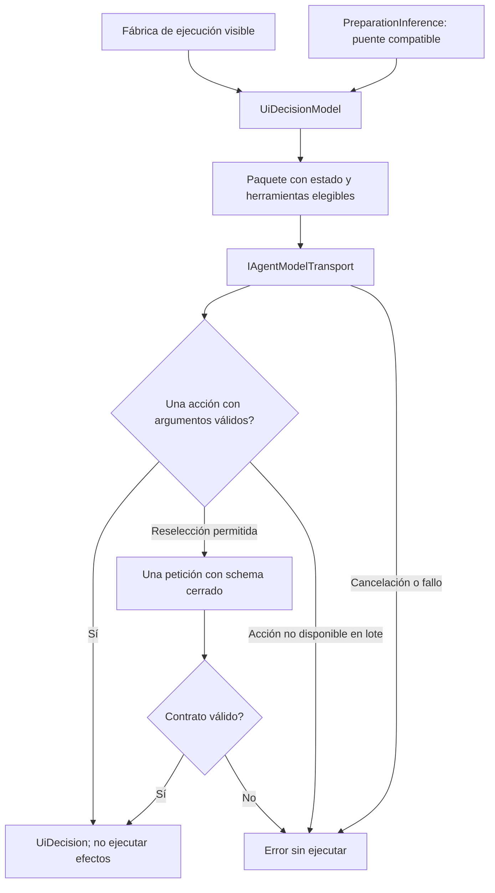

# Selección de acciones UI independiente del intérprete

## Auditoría y decisión

La fábrica de ejecución visible resuelve IUiDecisionModel como PreparationInference.
Eso construye interpretación, autoría y cliente de edición para elegir una sola
acción. La selección existente sólo utiliza transporte, política local, JSON,
metadatos del sistema y UiDecisionContext. Chat no añade recursos extra al método
Decide: no tiene AgentStage; la guía ya se incorpora explícitamente.

Se comparan: (A) mantener el alias conserva acoplamiento innecesario; (B) un proxy
que delegue al intérprete no permite retirarlo; (C) extraer la capacidad actual a
UiDecisionModel conserva el algoritmo y elimina la dependencia de composición.
Se elige C, sin cambiar instrucciones ni añadir otro árbitro o framework.

## Contrato y propietarios

- IUiDecisionModel sigue en Application; UiDecisionModel implementa selección y
  validación de formato. Recibe IAgentModelTransport prestado y LocalModelPolicy.
- El transporte compartido posee HTTP, errores técnicos, caché y reintento HTTP.
  El selector conserva una sola reselección estructurada ya existente.
- UiDecisionContext contiene petición, memoria, observación, catálogo y permisos.
  Salida: UiDecision con argumentos clonados, o los mismos errores/cancelación.
  El selector no ejecuta herramientas, accede a registros ni concede aprobación.
- Contexto de inferencia de agente: constante de LocalModelPolicy. El alias público
  PreparationInference.InferenceContextLength conserva valor y compatibilidad.
- PreparationInference.Decide se conserva como puente de compatibilidad hacia el
  mismo selector; no retiene algoritmo paralelo. La fábrica real deja de resolver
  al intérprete para IUiDecisionModel. No cambian HTTP, SQLite ni paquetes.
- Reflection lee AgentStage desde el nuevo propietario. Cambian únicamente el
  nombre consumer y su hash de versión en la guía; definiciones y responsabilidad
  no cambian. Se verificará esa diferencia de metadatos expresamente.
- La cancelación pasa al transporte; error de disponibilidad conserva
  MODEL_UNAVAILABLE. Ninguna dependencia prestada se dispone desde el selector.



```text
componer selector con transporte y política existentes
conservar construcción del paquete de observación y guía
pedir una sola acción con las herramientas elegibles
validar argumentos de la acción propuesta
si falta selección, hay lote permitido o argumentos inválidos:
    pedir una sola reselección con el schema de herramientas elegibles
    validar respuesta; devolver decisión sin ejecutar
si una acción no está permitida, no conceder un permiso por reintento
propagar cancelación y convertir indisponibilidad como antes
```

## Aceptación prevista

Resolver/usar el selector desde las fábricas reales con construcción del intérprete
prohibida. Comparar algoritmo extraído contra original; comprobar sólo el cambio
de identidad de la guía. Ejecutar pruebas de paquetes/recuperación/reselección y
control/aprobación afectados. Compilar consumidores. No atribuir comprensión del
modelo a respuestas sintéticas ni repetir frontend ajeno al cambio.

## Resultado ejecutado

IMPLEMENTADO Y VALIDADO para aislamiento y compatibilidad. La comparación exacta
del bloque extraído conserva instrucciones, schema, tamaño de contexto, reglas,
callbacks y reselección; sólo cambia el tipo que publica la guía reflejada. El
puente anterior contiene una única delegación. La fábrica real resuelve y utiliza
el selector aunque construir intérprete y cliente de edición lance una excepción.

Pasan 174 pruebas dirigidas finales, cero fallidas/omitidas, con compilación previa
de la fuente congelada. Incluyen recuperación HTTP, caché compartida, paquetes de
contexto, seis variantes HTTP reales de reselección mediante adaptador compatible
y selector independiente, control/aprobación/borrado y la cohorte de 30 del adaptador.
No son 174 solicitudes a Qwen. API/Blazor compilan con cero warnings/errores; sus
tres DLL compartidas son idénticas a las utilizadas por las pruebas. Evaluation
compila como dependencia. Dieciséis controles estáticos pasan.

La primera compilación descubrió un fixture anterior de NovaInferencePortTests que
no correspondía al constructor SemanticMeaning actual, además de un new() ambiguo
en la prueba nueva. Se corrigieron ambos fixtures antes de la tanda final. La
evidencia anterior de 30 PASS se conserva pero NO acredita esa fuente que no
compilaba; las 30 se revalidan dentro de las 174 con nueva procedencia compilada.
Las 27 pruebas intermedias corresponden a una selección/fuente anterior, no al
checkpoint final que añade el recorrido HTTP independiente.

[Fuentes congeladas](../evidence/ui-decision-module-20261020/source-freeze.json),
[procedencia compilada](../evidence/ui-decision-module-20261020/compiled-provenance.json),
[resultado](../evidence/ui-decision-module-20261020/verification.json).

No se ejecutó frontend nuevo: no cambió protocolo ni presentación. No se repitió
modelo real porque no cambia la hipótesis semántica rechazada ni acredita corregirla.
MAUI sigue pendiente de herramientas autorizadas. No cambia ninguno de los 88
criterios ni su estado; objetivo global y versión permanecen abiertos.
