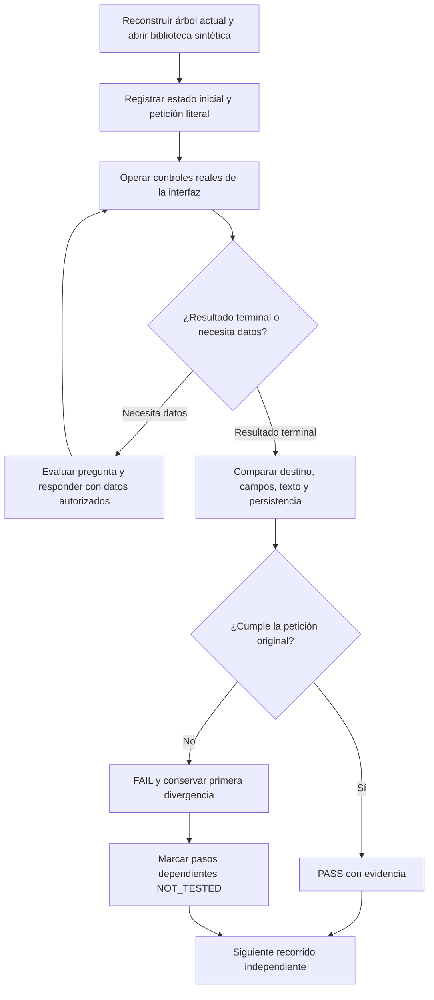

# Auditoría funcional de QuickPrompt NOVA — 2026-10-18

Estado final: **biblioteca manual funcional en los recorridos ejecutados; agente autónomo NO ACEPTADO**. En 11 peticiones reales al agente, 3 cumplieron su objetivo y 8 fallaron, con 85 llamadas a Qwen. El control de cancelación se probó aparte. Esta muestra exploratoria incluye turnos consecutivos y no estima precisión general. No declarar aceptación por compilar o por devolver `COMPLETED`.

## Entorno y alcance

- Repositorio: `C:\Projects\Repos\QuickPrompt-Web`; árbol actual, con cambios anteriores conservados.
- Se encontró el puerto 5190 detenido. Se reconstruyeron la API y React sin instalar dependencias, y se inició `http://127.0.0.1:5190/`.
- Instancia de auditoría: `.playwright/ui-audit-20261018-153336/api/QuickPrompt.Api.dll`; web `apps/web/dist`; SQLite **sintética y separada** `.playwright/ui-audit-20261018-153336/audit.sqlite`. No se abrió ni modificó la biblioteca personal.
- Perfil predeterminado de producción: `TaskGoals=false`, `TaskResultContract=false`, `ReuseInference=true`, `QwenThinkingSampling=false`; `qwen3:8b` en Ollama local. No es el perfil experimental P5b del informe anterior.
- Playwright operó controles reales. Las escrituras se hicieron desde la UI; las lecturas HTTP contrastaron identidad, revisión, estado y persistencia. Sin respuestas grabadas ni sustitución del modelo.
- API: compilación correcta, cero errores y advertencias. React: compilación correcta; Vite advierte un paquete principal de aproximadamente 555 kB.
- Modo REVIEW/ANALYZE con `algorithmic-engineering`, `ui-ux-audit` y `bug-root-cause`: sin modificaciones de código de producto, commit, push ni despliegue remoto.

## Algoritmo y contratos de auditoría



```text
para cada recorrido definido:
    registrar petición, identidad, revisión, cuerpo y valores anteriores
    ejecutar acciones visibles sobre registros propios de auditoría
    esperar estado real; no equiparar clic retornado con actualización terminada
    si requiere aprobación: contrastar propuesta y actuar en su diálogo
    comparar resultado con petición original, no solo con plan generado
    verificar coincidencia de formulario, vista previa y versión persistida
    ante fallo: conservar original, resultado y primera divergencia
    no reintentar hasta convertir un fallo en PASS; no inventar pasos alcanzados
```

Invariantes: otro registro no puede sustituir al nombrado; completar variables no modifica plantilla; ejecutar requiere resultado real; guardar requiere identidad/revisión y aprobación cuando corresponda; cancelar eliminación conserva registro y navegación; ninguna acción toca datos personales.

## Evidencia

Directorio: [evidencia UI](../evidence/ui-functional-20261018-153336/). Los JSON preservan peticiones, POST originales, observaciones y métricas por ejecución. Capturas muestran la interfaz real. Los errores del guion se conservan y se distinguen de los defectos del producto: etiqueta `Guardar cambios` inexistente, expectativa de revisión que omitía el cambio de favorito y conteo de filas antes de terminar la recarga. No contabilizarlos como regresiones de la aplicación.

## Biblioteca y controles manuales

| Recorrido real | Resultado | Comprobación |
|---|---|---|
| Crear, leer y editar prompts | PASS | Tres registros creados en formulario, reabiertos y contrastados con SQLite a través de la API; edición exacta guardada como revisión 3 |
| Duplicar, archivar y recuperar | PASS | Copia con ID propio, visible en Archivo y restaurada; originales conservados |
| Eliminar y cancelar eliminación | PASS | Eliminación confirmada de copias propias; Cancelar desde fila no abre detalle ni borra; Cancelar desde acción rápida conserva el foco |
| Favoritos, recientes, tarjetas y filas | PASS | Filtros y vistas accionados; favoritos devuelven el registro esperado; recientes reflejan usos reales |
| Colecciones | PASS | Crear, asignar, renombrar, filtrar, cancelar eliminación y eliminar colección sin borrar su prompt |
| Variables, vista previa y copia | PASS | Valores exactos en campo y compilación; portapapeles contrastado después de terminar la copia; mismo botón crea variable y restaura `Mi informe` |
| Navegar y volver | PASS | Los valores completados se conservan al volver durante la misma sesión; no equivale a persistencia de campos tras recargar |
| Búsqueda vacía | PASS | Mensaje de ausencia y cero filas; el input del agente no escribe simultáneamente en la búsqueda |
| Configuración y temas | PASS | Botón del header, preferencias en diálogo; tema oscuro reflejado en configuración |
| Orb móvil y scroll | PASS acotado | Viewport 390×844, botón dentro del viewport y sin desbordamiento horizontal; panel expandido ocupa gran parte del espacio |
| Pausa y control | PASS | Tocar/scroll no pausa; Pausar y Continuar explícitos funcionan; Detener finaliza CANCELLED sin escritura |
| Ejecución local explícita desde «Usar en…» | PASS técnico | Qwen3 8B devolvió exactamente `LISTO`; modelo instalado y stream reales |
| Calidad de respuesta local de soporte | FAIL semántico | Respuesta breve y pertinente, sin compensaciones; afirma una revisión del caso y promete informar sin datos que sustenten esas afirmaciones |

No hubo errores JavaScript `pageerror` durante los recorridos observados. Esto no prueba ausencia de errores fuera de su alcance.

## Hallazgos y causas

### Resultados reales con Qwen

La evidencia completa está en [07-final-audit.json](../evidence/ui-functional-20261018-153336/07-final-audit.json). `PASS/FAIL` compara contra la instrucción del usuario; la columna Estado muestra lo que declaró el sistema. Los tiempos son los medidos por la telemetría de cada ejecución, no el momento posterior en que se consultó su resultado.

| Petición / recorrido | Auditoría | Estado del sistema | Segundos | Llamadas LLM |
|---|---|---|---:|---:|
| Abrir por nombre | PASS | COMPLETED | 39.8 | 6 |
| Completar un campo por instrucción | PASS | COMPLETED | 27.5 | 6 |
| Cambiar de prompt y ejecutar | FAIL | COMPLETED | 36.6 | 7 |
| Ejecutar mediante botón rápido | FAIL | COMPLETED | 23.3 | 5 |
| Actualizar texto y pedir aprobación | FAIL | FAILED | 55.2 | 12 |
| Crear prompt reutilizable | FAIL | BLOCKED | 68.1 | 15 |
| Completar dos campos mediante botón | PASS | COMPLETED | 22.5 | 5 |
| Solicitar eliminación con confirmación | FAIL | COMPLETED | 25.3 | 6 |
| Preparar con datos faltantes | FAIL | COMPLETED | 26.6 | 7 |
| Corregir valores en el siguiente turno | FAIL | BLOCKED | 41.6 | 9 |
| Responder aclaración y retomar tarea | FAIL | BLOCKED | 35.5 | 7 |

La aprobación, rechazo y commit de nueva versión por el agente permanecen **NOT_TESTED**: el flujo falló antes de proponer una versión. Las copias temporales y la colección de prueba se eliminaron por controles visibles. Quedaron los tres prompts sintéticos originales, con revisiones 3/1/1 y plantillas verificadas. Se recargó la interfaz al finalizar para empezar una sesión conversacional nueva.

### Crítico: se informa éxito de una tarea diferente

Al pedir abrir **Verificación local** y ejecutarlo, la interpretación cambió el destino al resultado anterior **Proyecto**, retuvo solo `RESOLVE_PROMPT/OPEN_PROMPT` y terminó `COMPLETED`. Incluso el botón rápido **Ejecutar con IA local**, con ID y revisión correctos, perdió la ejecución en la interpretación. La conexión local sí funciona mediante el control manual.

La primera divergencia está antes del manejo del formulario: `SemanticInference.Interpret` compone objetivos mediante varias inferencias y puede reducirlos; el ejecutor verifica las postcondiciones de ese plan reducido. En el perfil observado `Goal` está deshabilitado: completar el plan interpretado no demuestra cumplir todos los efectos de la petición original. No atribuirlo a Playwright o a un campo ausente.

### Crítico: datos del flujo se convierten en valores de negocio

En **Preparar para una IA → Ollama local**, dejando los dos campos vacíos, NOVA escribió `cliente = Ollama local` y `problema = Prepara el prompt seleccionado para Ollama local, sin ejecutar ni enviar.`. No preguntó por datos faltantes y declaró éxito.

`AgentOrchestrator.Visible` acepta extracciones cuyo valor y evidencia son subcadenas literales de la petición; después las incorpora a `input.Values`. `UiToolCatalog.Validate` permite el valor ya incluido en ese diccionario. La literalidad prueba que el texto apareció, pero no que fuera un dato autorizado para **ese campo**. El destino y la orden no son un cliente ni un problema de soporte. Hace falta preservar y validar el rol/procedencia de los datos a lo largo del flujo, sin reglas por palabras concretas.

### Crítico: actualización inexacta, aprobación no alcanzada

La petición pedía cambiar únicamente `tres mejoras` por `dos mejoras`, conservando el resto, y solicitar aprobación de una nueva versión. La interpretación marcó `shortening=true`, omitió guardar y prohibió `REQUEST_SAVE_VERSION`. También convirtió `Conserva <proyecto>` y `el resto del texto`, que eran indicaciones de edición, en `literalClauses` de contenido. El editor recibió `Revisa <proyecto> ... Prioriza acces.`, eliminando más texto del autorizado. La verificación posterior detuvo la ejecución con `UI_DRAFT_REQUIREMENTS_MISMATCH`.

La protección persistente funcionó: el registro siguió en revisión 3 con el cuerpo original. La UI quedó con el borrador inválido y la observación del run retuvo el cuerpo anterior: la validación ocurre después de escribir el borrador en pantalla (`EditorPreparation` → `applyAgentProposal` → `VerifyVisible`). No se probó rechazo ni aprobación/commit de una propuesta real porque esa propuesta no se alcanzó. No sustituir este resultado por pruebas de transporte o respuestas simuladas.

### Crítico: creación bloqueada con campos vacíos

**Crear prompt** para un resumen de reuniones produjo `CREATE_DRAFT`, abrió el editor y realizó generación y corrección, pero acabó `BLOCKED / INVALID_DECISION`. Los campos Título y Contenido quedaron vacíos; no hubo nuevo registro. El rechazo anterior a aplicar la propuesta evita persistir contenido inválido, pero la pregunta genérica no permite al usuario recuperar la tarea con información concreta. El código convierte excepciones de validación en ese código general; la UI no ofrece la causa concreta del rechazo. No inventar una causa más específica que la evidencia disponible.

### Funcionalidad incompleta: eliminar mediante lenguaje natural

La petición de eliminar una copia y pedir confirmación se convirtió en abrirla, con `COMPLETED` y sin confirmación. `SemanticOperation` no contiene DELETE. El botón rápido de eliminación llama a `quickRemove` y al diálogo nativo: es una ruta funcional de UI, no evidencia de que el modelo pueda realizar CRUD autónomo completo. Ante una operación no soportada, debe explicarlo y facilitar el control permitido, sin declarar otra tarea completada.

### Crítico: recuperación de conversación sin continuidad

Después de los datos inventados se proporcionaron explícitamente `cliente: Ana de prueba` y `problema: Pedido de prueba retrasado dos días`, indicando que los anteriores eran incorrectos. NOVA preguntó si debía reemplazarlos o simplemente confirmar que estaban aplicados. Al contestar sí y repetir los datos, respondió `¿Qué tarea o cambio quieres preparar?`. Ambos turnos terminaron BLOCKED y los valores incorrectos siguieron en los campos. No fue una recuperación exitosa ni una ambigüedad pendiente de información del usuario: se perdió la tarea a lo largo de turnos con datos suficientes.

### Usabilidad importante: panel expandido bloquea acciones

En 1440×1000, el panel NOVA expandido interceptó el clic real de **Copiar prompt**, con timeout de 30 segundos. Cerrar el panel permitió copiar correctamente. `AgentDock` mide el `aside` de 60 px para `--nova-dock-height`; su panel es absoluto y no contribuye a esa altura. El espacio reservado no representa el área que tapa el panel. Capturas y traza de Playwright confirman la obstrucción. Revisar la composición/reserva de espacio en desktop y móvil; no usar `force:true` para ocultar este fallo.

Tras finalizar y recargar, la biblioteca volvió a mostrar tres registros, pero conservó sobre el contenido la pregunta genérica de la última tarea BLOCKED y el estado «Necesito tu atención» del orb, aunque no hubiera ejecución activa. `NovaLive` devuelve esa pregunta para un run terminal aun con el panel cerrado; considerar mostrarla dentro de la última actividad con contexto y cierre explícito.

### Rendimiento observado

Abrir requirió 6 llamadas / 39,8 s; llenar un campo 6 / 27,5 s; llenar dos mediante acción rápida 5 / 22,5 s; actualizar falló con 12 / 55,2 s y crear con 15 / 68,1 s. Son recorridos exploratorios distintos, no un benchmark estadístico ni una medición con RAM estable.

La suma de etapas `llm.*` representa aproximadamente 95–99% del tiempo de esos recorridos. La primera acción visible de apertura llegó a los 39 s. Reducir la animación o esconder el registro de actividad no resuelve ese coste dominante. Las opciones rápidas vuelven a convertir decisiones explícitas del botón en texto para reinterpretarlo; sus operaciones e identidad deberían conservarse como datos tipados y reservar el modelo para información no proporcionada y contenido.

## Corrección sistemática recomendada, no implementada en esta auditoría

1. Conservar el contrato de la petición original y comprobar cobertura de todos sus efectos frente al resultado: destino, autoría, valores, preparación/ejecución y persistencia. Un efecto omitido debe impedir `COMPLETED` o generar una aclaración concreta.
2. Propagar las decisiones explícitas de los botones como operaciones tipadas con identidad/revisión y valores ya vinculados; evitar reinterpretar su intención como texto libre. No introducir keywords ni regex para decidir intenciones.
3. Separar datos para campos, instrucciones del flujo y contenido de la plantilla; mantener procedencia y vínculo campo–dato. Si falta un dato, preguntar; una coincidencia literal no basta para rellenarlo.
4. Separar reducir el número de resultados de acortar la plantilla; contrastar cambios con el contrato de edición y validar la propuesta antes de publicarla como borrador utilizable.
5. Mantener el objetivo y los valores nuevos al responder una aclaración; no convertir la recuperación en una nueva interpretación sin obligaciones anteriores.
6. Medir y reducir inferencias redundantes después de fijar la corrección semántica. Reutilizar solo resultados con contexto/identidad/revisión compatibles. No activar automáticamente el perfil experimental rechazado en campañas anteriores.
7. Repetir estos flujos y una evaluación independiente con solicitudes diversas antes de aceptar la base autónoma. Mantener los fallos registrados como regresiones, sin cambiar sus expectativas.

## Límites

No se validaron MAUI/Android, navegadores externos, envío a terceros, restauración/importación de respaldos, concurrencia de varios usuarios, recarga/crash durante aprobación ni holdout semántico independiente. No se repitió toda la suite unitaria histórica en esta auditoría sin cambios de producto. La aceptación de aprobar/rechazar/guardar mediante agente queda **NOT_TESTED por fallo previo**; el guardado manual sí pasó.

La comprobación de persistencia se hizo mediante lecturas de la API y recarga de UI, sin reiniciar el servidor. Una inspección adicional directa de SQLite con `python` no pudo ejecutarse porque ese comando no estaba disponible; no se instaló software para ella.

La descarga de actividad sí se accionó y generó [06-activity-export.json](../evidence/ui-functional-20261018-153336/06-activity-export.json) con la petición y etapas del último turno bloqueado. Ese turno no ejecutó acciones DOM; el archivo lo refleja. No confundir una exportación funcional del registro con una ejecución correcta del agente.

## Uso actual

Abrir `http://127.0.0.1:5190/` accede a esta biblioteca de auditoría. Para un uso fiable en los recorridos comprobados: abrir un prompt, completar sus variables, revisar la vista previa, copiar o elegir **Usar en… → Ollama local → Ejecutar en este equipo**. Para gestionar registros, usar los controles de la biblioteca. El orb de la esquina abre NOVA; cerrar su panel permite acceder a acciones que pueda tapar.

La instancia sigue activa con datos sintéticos. El arranque habitual del proyecto es `powershell -File scripts/Start-Nova.ps1 -Background`, con su propia ruta de datos; no se ejecutó sobre la biblioteca personal durante esta auditoría. El código web vive en `apps/web`, la API en `backend/QuickPrompt.Api`. La rama local es `main`, último commit `f7e928f`; el árbol incluye trabajo anterior sin commit, no equivalente a una versión publicada o aceptada.
