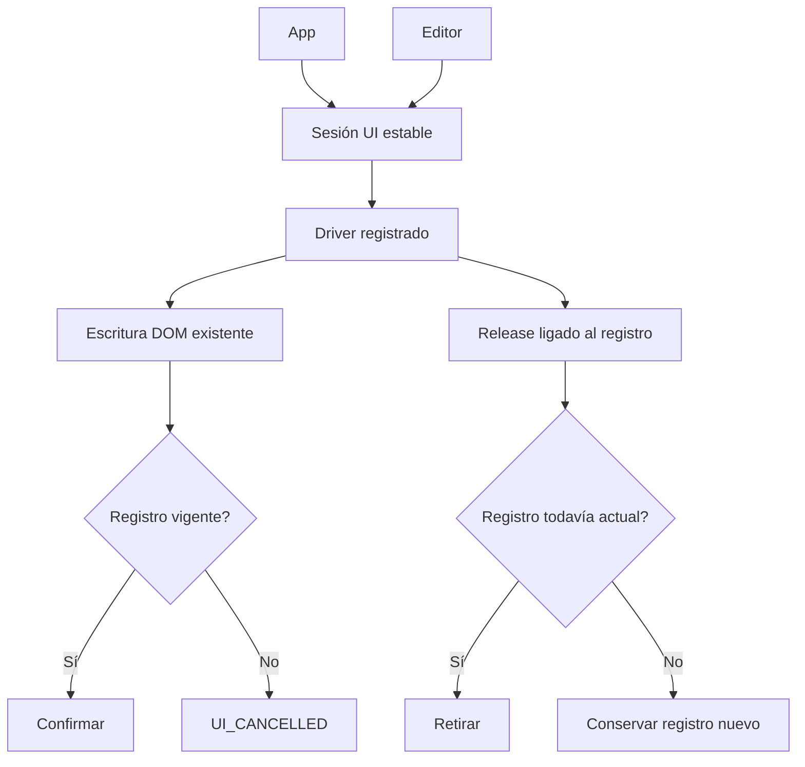

# Sesión de propuestas por aplicación

## Auditoría y contrato de cambio

AgentUiDriver mezcla su ejecución DOM con un registro global currentDriver.
SameTabAgent registra/retira ese escritor y EditorPreparation envía propuestas por
el global. Un cleanup de otro montaje puede retirar al escritor más reciente;
dos sesiones no pueden aislar el destino. Una promesa iniciada antes de cambiar el
registro puede declarar éxito después. No se atribuyen a esto fallos lingüísticos.

Propietario elegido: AgentProposalSession, sólo vínculo de propuestas al escritor
activo. AgentUiDriver conserva controles DOM, cancelación, límites, cursor y estado
anterior; SameTabAgent conserva su ciclo de vida y recibos. App compone una sesión
estable mediante proveedor React. Editor manual sin módulo de agente conserva su
aplicación directa; SameTabAgent aislado tiene sesión local de su montaje.

Alternativas: ampliar el global mantiene acoplamiento entre aplicaciones; incluir
DOM en ApplicationServices mezclaría transporte con features; una sesión UI pura
con puerto estrecho y Context existente separa esta responsabilidad sin framework.
No se introducen servicios genéricos, registro de frases ni capacidades por caso.

Contrato: register(writer) devuelve release idempotente ligado a ese registro;
apply(text, signal) devuelve false sin escritor, true sólo tras completar el mismo
registro, o error original/cancelación. Release antiguo nunca retira otro registro.
No compartir estado entre instancias. Cancelación y cambio de registro impiden
confirmación tardía. La sesión no cancela/dispone al driver: lo hace SameTabAgent,
como antes. No garantiza revertir una escritura DOM que ya ocurrió.



```text
crear sesión por montaje App, sin IO ni estado global
registrar escritor con identidad local única
release sólo elimina su identidad si todavía es actual
apply captura identidad; sin escritor devuelve false
escritor recibe texto/señal sin alterar; conservar su error
tras await, comprobar señal e identidad antes de devolver true
SameTabAgent detiene su driver y libera su lease al terminar/desmontar
Editor usa puerto del contexto, con fallback manual sólo cuando no hay escritor
```

Compatibilidad: se retiran exports internos setAgentDriver/applyAgentProposal de
AgentUiDriver tras migrar consumidores. Sin API HTTP/BD, dependencias o paquetes
nuevos. Markers/selectores, identidad, secuencias y permisos no cambian. El DOM
todavía usa AgentUiSurface y eventos de ventana: no se afirma aislamiento completo
de dos aplicaciones DOM en una ventana ni intercambio en caliente de servicios.

Aceptación: reproducir fallos del registro original; conservar cuerpos de los tests
al cambiar el adaptador; sesión/cancelación/error y recorrido driver-editor real;
suite frontend, TS/build, browser con datos sintéticos y contratos de superficie.
Rollback conjunto desde before.json. Estado: IMPLEMENTADO y verificado. Web-only.

## Resultado ejecutado

Tres controles de ownership fallan con el registro original; el caso de ausencia
manual ya pasaba. Tras sustituir sólo el adaptador del fixture, los mismos cuatro
cuerpos de test pasan. Se añaden cancelación/error y editor/proveedor: nueve casos
nuevos en total. No se retiraron expectativas para obtener PASS.

- 180/180 pruebas frontend en 31 archivos PASS, cero omitidas. Integración con
  AgentUiDriver real escribe texto Unicode en el textarea React controlado sin
  invocar el fallback manual; sin agente, el camino manual continúa funcionando.
- AST confirma clase AgentUiDriver y cuerpo de la vista App idénticos. El cuerpo
  de EditorPreparation es idéntico después de añadir su binding de sesión. No se
  cambiaron selectores, reglas de identidad/valores ni secuencias/recibos.
- TypeScript PASS. Build web PASS con advertencia de chunk principal >500 kB
  conservada: 576,16 kB / 177,90 kB gzip. Sin paquetes ni CSS nuevos.
- 22 controles headed Edge/HTTP PASS: 15 de host normal/desactivado/sustituido y
  siete de workspace, biblioteca, campos, settings y móvil. mobile-expanded.png
  inspeccionado; sin errores de navegador y sin nuevo modelo real.
- API/evaluador recompilados sin advertencias/errores; DLLs iguales al artefacto
  backend previo. No se repitió una matriz backend ajena al cambio. 29 controles
  estáticos PASS; OpenAPI y matriz canónica sin cambios de SHA256.

El reporte Vitest quedó inicialmente bajo apps/web por resolver outputFile desde
--root. El primer recolector usó un cwd incorrecto y falló antes de mutar; después
se trasladó el reporte verificando SHA, sin repetir pruebas. Incidente conservado.
El chequeo final de diff detectó una línea vacía adicional al final del driver;
retirada sin cambiar su AST. Snapshot v2 y nuevo build web: todos los artefactos
idénticos byte por byte a los usados por los recorridos y pruebas anteriores.

[Verificación y provenance](../evidence/ui-proposal-session-20261020/verification.json).
[Recorrido workspace](../evidence/workspace-1792539160904/validation.json).
Los procesos QA propios se cerraron, servicios personales sin reiniciar. No acredita
comprensión Qwen, fidelidad general, latencia ni aislamiento completo de varios
árboles DOM/eventos de ventana. Meta activa y versión abierta: 34/54 intacto.
