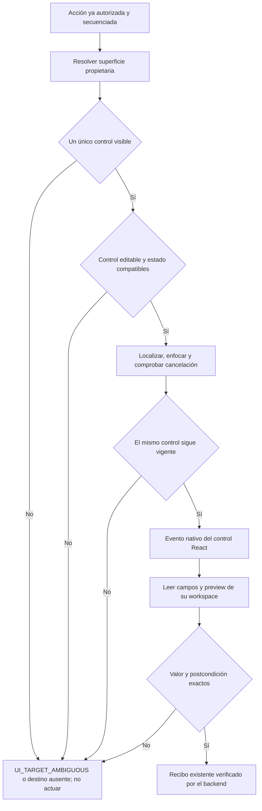
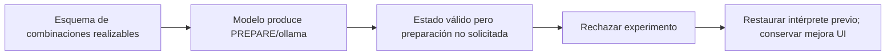

# Contrato de superficies UI para NOVA

2026-10-19. Cambio vertical del adaptador de UI; no sustituye el intérprete ni acredita fiabilidad semántica general.

## Contrato de cambio y decisión

- **Resultado:** observar y completar exclusivamente el formulario real del prompt activo; localizar controles por identidad estable, sin depender del idioma, texto visible o una clase CSS.
- **Evidencia previa:** `AgentUiDriver` lee variables, preview y controles de todo `document`; `fillVariable` toma la primera coincidencia por nombre y los clics buscan texto. `SameTabUiDispatcher` y `LiveRuns` ya poseen secuencia, identidad de pestaña, autoridad, recibos y aprobación. Esas responsabilidades se conservan.
- **Propietario:** el frontend posee los controles, sus datos y superficies. El adaptador `AgentUiSurface` resuelve exclusivamente esas declaraciones. `AgentUiDriver` conserva la interacción nativa, pausa/cancelación y comprobación de intervención. El backend conserva permisos, revisión y postcondiciones.
- **Invariantes:** un único destino válido; no tocar campos ajenos, ambiguos, deshabilitados o de sólo lectura; no ejecutar selectores recibidos del modelo; revalidar destino tras el progreso visual; aprobación vinculada a su ejecución; fallo sin escritura cuando no puede identificarse un destino único.
- **Extensión:** los componentes declaran `data-nova-control`; la biblioteca declara su superficie. El puerto utiliza claves tipadas para biblioteca, workspace, destino y actividad. Una etiqueta puede traducirse sin cambiar el contrato. No se crea una jerarquía de plugins por cada frase.
- **Dependencias permitidas:** componentes React → atributos DOM; driver → superficie DOM; recibos existentes → backend. Dominio y aplicación no dependen de React, CSS ni traducciones. Reflection mantiene el catálogo de herramientas del servidor.
- **A:** mantener búsquedas globales y corregir cada etiqueta: rechazado por acoplamiento y colisiones.
- **B:** adaptador compartido de superficie sobre controles actuales: elegido; hay variación real entre biblioteca, detalle, editor, portal de destino y panel de actividad.
- **C:** otro framework/browser, registro global o reescritura del agente: innecesario para este fallo.
- **Compatibilidad:** se conservan nombres/argumentos de herramientas y JSON de observaciones. Los atributos son internos al frontend. Un error explícito de ambigüedad se admite en el recibo existente sin ampliar autoridad. Sin migración de datos, dependencias o cambios de modelo.
- **Desactivación/rollback:** restaurar adaptador/driver y retirar atributos; conservar pruebas y evidencia. El índice vectorial sigue desactivado por defecto.

## Algoritmo



```text
identificar exactamente un workspace visible o la biblioteca
observar variables y preview únicamente dentro del workspace propietario
resolver la clave de control en biblioteca, workspace, diálogo de destino o actividad
para una aprobación, usar únicamente el panel de la ejecución indicada
rechazar ambigüedad antes de emitir clic/input
comprobar capacidad editable, pausa y cancelación
enfocar el control real y publicar progreso sin añadir llamadas al modelo
revalidar que el selector interno resuelva al mismo nodo antes de actuar
escribir por el setter/evento nativo y conservar la protección frente a edición concurrente
antes de cada fragmento volver a resolver el mismo campo en su propietario
observar la misma identidad y comprobar valor/formulario/preview
enviar el recibo existente; reintentar entrega nunca repite la acción DOM
```

## Verificación y límites

Regresiones antes/después: valores y disponibilidad ajenos al workspace, campos homónimos, sólo lectura, etiquetas traducidas, controles duplicados y paneles de otra ejecución. Suite React, TypeScript/build, contrato de error del backend y recorridos reales en Edge con SQLite sintética. Separar pruebas del adaptador de tareas con Qwen real.

El skill `universal-modular-architecture` se instala en `.agents/skills` del repositorio y se aplica junto con `algorithmic-engineering` y `adaptive-ai-systems`. Se conserva el paquete original; no se cambia la política global del usuario ni se copia automáticamente `AGENTS.example.md` como regla del repositorio.

Los fallos anteriores de referencia, destino y autoría pueden ocurrir antes de cualquier acción de UI. Esta intervención no los cuenta como resueltos. Resultados ejecutados y estado final se añadirán tras las comprobaciones.

## Experimento rechazado: destino realizable no implica destino solicitado

El recorrido libre existente `readOnly` falló antes de usar el adaptador: dos respuestas consecutivas `PREPARE/providerId=null`, admitidas por el esquema anterior y rechazadas por `DestinationGoal.Objective`. Traza conservada en `docs/evidence/latency-1792432491024/`. Esa misma incompatibilidad ya afectaba a variables. La identidad del origen se había reconocido; no fue un error de clic.

Se evaluó extender el contrato existente sin otro clasificador ni servicio. `DestinationContractFor(ProviderRegistry.Providers)` construía combinaciones válidas desde capacidades actuales: NONE sin proveedor; SHOW_OPTIONS con proveedor válido opcional; PREPARE sólo con un proveedor que pudiera preparar; EXECUTE_NOW sólo con uno que soportara ejecución local. Se conservaron nombres JSON y controles independientes de ámbito, datos y permisos. No se eligieron proveedores por similitud ni se tradujeron palabras del usuario en código.

Trece controles contractuales y la suite de 561 pruebas pasaron. La comprobación real con Qwen refutó la suficiencia de esa solución: `readOnly` abrió el origen, pero añadió `PREPARE_LOCAL_EXECUTION/ollama` no solicitado; `variables` siguió bloqueado al reinterpretar el título como el contenido futuro del caso. El esquema eliminaba combinaciones inválidas sin recuperar la intención. No se promueve. [Traza real](../evidence/latency-1792432718935/measurements.json), [código/pruebas archivados](../evidence/ui-surface-20261019/rejected-destination-contract/).



## Instalación y evidencia acotada

El ZIP se inspeccionó antes de extraer, se rechazaron rutas ajenas/enlaces y se verificó la igualdad SHA256 de los diez archivos instalados. Se ejecutó el `scripts/check_skill.py` original con el Python existente del runtime: **PASS**. [Registro de instalación](../evidence/ui-surface-20261019/skill-installation.json). La ubicación es de proyecto y quedará disponible para descubrimiento en próximos turnos; en éste se aplicó leyendo el skill y sus guías. No se instaló otro Python ni se modificaron instrucciones globales.

Regresiones del adaptador: **0/3 antes → 3/3 después** en los controles iniciales. Una cuarta regresión detectó que variables conservaban un nodo mientras los clics volvían a resolver su identidad; falló antes de corregirla. Ahora toda escritura usa un ID o resolver del propietario y vuelve a validarlo tras progreso y entre fragmentos. La suite completa termina **112/112 React PASS**, con nueve controles nuevos que incluyen aislamiento, sólo lectura, traducciones, ambigüedad, cambios de binding/nodo y aprobación de otra ejecución. La primera suite migrada conservó seis fallos de fixtures sin metadatos; se actualizaron sus declaraciones manteniendo expectativas y timeouts. [Antes](../evidence/ui-surface-20261019/react-before.json), [binding antes](../evidence/ui-surface-20261019/react-binding-before.json), [final](../evidence/ui-surface-20261019/react-final-binding.json).

Backend final con error explícito de ambigüedad, tras restaurar exactamente `SemanticInference.cs`: **548/548 PASS**, cero omitidas. [TRX final](../evidence/ui-surface-20261019/tests/backend-restored-final.trx). Las 561 pruebas pertenecen al experimento rechazado y su [TRX](../evidence/ui-surface-20261019/tests/backend-contract-v2.trx) se conserva. TypeScript/build de frontend pasan; los avisos previos de bundle mayor de 500 KB y salida externa se conservan, sin cambiar dependencias ni configuración para silenciarlos. API sin warnings/errores.

Edge con API-v1/web-v2, datos sintéticos: siete comprobaciones sin inferencia y ocho al incluir ejecución real con Qwen. Acciones rápidas completaron apertura en tarjetas/filas, campos, preview, Claude sin envío y Qwen local con respuesta exacta `LISTO`. Edición/guardado manual y reapertura mantuvieron identidad/revisión. [Resultados con Qwen](../evidence/ui-surface-20261019/1792432440814/results.json). La primera prueba se detuvo por usar un nombre de label incorrecto en el arnés del selector de destino; se corrigió el locator del arnés, sin modificar producto ni expectativas, y se conserva ese fallo.

Una petición libre de actualización/guardado con Qwen y el mismo frontend completó la aprobación nativa, persistió el cuerpo correcto y consumió la aprobación: 100259 ms/17 llamadas, `docs/evidence/latency-1792432491024/`. La petición de apertura de esa tanda falló antes de UI y motivó la corrección contractual descrita arriba. Esos resultados pertenecen al backend anterior a endurecer el esquema; no se mezclan con la aceptación del candidato posterior.

El arnés anterior marcó `readOnly` como correcto por título/cuerpo intactos, aunque hubo preparación no solicitada. Se conserva ese resultado bruto y se registra como **FAIL semántico** en el manifiesto; se endurece la aserción de esa misma petición para exigir sólo navegación, outcome READ y ningún proveedor abierto. No cambia el mensaje ni se relajan umbrales. La petición de variables es FAIL/NEEDS_CLARIFICATION (44256 ms/8 llamadas), aunque el título correcto estaba en el catálogo.

El [manifiesto](../evidence/ui-surface-20261019/validation.json) identifica hashes, candidatos y resultados finales. No se acredita p95, fidelidad general de creación/copia ni cierre de la versión. El índice vectorial sigue desactivado, y la instancia personal en 5190 permanece sin cambios. La siguiente mejora semántica necesita preservar la vinculación entre origen identificado, autoridad y objetivo durante toda la ejecución; no imponer un proveedor válido para ocultar un destino inventado.

## Candidato final y reproducción

Tras restaurar el intérprete y completar la revalidación de campos se compiló API-v3/web-v3 y se repitieron los recorridos reales: **8/8 comprobaciones PASS**, seis ejecuciones tipadas COMPLETED y `LISTO` con Qwen real. Cero errores de página/peticiones externas. [Recorrido final](../evidence/ui-surface-20261019/1792433248090/results.json).

Se repitió el guardado libre sobre ese frontend final: **COMPLETED/PASS**, aprobación CONSUMED, mismo ID y revisión 1→2. Se inspeccionaron captura y cuerpo íntegro: instrucción profesional para solicitar entrevista, preservando límites de datos, sin incluir órdenes de aprobar/guardar. Formulario, preview, borrador aprobado y texto persistido coinciden. Los hashes de API y todos los assets web coinciden entre ambas tandas finales. Duró **164497 ms/19 llamadas**, frente a 100259 ms/17 llamadas en el intento anterior; no demuestra mejora de rapidez ni p95. No se acredita reinicio para este candidato. [Guardado final](../evidence/latency-1792433270468/measurements.json).

```powershell
dotnet test backend/QuickPrompt.Tests/QuickPrompt.Tests.csproj --no-restore
# Desde apps/web:
npm test
npm run build -- --outDir ../../.playwright/ui-surface-20261019/web-v3
# Desde la raíz:
dotnet build backend/QuickPrompt.Api/QuickPrompt.Api.csproj --no-restore --output .playwright/ui-surface-20261019/api-v3
$env:NOVA_TEST_BUILD='.playwright/ui-surface-20261019/api-v3/QuickPrompt.Api.dll'
$env:NOVA_TEST_WEBROOT='.playwright/ui-surface-20261019/web-v3'
node Tests/nova/ui-surface.cjs --real-qwen
```

El arnés utiliza Edge/Playwright ya instalados, crea su propia SQLite sintética, verifica los campos reales y libera su API/ventana al terminar. No inicia otra instalación, no cambia el puerto personal 5190 y no prueba comprensión libre mediante acciones rápidas con objetivos tipados.
