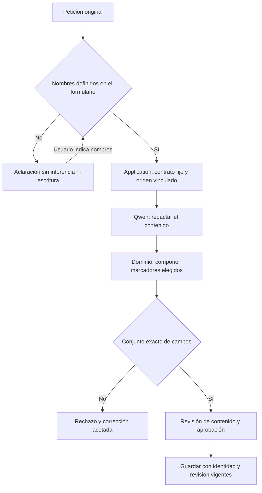

# Variables de NOVA: flujo con aclaración

## Resultado y alcance

Se mantiene Qwen3:8b para redactar. Los nombres de campos proceden del control explícito del usuario, no de metadatos inventados por el modelo. Si faltan, NOVA pregunta antes de generar; conserva el encargo original. Esta alternativa fue elegida por el usuario después de observar resultados semánticos inconsistentes.

La interpretación automática libre de nombres no quedó resuelta: se retiró de este flujo y sus intentos fallidos se conservan. No se presenta la selección confirmada como una mejora universal del modelo. La redacción sigue requiriendo revisión; en las pruebas el modelo añadió requisitos de contenido no pedidos, como un mínimo de patrones. Esta corrección garantiza el contrato de campos, no toda la fidelidad de la prosa.

## Uso

En **Crear prompt** o **Actualizar prompt**, activar **Definir las variables ahora** y escribir un nombre por línea. Si se deja desactivado, la aclaración permite definirlos conservando la petición.

Para el caso original:

```text
nombre proyecto
proposito
tipo
```

`web`, `app` y `AI` son posibles valores de `tipo`, no otros campos. No se rellenan valores al crear la plantilla. En actualización se indican sólo las variables nuevas; las actuales permanecen. Una lista vacía confirmada crea sin variables o conserva las existentes al modificar el texto. Recargar la página durante una aclaración puede requerir volver a elegir la acción: su continuación contiene la petición sólo en memoria, sin persistir texto privado en el navegador.

## Propietarios y algoritmo



1. `LiveCommand.InputNames` separa nombres de valores. `null` pide aclaración y `[]` expresa una selección vacía.
2. `PromptInputContract` copia la selección, conserva los campos del origen y vincula petición y cuerpo de origen. `TaskGoal` impide reinterpretarla durante un reintento.
3. El generador y el editor reciben el contrato. El dominio incorpora marcadores omitidos y rechaza campos adicionales. Agregar campos puede conservar exactamente el texto previo, sin exigir otra reescritura.
4. Los metadatos del editor se derivan del cuerpo compuesto. El cierre compara campos reales; una lista vacía procedente de un borrador incorrecto ya no valida la petición.
5. Los controles de escritura, revisión y aprobación permanecen independientes. Se distingue definición de campos de completar datos para usar el prompt.

La interfaz comparte `PromptInputNames` entre la acción inicial y la aclaración. Se documentó `LiveCommand` en OpenAPI. No se agregaron modelos, dependencias ni rutas por palabras clave. El intérprete experimental de nombres no queda como fallback.

## Evidencia ejecutada

- Backend: **1.180/1.180**, sin omitidos. TRX: `backend/QuickPrompt.Tests/TestResults/variable-contract-release-check.trx`.
- Interfaz: **279/279**, 41 archivos. Incluye nuevas regresiones de selección de campos y aclaración sin pedir valores.
- MCP: **25/25** y lectura real posterior a activar el servidor.
- Arquitectura: **37 comprobaciones estáticas**; enlaces de documentación: **15 documentos**, sin errores.
- Build de API y frontend correcto. El frontend conserva un aviso de tamaño de bundle, sin error de compilación.
- Lab: **6/6** comprobaciones sobre capturas reales y recibos, no inferidas de un estado COMPLETED.

Recorridos de navegador en biblioteca aislada, puerto 5295:

| Recorrido | Resultado observado |
|---|---|
| Petición original sin selección de campos | BLOCKED con aclaración, sin llamar al modelo ni escribir |
| Continuar con tres nombres | Tres marcadores reales; valores vacíos; misma petición original |
| Guardar tras revisión | Un prompt, revisión 1 |
| Agregar audiencia y restricciones | Texto anterior intacto, tres campos conservados y dos nuevos |
| Antes de aprobar la actualización | Revisión guardada 1, efecto no comprometido |
| Después de aprobar | Misma identidad, revisión 2; revisión 1 conservada |
| Render con sólo tres valores | Faltan audiencia y restricciones; no se inventa resultado |
| Render con cinco valores | Texto preparado sin marcadores pendientes |
| Render con revisión antigua | HTTP 409 |

Capturas, JSON, pruebas y reportes: `.playwright/variable-repair-20261024/browser/`. El primer informe del arnés omitía eventos terminales `run_finished`; se conservó junto con la corrección del arnés y el informe final. Los fallos baseline y de los candidatos descartados también permanecen guardados.

## Activación local

Artefacto: `.nova-build/variable-contract-final-20261025/`, API en 5277 y perfil de escritorio actualizado con copia de respaldo. SHA256 de `QuickPrompt.Infrastructure.dll`: `23710C353ACFFA7366074CAF02EB68531520C1950CDC049D6D41B84BB14574F3`.

La comprobación posterior dio `/health: ok`, biblioteca principal idéntica por SHA256 y lectura MCP correcta. Se conservó el editor anterior sin recargar para no perder el borrador del usuario; la interfaz actualizada se abrió aparte. No se modificaron los prompts existentes ni se creó un commit, tag o certificación de versión.
