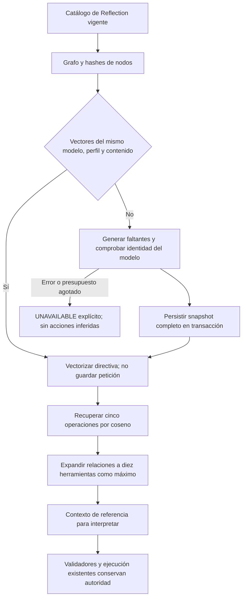

# Conocimiento vectorial del sistema NOVA

2026-10-19. **EXPERIMENTAL / NO ACTIVADO POR DEFECTO.** Implementación solicitada de búsqueda numérica y relaciones del catálogo de Reflection. No se presenta como recuperación de la fiabilidad semántica.

## Alcance y propósito

El índice contiene **40 nodos del sistema**: 20 operaciones semánticas y 20 herramientas de UI. Sus **22 relaciones `IMPLEMENTED_BY`** proceden de las declaraciones actuales, sin inventar herramientas internas que no figuren en ese catálogo. No es una base de ejemplos de frases ni un clasificador por palabras. No contiene biblioteca personal, sesiones, borradores, documentos del usuario ni respuestas rechazadas.

Se utiliza `nomic-embed-text-v2-moe:latest`, ya instalado, mediante `/api/embed` local. Qwen conserva la interpretación y generación. No se descargan modelos ni se añaden servicios, extensiones SQLite o paquetes. SQLite almacena vectores numéricos y su procedencia; el producto punto sobre vectores normalizados calcula vecinos exactos en .NET. Con este catálogo pequeño no hace falta un servicio HNSW o una base de grafos independiente. Las relaciones se reconstruyen del catálogo de código vigente, no de texto mutable leído de la base.

Las [instrucciones oficiales de Nomic](https://ollama.com/library/nomic-embed-text-v2-moe) especifican los prefijos de consulta/documento y un límite de 512 tokens. La [API de embeddings](https://docs.ollama.com/api/embed) permite lotes y `truncate=false`. El cliente usa ambos mecanismos: fragmentos Unicode de hasta 384 bytes, prefijos correspondientes, lotes de hasta 16 y rechazo de respuesta incompatible. No se recorta silenciosamente la petición. Los fragmentos se combinan mediante media y normalización; esa política forma parte de la identidad del índice.

## Flujo y contratos



```text
leer metadatos del catálogo de código y calcular versión estable
consultar identidad/digest del modelo local instalado; no descargar
recuperar vectores sólo con perfil y hash de contenido vigentes
generar faltantes y la consulta en lotes y fragmentos acotados
comprobar dimensiones, valores finitos, norma e identidad posterior del modelo
persistir todos los vectores en una transacción
ordenar operaciones por similitud numérica y expandir sus herramientas relacionadas
formar contexto acotado con descripciones, contratos, procedencia y ausencia de autoridad
añadir ese contexto a las vistas de interpretación que lo conservan
dejar selección de objetivos al modelo y permisos/efectos al dominio
si falla recuperación: devolver UNAVAILABLE sin inventar operación ni ocultar estado
si cancela el usuario: propagar cancelación
```

| Componente | Contrato y responsabilidad |
| --- | --- |
| `CapabilityGraph.FromReflection` | Snapshot de metadatos y relaciones existentes; ninguna frase de usuario crea nodos |
| `OllamaEmbeddings` | Endpoint HTTP loopback validado, sin redirecciones/proxy; modelo de embeddings instalado, sin pull ni nube |
| `CapabilityVectorStore` | SQLite separada con `application_id` propio y versión; rechaza bases ajenas; transacción para reemplazar snapshot |
| `VectorCapabilityKnowledge` | Perfil por modelo/digest/política, hashes por nodo, memo de hasta 64 consultas por hash en memoria, presupuesto 25 s y contexto 16 KB máximo |
| `PreparationInference` | Recibe `systemCapabilities` como referencia; no convierte puntuaciones en objetivos/IDs ni permisos. Marca READY/CACHE_HIT/UNAVAILABLE en notas del plan cuando éste existe |
| API | `QuickPrompt:Knowledge:Enabled=false` por defecto. Activación explícita crea `<DataPath>.capabilities.sqlite`; no migra la SQLite de dominio |

Las descripciones y esquemas que llegan al modelo proceden siempre del código actual. El almacén persistente sólo aporta vectores que coinciden con hashes y perfil. Cambiar catálogo o modelo invalida la reutilización. Ninguna petición o vector de consulta se guarda en SQLite. Un resultado similar no selecciona el origen de un prompt ni autoriza ejecución, guardado o eliminación.

Los consumidores existentes sin conocimiento inyectado conservan sus paquetes de modelo sin el campo nuevo. La búsqueda SQL de prompts no se sustituye por este experimento: son dos responsabilidades distintas. Los perfiles experimentales `TaskGoals` y `TaskResultContract` siguen sin habilitarse.

## Resultados ejecutados y decisión

Dataset sintético congelado antes de ejecutar: `Tests/nova/knowledge/dataset.json`, diez casos de desarrollo y diez de validación. Se mide recuperación de operaciones relevantes, incluso cuando una petición negativa habla de una operación que **no** debe ejecutarse. Eso no es medición de intención ni de cumplimiento.

| Split | Recall@5 vectorial | Recall@5 léxico sobre las mismas descripciones | Estado |
| --- | --- | --- | --- |
| Desarrollo | 0,80 | 0,40 | FAIL: una recuperación no disponible en arranque y una omisión |
| Validación | 0,90 | 0,30 | PASS acotado de recuperación; una omisión permanece |

Resultado global **FAIL** bajo el umbral congelado y disponibilidad exigida. La primera consulta agotó los 25 s; no se elimina ni se atribuye una causa de carga concreta sin medición adicional. No se modifican descripciones ni umbrales después de leer validación. [Resultados completos](../evidence/vector-knowledge-20261019/retrieval.json).

Recorrido existente `variables` con Qwen3 8B y Edge visible, API experimental activada, sólo SQLite sintética: **FAIL, BLOCKED/NEEDS_CLARIFICATION**, 60300 ms, ocho llamadas. `systemCapabilities` estaba READY y `COPY_PROMPT` era la primera operación recuperada. El destino aun así se interpretó `PREPARE/ollama`; el selector rechazó Proyecto técnico aunque la fase anterior lo había identificado y seguía entre los candidatos reales. No se completaron campos, no se guardó y no hubo efecto autorizado. [Traza](../evidence/latency-1792431141001/measurements.json). Captura inspeccionada; una sola pestaña, sin solicitudes externas del navegador. Se conserva este fallo; no se reintenta cambiando la frase.

No se promueve el experimento ni se activa por defecto. La conclusión es limitada: hay ventaja de recuperación sobre el comparador léxico, pero no recuperación del comportamiento del agente ni evidencia de mejora de latencia. El [análisis de fábrica](AGENT_FACTORY_DESIGN.md) describe por qué las etapas deben mantener una orden y contratos coherentes en lugar de reinterpretarla.

Pruebas deterministas: 12 casos de vectores/persistencia, dos de transporte de conocimiento y la suite existente. Ver conteo final y hashes en el [manifiesto](../evidence/vector-knowledge-20261019/validation.json). Se conservan pruebas previas, resultados rechazados y la muestra de UI fallida. Contratos e infraestructura correctos no equivalen a comprensión del modelo. Sin benchmark p95, holdout semántico general ni cierre de autoría.

Reproducir recuperación: `dotnet run --project Tests/nova/knowledge/KnowledgeBenchmarks.csproj -- Tests/nova/knowledge/dataset.json docs/evidence/vector-knowledge-NUEVO`. El reporte sólo admite una carpeta bajo `docs/evidence` del workspace; el caché del benchmark vive bajo `.playwright`. No usar biblioteca personal para evaluar.
