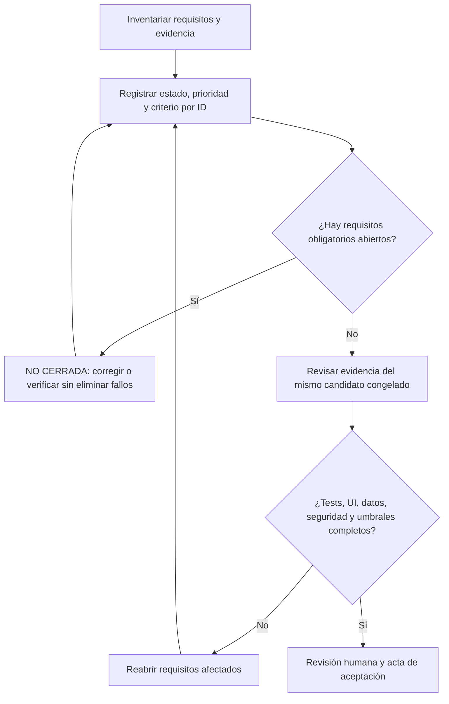

# Matriz obligatoria de cierre — QuickPrompt NOVA

Fecha: 2026-10-22, America/La_Paz. **Estado: NO CERRADA.** Modo IMPLEMENT: la evidencia de cada actualización se detalla debajo; no implica cierre global.

**Regla del usuario:** no dar esta versión por completada ni cerrada mientras quede algún requisito obligatorio abierto. Todos los registros de esta matriz son obligatorios; la prioridad sólo ordena el trabajo. No se excluye alcance ni se rebajan criterios para conseguir un resultado verde.

QuickPrompt NOVA web local: React, API, SQLite, agente en la misma pestaña y Qwen3 8B. Incluye pendientes de paridad web y decisiones de alcance; no autoriza leer datos privados, instalar, publicar, hacer commit ni retirar Blazor. Registro histórico del alcance ampliado: la versión inicial por acciones NOVA1.0.0 se cierra separadamente por aceptación explícita del usuario; véase RELEASE_NOVA_1_0_0. No se convierte el resto del expediente en PASS.

**88 requisitos: 34 cerrados en su alcance probado y 54 abiertos.** No es un porcentaje de fiabilidad ni una estimación de trabajo restante. Los abiertos se distribuyen en 13 fallos observados, 35 parciales, 4 pendientes y 2 sin verificar.

## Qué significa cerrado

Un cierre acotado conserva el alcance y fecha de su evidencia. Los recorridos manuales probados no prueban el agente; los tests simulados no prueban comprensión de Qwen; un estado COMPLETED no demuestra cumplir la petición. Las pruebas históricas de otro build se identifican como tales y deben repetirse mediante REL-04 antes del cierre de versión. No se borra un fallo histórico al corregirlo: se añade evidencia posterior y se vincula al criterio original.

- **CERRADO:** Criterio acotado ejecutado y comprobado; no acredita por sí solo el release ni otros casos.
- **PARCIAL:** Hay implementación o éxitos comprobados, pero no cubren el criterio completo o el candidato final.
- **FALLA:** Existe un fallo real relevante sin evidencia posterior suficiente que cierre esa familia.
- **PENDIENTE:** Falta capacidad, entrega o decisión explícita de alcance.
- **SIN_VERIFICAR:** No existe evidencia suficiente de ejecución para este criterio. No significa que falle.

Los requisitos de paridad, privacidad y proveedores se incluyeron desde el SOW y la paridad pendiente; no se inventan como nuevas funcionalidades. Los que requieren decidir alcance permanecen abiertos hasta acuerdo explícito o implementación y validación. Datos privados y sesiones externas no quedan autorizados por esta matriz.

## Auditoría de esta revisión

- QuickPrompt NOVA1.0.0 cerrada por instrucción y aceptación del usuario del flujo por acciones. REL-09 CERRADO por su testimonio de uso satisfactorio. Número visible desde package.json; publicación prevista con tag nova-v1.0.0 sin reemplazar el tag histórico v1.0.0. Los demás87 estados originales no cambian: este expediente ampliado conserva criterios sin certificar y no acredita universalidad del decoder libre retirado. [RELEASE_NOVA_1_0_0](../releases/NOVA_1.0.0.md).
- Flujo principal elegido por el usuario: acción explícita e IA para contenido/búsqueda. Candidato action-workbench-release-20261022, API sin Evaluation ni fallback al decoder rechazado. Repetición actual de navegador 14/14 PASS con Qwen3:8b fijado, búsqueda original, creación/guardado/reapertura, mejora/revisión2, ejecución útil y borrado confirmado; segundo consumidor Core PASS. Integridad de 364 archivos congelados y 43 API PASS; evidencias previas backend1160, React253 y SDK54 verificadas por hash, sin afirmar reejecución. Primer intento de revisión FAIL9009 por alias Python del arnés, conservado; repetición con entorno existente PASS. Cierre técnico sólo del recorrido probado. REL-09 no ejecutado y cierre integral NO_CERRADA; no se modifican los88 estados ni los oráculos libres fallidos. Incluye análisis y propuesta de mejora de adaptive-ai-systems, sin modificación global. [ACTION_WORKBENCH_RELEASE_20261022](CIERRE_TECNICO_ACCIONES_20261022.md).
- Lab8800 y revisión sintética5199, candidato input-authority-v9: corregida fuga de valores hacia metas de lectura/explicación/autoría. Reproducción roja3/5; backend1117 PASS; matriz de desarrollo real16/16 PASS; UI completa12/13 FAIL porque Qwen omite PREPARE_PROVIDER para Claude aunque completa su plan de lectura. Base sin modelo6+4+5 PASS. Lab76 y verificación visual real6 PASS. Certificador12 controles PASS, incluyendo IDs exactos e identidad de modelo; misión lab-live-3814e79d2c91 rechaza cierre con55 requisitos abiertos y UI fallida. Validation y holdout /9 NOT_TESTED. Ensayos /5-/8 retirados y conservados. Igualdad LF cruda Windows FAIL; CF_UNICODETEXT especifica CRLF según Microsoft, conflicto de criterio pendiente de aclaración. No se modifican los88 estados ni se declara fiabilidad universal. [LAB_CLOSURE_DIAGNOSIS_20261021](LAB_CLOSURE_DIAGNOSIS_20261021.md).
- Separación aplicada a la ruta de producción: Core/Pydantic AI genérico por adaptive-inference/1; dominio, permisos, identidades, UI y efectos en .NET. Motor nativo y transporte/cache fuera de producción; controles históricos solo en Evaluation. Backend 1058, SDK 42, stdio 4 y compartidas 168 PASS; arquitectura estática PASS. Candidato final UI 8/9 y desarrollo 11/16 estrictos FAIL. Preparar para copiar agrega adaptación no solicitada y termina COMPLETED. Fallos originales y de migración conservados; validation/holdout NOT RUN. No se modifica ningún estado de cierre. Revisión 5196 conserva build anterior; sin migración DB. Ver CORE_HOST_BOUNDARY_20261021.md y boundary-handoff-manifest.json. [CORE_HOST_BOUNDARY_20261021](CORE_HOST_BOUNDARY_20261021.md).
- Reorganización ejecutada: 293 archivos movidos, cero faltantes; móvil en apps/mobile y puente Core en agents/nova-core. Compatibilidad activa aislada sin fallback; consejo independiente; navegación de fuente ligada después de abrirla. Final: backend 1022, React 239 y compartidas 168 PASS; worker 5 y puente 7 PASS. UI offline 4/4, manual 7/7 y archivo entre consumidores 14/14, con sus candidatos identificados. Contratos experimentales 4–8 retirados por regresiones; contrato vigente 3 tampoco acredita autoría ni origen nombrado en la repetición real. DAT-03 autorizada: copia/importación local de 22 plantillas y un historial, exportación, idempotencia, reinicio y reapertura UI PASS; metadato UpdatedAt de historial sólo en respaldo, por lo que continúa PARCIAL. Sin datos privados en evidencia pública. La versión sigue NO_CERRADA. [LAYOUT_RETIREMENT](ORDERED_AGENT_CLOSURE_20261020.md).
- Core participa en el intérprete real de NOVA con composición explícita y Qwen local; sin fallback al intérprete nativo. API-v8 y SDK/worker congelados: backend 1013, SDK 27 y puente 7 PASS; límites modulares PASS. Campaña UI libre 5/7 aceptada: preparación original sin copiar/ejecutar, copia exacta con uso único, lectura, datos como órdenes y ejecución LISTO. Fallan formulación alternativa por COPY_PROMPT omitido y creación literal por punto añadido, aunque ambas dicen COMPLETED. Puente nativo Core con Qwen y preparación visible de dos campos pasan. No se revalida cierre global, aprobación/guardado/reinicio compuesto, validation/holdout ni LF/CRLF. Estados intactos: 33 cerrados/55 abiertos, NO_CERRADA. Revisión Core abierta en 5196. [ADAPTIVE_CORE_INTERPRETER_20261021](../evidence/core-agent-20261021/summary.json).
- Incremento de historial: 994 backend, 168 compartido y 227 frontend PASS. UI del agente 7/7 tipadas; historial 5 recorridos PASS con fallo separado de igualdad nativa. PAR-05 cerrado en su alcance de exploración y borrado: 33 CERRADO/55 abiertos. Autoría Qwen sigue FALLA; dos variantes de componente retiradas, sin gates validation/holdout. Lanzamiento permanente nuevo rechazado por revisión automática; 5194 sigue con el build anterior. [SKILL_DELIVERY_20261021](ORDERED_AGENT_CLOSURE_20261020.md).
- Auditoría web del candidato conservado: 960 backend/211 frontend/20 actividad PASS; Qwen real y Edge 3/8 PASS, 5/8 FAIL. Variante de reasoning workflow rechazada y retirada, 2/6; no se mezcla con el candidato final. CTX-02 se reabre FALLA por regresión de la segunda formulación original; SAV-01 se reabre PARCIAL porque falla el primer paso común de creación y no se revalida el flujo de guardado. Sus PASS históricos permanecen. 32 CERRADO/56 abiertos, NO_CERRADA. No se acredita aprobación/rechazo UI/reinicio no alcanzados, validation/holdout ni latencia global. [AGENT_INPUT_AUTHORITY_AUDIT](AGENT_CLOSURE_NAVIGATION_20261020.md).
- 34 CERRADO / 54 abiertos; goal ACTIVO. Cierres nuevos de la ejecución: EXE-07, LIB-02, SAV-01 y DAT-06. Crear/adaptar/guardar con aprobación y reapertura real del respaldo pasan en su alcance, con revisión independiente y rollback QA verificado. Tanda de guardados conjunta FAIL por cláusula semántica al adaptar una fuente. 97 controles dirigidos pasan; no sustituyen fidelidad general, holdout, latencia ni aceptación humana. [CLOSURE_APPROVAL_FIX](CLOSURE_WAVE6.md).
- LIB-02 cerrado con seis controles UI de búsqueda/filtros/paginación sin modelo; EXE-07 conserva cierre acotado. 32 cerrados/56 abiertos. Qwen de planificación mejora de 14/16 a 15/16 en desarrollo con definiciones de catálogo; persiste un guardado adicional. Experimento de continuidad de autoría rechazado y retirado. Versión NO_CERRADA. [LIBRARY_OFFLINE_CLOSURE](../evidence/library-offline-1792494209551/results.json).
- Meta de 88 requisitos activa; EXE-07 cerrado en alcance probado tras corregir recuperacion HTTP y feedback visible, con UI ausente/timeout y Qwen transitorio/persistente del mismo build. Restantes criterios y fallos conservados. 31 cerrados/57 abiertos; version NO_CERRADA. [CLOSURE_FAILURES](../evidence/closure-goal-20261020/wave1/feedback/acceptance.json).
- Campaña final actual sin cambios de producto: 730 backend, 151 compartidas, 136 React y builds PASS; 355 fuentes intactas y candidato/config/modelo/fixtures identificados (REL-06 cerrado). Desarrollo Qwen 14/16 FAIL; UI con revisión independiente 11/21, borrado 5/6; guardado de versión y reinicio exactos PASS. Se conservan fallos de origen, borrador temporal, fidelidad, reintentos y vínculo de evidencia en pregunta explicativa. Validation/holdout no ejecutados por gate de desarrollo fallido. Sólo arneses ajustados con expectativas originales intactas. Inventario/licencias/auditoría parcial, sin migrar datos privados ni sustituir piloto humano. Versión NO_CERRADA. [RELEASE_VALIDATION](RELEASE_VALIDATION_20261020.md).
- Frontera instruction-scope-3 integrada en el propietario actual: guía/contexto/respuesta JSON tipados y esquemas SDK derivados de C#, validación estricta y coherencia con catálogo real; Writes/Requires por atributos sin routing por frases. 194 controles dirigidos PASS; tres regresiones de planificación Qwen PASS, incluida edición legítima. Las dos peticiones libres originales pasan en UI real con valores literales, fuente/revisión/cuerpo, preview y copia del navegador exactos (35,347/33,509 s, 14/15 llamadas); ensamblados congelados iguales. Fallos y candidatos rechazados conservados. Vector SQLite/Nomic existente opcional, no activado ni cualificado en vivo. No se repiten matrices generales ni holdout, no se acredita clipboard OS, creación/fidelidad general o latencia global; 29 cerrados/59 abiertos intactos. [TYPED_AGENT_CONTEXT](TYPED_AGENT_CONTEXT.md).
- Bucle UI extendido en sus propietarios: guía derivada de atributos existentes, estado/campos actuales, catálogo elegible con permisos, memoria original/continuación y recibos de efectos comprobados. Sin llamadas extra ni nuevo registro de acciones. 101 controles dirigidos PASS; build API 0 warnings/errores, tres ensamblados coinciden con snapshot probado. Qwen/UI real: acción rápida completar/copiar PASS (15,3 s, 5 llamadas con reintento de protocolo); petición libre retenida FAIL (156,8 s, 19 llamadas), autoría inicial confunde completar/copiar con adaptación y mezcla datos/workflow. Tiempos no comparables como mejora de latencia. Semántica inicial no sustituida, sin creación/guardado/holdout nuevos ni matrices ajenas. Ningún requisito cerrado. [UI_AGENT_RESOURCES](UI_AGENT_RESOURCES.md).
- Investigación primaria sobre bucle de agente, contexto operativo y descubrimiento progresivo. Prototipo prepare_task no cualificado: cuatro casos retenidos fallan antes y tras recuperación acotada del protocolo. Alternativa con métodos de planificación por acción archivada/retirada antes de activarse, por duplicación de propietarios. Composición API aún anterior. 75 pruebas dirigidas de límites y consumidores PASS, no semántica general; sin nuevas matrices frontend/backend ni holdout. Catálogo existente y contexto/recibos reales son la dirección vigente. Sin nuevos requisitos cerrados. [PRODUCTION_AGENT_ARCHITECTURE](PRODUCTION_AGENT_ARCHITECTURE.md).
- Dependencias Microsoft.Extensions.AI.Abstractions 10.11.0 y System.Text.Json 10.0.13 autorizadas y restauradas. Herramientas de lectura migradas a esquemas SDK desde DTO/métodos reales; permisos, hook de revisión, presupuesto, cancelación y timeout compartidos. Qwen real consulta dos versiones SQLite y responde con títulos reales; primer transporte con envoltorio conservado como FAIL. Compatibilidad completa STJ 696 PASS; hook adicional 16 PASS en tanda separada. Composición semántica legacy todavía no sustituida, autoría y UI del sustituto no acreditadas. Sin promoción ni nuevos requisitos cerrados: 29/59 intactos. [REFLECTED_AGENT_REPLACEMENT](REFLECTED_AGENT_REPLACEMENT.md).
- Se elimina el subconjunto del generador del contrato privado del revisor: petición ligada al objetivo siempre completa, también en la ruta previa. Cuatro regresiones antes FAIL; final 82 controles dirigidos PASS; API/evaluador compilan sin warnings/errores y tres ensamblados compartidos coinciden. Ensayo nativo de herramientas con paquetes del autor real/Qwen3:8b: transporte válido, tres tareas conservan autoría/órdenes de sesión; protocolo rechazado sin integrar. No modifica el modelo, no promueve creación ni acredita UI/holdout/latencia; filas canónicas y 29 cerrados/59 abiertos intactos. [REVIEW_AUTHORITY_BINDING](REVIEW_AUTHORITY_BINDING.md).
- Recuperación del revisor corregida dentro de su propietario: grupos independientes de cuerpo/título, schema parcial cerrado y mismo máximo de dos llamadas. Antes fallan 6 de 8 regresiones originales; final 78 controles dirigidos PASS, incluidos 10 de reparación/límites. Compilan API/evaluador sin warnings/errores, fuentes congeladas y tres ensamblados compartidos idénticos. Qwen3:8b real en seis artefactos congelados: cuatro etiquetas coinciden, pero dos cuerpos incorrectos reciben ACCEPT; gate semántico FAIL. No equivale a generación/UI integral, no se promueven perfiles ni creación, no se repiten suites generales ni holdout. Cero requisitos nuevos cerrados. [FIDELITY_REPAIR_CONTRACT](FIDELITY_REPAIR_CONTRACT.md).
- Continuación acotada a autoría: se evalúa create del editor compartido real y se conserva el fallo de contaminación del resumen. La sustitución directa también obliga variables donde NOVA permite ninguna: regresión de compatibilidad protegida. Proyección de predicados, transporte de documento y parámetros literales no cualifican cobertura/destinatario; calibración de IDs sí pasa y no acredita semántica. 24 contratos dirigidos PASS; evaluador compila sin warnings/errores. Núcleo API/autoría v4 intacto, sin promoción ni nueva campaña UI, matrices generales o holdout. No se cierra ningún requisito. [AGENT_RELIABILITY_ROOT_CAUSE](AGENT_RELIABILITY_ROOT_CAUSE.md).
- Matrices separadas de backend, frontend y agente con propietarios, selecciones, tipos de evidencia y criterios originales. En este incremento sólo autoría y su dependencia campos/copiar. Seis pruebas del gate de aceptación pasan: un proceso sin errores o COMPLETED no implica éxito; contenido sin revisión queda NOT_TESTED; rechazo externo convierte el caso en FAIL y se liga al hash exacto de sus mediciones. La revisión de contenido la declara Codex, no es piloto humano. [TEST_MATRICES](testing/README.md).
- Autoría aislada sigue sin promoción. V3: backend histórico 652/652 y UI 1/3; fuente equivocada como nueva tarea y creación contaminada. V4 conserva encargo literal, restringe catálogo a autoría y genera sólo contenido editable, con valores en el extractor existente. Pasan 21 contratos dirigidos del agente; build API sin advertencias/errores y tres ensamblados compartidos idénticos. UI real: ambos completar/copiar cumplen fuente/revisión/valor/compilado exactos; creación y seguimiento se ejecutan, pero la inspección independiente rechaza metainstrucciones. Gate combinado FAIL; 385 fuentes estables durante la tanda. No suite general backend/frontend repetida, promoción, holdout ni latencia aceptada; ningún criterio cerrado. [AUTHORING_IDENTITY_CANDIDATE](AUTHORING_IDENTITY_CANDIDATE.md).
- Refactor conservado: etapa de uso extraída con resultado tipado, presupuesto local y evidencia diagnóstica; identidad excluye datos de campo con reproducción antes FAIL/después PASS. Backend final 639/639; builds API/evaluador y hashes compartidos PASS; React 136/136 y legacy 151/151 con fuentes intactas. Protocolo conjunto rechazado: autoría 19/19 aislada, pero cuatro llenados extra. Proyección sin cuerpo rechazada: UI/Qwen 0/3, dos COMPLETED con edición no pedida y creación bloqueada. Se restauró el paquete de conocimiento anterior dentro del módulo nuevo. Sin cierre semántico, validación independiente, holdout o mejora de latencia aceptada. [INSTRUCTION_USE_REFACTOR](INSTRUCTION_USE_REFACTOR.md).
- Identidad/procedencia/revisión de conversación centralizadas en AgentSessions, separadas de recibos de operación. Reproducción antes FAIL y después PASS; candidato final 636 backend, 151 legacy, 136 React sin omitidas, compilaciones y hashes compartidos PASS. UI manual repetida 21/21 PASS; timeout previo de foco/selección conservado sin causa confirmada. Qwen real en tres escenarios originales: variables=FAIL (138699 ms); boundVariables=FAIL (139856 ms); unsavedAdapt=FAIL (114263 ms). No se cierra fiabilidad semántica, multi-turno general ni latencia; ninguna expectativa original se rebaja. [CONVERSATION_LIFECYCLE](../evidence/closure-20261020/conversation-lifecycle-checkpoint.json).
- Checkpoint de builds y automatización conservado: 621 backend, 151 legacy y 136 React PASS; API/evaluador/web compilan, tres ensamblados compartidos idénticos y fuentes sin cambios. Script mantiene señal de versión abierta y conserva fallos. REL-03/07 cerrados sólo en su alcance; UI dirigida manual 21/21 PASS no certifica NOVA. [CANDIDATE_VERIFY_RESULTS](../evidence/closure-20261020/candidate-retained-final-v2/verification.json).
- Comparación autorizada completada: Qwen3.5 9B 12/16 de intención frente a 13/16 de Qwen3 8B en mismo runtime; ambos fallan. Crítico nativo 9B 2/6 válidos correctos, cuatro inconcluyentes. Candidato temporal descartado y retirado; Qwen3 8B y Nomic conservados. Sin promoción, validación independiente, holdout ni mejora de latencia aceptada. [MODEL_COMPARISON_COMPLETED](LOCAL_MODEL_COMPARISON_PROPOSAL.md).
- Contrato independiente de explicación rechazado y retirado: desarrollo intención 11/16, destino 14/16, cuatro planes con efectos extra y tres prohibidos, sin ejecución en esa campaña. UI real pidió abrir/explicar sin editar y produjo adaptación a 128080 ms. Contraste nativo posterior: 6 PASS/3 FAIL/8 INCONCLUSIVE; no integrado. No se cierra AI/AUT ni se rebaja criterio. [SEMANTIC_COMPOSITION_REJECTED](SEMANTIC_CAPABILITY_OWNERSHIP.md).
- COMPLETION_CONTRACT_FINAL: 597/597 backend PASS, ninguna omitida; API/evaluador con hashes compartidos y fidelidad original restaurada. Qwen/Edge visible: 6/6 PASS en el mismo candidato. Datos inline/separados 23169/20374 ms con fuente/cuerpo/revisión, campos, preview y copia exacta. Apertura, Claude y Qwen local pasan. Guardado 79997 ms/12 llamadas, una generación y revisión; aprobación, misma identidad/revisión 2, texto aprobado exacto y otros registros intactos. Los fallos anteriores se conservan; sin p50/p95, holdout general ni cierre de versión. [COMPLETION_COPY](../evidence/completion-copy-20261019/validation.json).
- COMPLETION_COPY_FINAL: UserInputScope liga datos/directivas a petición y revisión y llega a campos reales. Qwen/Edge final: 5/6 PASS; ambos mensajes originales de completar/copiar pasan con origen/cuerpo/revisión, valores, preview y botón real; apertura, Claude y ejecución local pasan. Guardado BLOCKED a 154545 ms/15 llamadas: rechazó un cuerpo limpio al exigir workflow de aprobación. Optimización de autoría rechazada y retirada; fidelidad restaurada exactamente. Backend 594/594 PASS, ninguna omitida. Clipboard OS y umbrales globales no acreditados. [COMPLETION_COPY](../evidence/completion-copy-20261019/validation.json).
- Planificación modular: origen y campos reales se resuelven antes de objetivos, con vínculo efímero de petición/ID/revisión. Modular-v3: apertura libre PASS, variables inline FAIL (incluye workflow en campo y omite copiar) y datos separados FAIL por destino. Modular-v4 recupera guardado libre con aprobación en mismo ID/revisión 2, cuerpo/preview/persistencia exactos y otros registros intactos; también preparación Claude sin envío y Qwen local LISTO. Tres recorridos finales PASS, no campaña general. Guardado 134256 ms/14 llamadas, Claude 58262 ms/9 y ejecución 35578 ms/9; rendimiento aún pendiente. Prototipos fallidos archivados, sin activar perfiles experimentales. [SEMANTIC_SCOPE](../evidence/semantic-scope-20261019/validation.json).
- Evidencia histórica del candidato UI_SURFACE: controles por identidad/propietario, campos y preview del workspace vigente, rechazo de ambigüedad/sólo lectura y aprobación ligada a ejecución. Edge final: ocho comprobaciones PASS, seis ejecuciones por acciones rápidas COMPLETED y respuesta local Qwen LISTO. Actualización libre con aprobación y revisión 2 pasa en los mismos hashes; en ese build la apertura libre quedó bloqueada antes de UI. No cierra fiabilidad semántica. [UI_SURFACE](../evidence/ui-surface-20261019/validation.json).
- Esquema relacional de destino rechazado: 561 pruebas contractuales/backend pasaron, pero Qwen añadió preparación local a una apertura y volvió a perder la referencia en variables. Se archivó y restauró exactamente el intérprete. El PASS bruto de apertura se revisa como FAIL semántico; la aserción se endurece sin alterar mensaje ni borrar evidencia. [UI_SURFACE](../evidence/ui-surface-20261019/validation.json).
- Conocimiento vectorial experimental: 40 nodos/22 relaciones de Reflection; Recall@5 0,80 desarrollo y 0,90 validación frente a 0,40/0,30 léxico, con timeout frío y omisiones conservados. UI de variables sigue FAIL aun con contexto READY y COPY_PROMPT recuperado primero. No se activa por defecto ni cierra fiabilidad. [VECTOR_KNOWLEDGE](VECTOR_KNOWLEDGE.md).
- AUT-07: diagnóstico nuevo con Qwen real confirmó dos omisiones aceptadas por el revisor anterior. Cuatro variantes no superaron su criterio y se restauró el producto; ningún requisito de autoría se cierra. Backend restaurado 466/466 PASS; tres controles del diagnóstico distinguen rechazo semántico y revisión inconcluyente. [AUTHORITY_DIAG](AUTHORING_AUTHORITY_DIAGNOSTIC.md).
- Backend del candidato modular-v4: 575/575 PASS, cero omitidas. Se retiró SemanticPlanning y se migraron sus consumidores a ITaskPlanner; los contratos prueban separación de origen, revisión de destino antes de capacidad y workflow del editor uniforme sin depender de TaskGoal. No acredita fiabilidad semántica general. [BACKEND](../evidence/semantic-scope-20261019/tests/backend-editor-workflow-verified.trx).
- Selección de origen: planificación anotada mejora 15/16→16/16 sin inferencias; el selector de tres estados pasa 48 condiciones de 16 peticiones y UI dirigida de inexistencia/ambigüedad/paráfrasis. Se conservan variantes rechazadas; no se cierra la interpretación general ni autoría. [SOURCE_RECOVERY](SOURCE_SELECTION_RECOVERY.md).
- Autoría: un predicado único independiente dio 5/6 y rechazó un cuerpo correcto. Experimento rechazado sin modificar DraftFidelity; validación independiente no ejecutada. AUT sigue abierto. [AUTHORING_PREDICATE](AUTHORING_PREDICATE_DIAGNOSTIC.md).
- React actual: 112/112 PASS; nueve controles nuevos comprueban aislamiento de campos/preview, sólo lectura, independencia de etiquetas, ambigüedad, sustitución de nodo/binding y aprobación por ejecución. Cuatro regresiones fallaron antes de implementar. Toda escritura revalida su propietario tras progreso y entre fragmentos. Se conservan controles previos de foco y fallos de migración de fixtures. [REACT](../evidence/ui-surface-20261019/react-final-binding.json).
- Actualización como versión y rechazo pasan con Qwen/Edge en API source-order-v1/web-focus-v1 y tras reiniciar la SQLite sintética. La copia falla por contaminación de autoría y no escribe. SAV-02/SAV-03 siguen PARCIAL; no es aceptación del CRUD entero. [SAVE_RECOVERY](SAVE_RECOVERY.md).
- Auditoría del núcleo confirma contratos distintos según TaskGoal y selección del generador convertida en autoridad del revisor. Un candidato de contexto compartido dio 1/6 juicios correctos válidos, cinco inconcluyentes; se rechazó y restauró producto. No se habilitan perfiles experimentales ni se cierra autoría. [AGENT_CORE_REVIEW](AGENT_CORE_ARCHITECTURE_REVIEW.md).
- SAV-04 cerrado en su alcance funcional: seis mensajes congelados Qwen/Edge y cuatro controles de ciclo de vida pasan en el mismo candidato. Confirmación nativa, revisión obsoleta, pausa, reinicio y rechazo de aprobación antigua; otros registros conservados. Persiste un timeout de interpretación bajo EXE-07/PER; no es aceptación global del agente. [DELETION_DIAG](AGENT_DELETION_ACCEPTANCE.md).
- Edge manual del candidato actual: siete recorridos PASS, incluyendo seis cancelaciones sin navegar/borrar y una eliminación confirmada. Se conserva una carrera anterior del arnés y se espera respuesta 204 más ausencia visible. [WORKSPACE_CURRENT](../evidence/workspace-1792420857772/validation.json).
- PAR-01: ocho controles reales Edge→API→SQLite PASS en escritorio/móvil, incluido guardar, reabrir, cancelar, exportar y rechazar ID inválido; sin inferencia ni datos privados. [CATEGORY_UI](../evidence/categories-20261019/1792416440035/results.json).
- Servicio sintético anterior: raíz 200, integridad ok, Qwen3 8B y origen ajeno 403. Esa observación no es un despliegue del build de categorías ni una auditoría de seguridad completa. [RUNTIME](../evidence/version-closure-20261019/runtime-observations.json).
- No se repitieron la campaña general del agente, holdout, legacy ni benchmarks con este cambio. Los fallos de autoría permanecen abiertos. Snapshot de auditoría original, no entrega congelada. [SNAPSHOT](../evidence/version-closure-20261019/snapshot.json).
- Skill aplicado al producto: defaults editables con historial y bloqueo de propuesta, cinco checks Edge/SQLite; extracción de valores futuros evita pedir datos no suministrados. 990 backend, 168 compartidas y 222 frontend PASS. Variante de fidelidad rechazada por contenido aunque COMPLETED; reviewer restaurado exactamente. No cierra autoría ni versión. [SKILL_DELIVERY_20261021](ORDERED_AGENT_CLOSURE_20261020.md).
- Adaptive Core real aplicado mediante puente de lectura de QuickPrompt con Qwen, y nueva copia UI con recibo exacto. Backend 1003/1003, React 233/233, SDK 24/24 y puente 7/7. E2E de copia y lectura del SDK PASS en candidato api-v3/web-v3; fallo de preparación libre y VAR-04 conservados. Instancia sintética 5195 abierta, 5194 intacta. No cambia ningún criterio ni estado de los 88 requisitos. [ADAPTIVE_CORE_APPLIED](../evidence/adaptive-apply-20261021/summary.json).
- Auditoría intención/plan: candidato intent-owned-provider, 1080 backend, 168 compartidas, SDK 42 y worker 4 PASS; fitness 35 PASS. Desarrollo Qwen 13/16 estricto FAIL (02/03/11); navegador con oráculo corregido v2 8/9 FAIL, falso COMPLETED de preparación preservado. Corregidos suspensión de autoría, metadatos de control y binding de proveedor local; contrato inmutable anterior al plan no acredita semántica inicial. Variante por objetivos 4/16 rechazada; PASS anterior 9/9 del oráculo incompleto no cuenta como aceptación. Validation/holdout NOT RUN. Sin activación de 5196 ni cambio en estados de los 88 requisitos. [CORE_HOST_BOUNDARY_20261021](CORE_HOST_BOUNDARY_20261021.md).
- Lab visual funcional8790: mapa animado por eventos reales, modales relacionados de etapa/caso/semántica, entradas/esperado/obtenido, editor con línea registrada y explorador, metas inmutables e informes persistentes. Lab59, Core46, backend1085 y navegador Lab11 PASS; actualización lenta serializada y transición real RUNNING→PASS sin recarga probada. Puerto genérico de observación integrado en Core. Segundo consumidor visual de soporte8791 con Qwen real: cuatro eventos nativos, ticket7, cero efectos. Última matriz asistida16 conserva15 PASS/1 FAIL development08; no UI final ni calificación ciega. Incremento paralelo sólo Development: app5197/Lab8792, eventos reales por runId desde React/.NET/Core/Qwen, 67 eventos y 8 comprobaciones navegador PASS. Lab64/Core49/backend1088 PASS sin omitidos; Production rechaza sin crear DB/diario. COMPLETED no acredita aceptación independiente. Estados88 intactos, NO_CERRADA. Ver CORE_HOST_BOUNDARY_20261021. [CORE_HOST_BOUNDARY_20261021](CORE_HOST_BOUNDARY_20261021.md).
- Hallazgo de entrega: el CI inspeccionado verifica MAUI, no el conjunto API/React NOVA. El comprobador de esta matriz es local y no modifica ese CI.

- Comprobador local verificado con seis controles: matriz abierta, cierre falso con pendientes, estado desconocido, falta de evidencia, ID duplicado y matriz vacía. [Resultado del comprobador](../evidence/version-closure-20261019/checker-validation.json). Estas comprobaciones no evalúan el agente.

## Algoritmo de cierre



```text
para cada requisito:
    contrastar la petición original, implementación, ejecución y su alcance
    registrar evidencia y criterio; ausencia de evidencia nunca es PASS
    si hay un fallo relevante no cerrado: conservarlo y mantener abierto
tras corregir: ejecutar regresión y añadir evidencia del mismo criterio
si cambia código/config/modelo: reabrir o revalidar los requisitos afectados
si algún obligatorio no está CERRADO: versión NO CERRADA
antes del acta: congelar candidato y comprobar campaña integral + umbrales
la aprobación de un borrador o un commit no sustituye aceptación de versión
```

## Matriz por área

### Biblioteca manual

| ID / prioridad | Requisito | Estado | Evidencia y estado observado | Condición para cerrar o conservar cerrado |
| --- | --- | --- | --- | --- |
| LIB-01 · Alta | Crear, leer y editar prompts con/sin variables | **CERRADO** | CRUD manual observado en React→API→SQLite con registros sintéticos y revisión exacta. [AUDIT](UI_FUNCTIONAL_AUDIT_2026-10-18.md) | Mantener esos resultados; repetir en la campaña final REL-04 con el mismo candidato. |
| LIB-02 · Alta | Buscar sin Ollama, filtrar y paginar | **CERRADO** | 2026-10-20: UI React/API/SQLite del candidato wave4 con endpoint del modelo 503, 26 registros sintéticos, 25 activos. Tres páginas exactas (12/12/1), búsqueda Unicode y combinación favoritos, archivo/recientes/colección, vacíos, error 503 de lista y recuperación, vuelta desde detalle conserva página/búsqueda/colección. Sin llamadas de inferencia ni mutaciones por lectura. Primer arnés conservado FAIL: asumía prefijo de título; contrato real AND de subcadenas también encuentra 10/20. Arreglado sólo el oráculo según contrato existente y segunda campaña PASS. Revalidar con candidato final. [BASE_ACCEPT](ACCEPTANCE.md), [OFFLINE_UI](../evidence/nova/acceptance-offline.json), [AUDIT](UI_FUNCTIONAL_AUDIT_2026-10-18.md), [LIBRARY_OFFLINE_CLOSURE](../evidence/library-offline-1792494209551/results.json) | Sin IA, búsqueda/filtros/paginación devuelven sólo los registros esperados; vacíos, errores y vuelta a la lista conservan estado. |
| LIB-03 · Media | Favoritos, recientes, tarjetas y filas | **CERRADO** | Vistas, filtros e iconos accionados y registros esperados comprobados. [AUDIT](UI_FUNCTIONAL_AUDIT_2026-10-18.md), [WORKSPACE](WORKSPACE_ACCEPTANCE.md) | Conservar IDs/revisiones y repetir smoke en ambas vistas en REL-04. |
| LIB-04 · Alta | Duplicar, archivar y recuperar | **CERRADO** | Copia con identidad propia; archivo y recuperación sin alterar el original. [AUDIT](UI_FUNCTIONAL_AUDIT_2026-10-18.md) | Conservar comportamiento y cubrir sus rutas en el candidato final. |
| LIB-05 · Bloqueante | Eliminar sólo tras confirmar; cancelar no navega | **CERRADO** | Revalidado en API-v4/React web-v2: Cancelar, cerrar y Escape desde tarjetas/filas conservan biblioteca, petición y registro; confirmar recibe 204 y verifica ausencia. Se conserva la carrera corregida del arnés. [AUDIT](UI_FUNCTIONAL_AUDIT_2026-10-18.md), [WORKSPACE](WORKSPACE_ACCEPTANCE.md), [WORKSPACE_CURRENT](../evidence/workspace-1792420857772/validation.json) | Cancelar/Escape/cerrar no envían DELETE ni cambian pantalla; confirmar elimina sólo ID/revisión elegidos. |
| LIB-06 · Media | Colecciones: crear, asignar, filtrar, renombrar y borrar | **CERRADO** | Recorrido completo manual; eliminar colección conserva el prompt. [AUDIT](UI_FUNCTIONAL_AUDIT_2026-10-18.md) | Mantener relaciones y protección de revisión; verificar en REL-04. |
| LIB-07 · Alta | Uso y contadores exactamente una vez | **PARCIAL** | Hay recibos/idempotencia y pruebas; falta observar todo el ciclo actual con doble clic, reenvío, cancelación y reinicio. [PARITY](PARITY.md), [BASE_ACCEPT](ACCEPTANCE.md), [BACKEND](../evidence/semantic-scope-20261019/tests/backend-editor-workflow-verified.trx) | Sólo copia/ejecución verificadas registran uso; vista previa/fallos/cancelación no; replay nunca duplica. |
| LIB-08 · Bloqueante | Conflictos entre revisiones y edición sin pérdida | **PARCIAL** | Guardias y pruebas existentes; no se unificaron conflictos manuales y del agente en un candidato final. [BASE_ACCEPT](ACCEPTANCE.md), [BACKEND](../evidence/semantic-scope-20261019/tests/backend-editor-workflow-verified.trx), [REVIEW](INITIAL_VERSION_CLOSURE_REVIEW.md), [SKILL_DELIVERY_20261021](ORDERED_AGENT_CLOSURE_20261020.md) | Dos editores, cambios simultáneos y respuesta tardía rechazan sobrescritura y conservan el borrador correcto. |

### Variables y texto

| ID / prioridad | Requisito | Estado | Evidencia y estado observado | Condición para cerrar o conservar cerrado |
| --- | --- | --- | --- | --- |
| VAR-01 · Alta | Crear/deshacer variable con el mismo botón | **CERRADO** | UI comprobó selección, creación y restauración literal; hay parser compartido. [AUDIT](UI_FUNCTIONAL_AUDIT_2026-10-18.md), [LEARNING](../LEARNING_ACCEPTANCE.md), [EDITOR_CODE](../../apps/web/src/features/prompts/InlinePromptEditor.tsx) | Conservar selección/caret, Unicode, signos y escapes; sin guardado implícito. |
| VAR-02 · Alta | Vista previa siempre disponible y vinculada a valores actuales | **CERRADO** | Preview visible ante campos incompletos y sin readiness obsoleta. Hook compartido invalida copia/transferencia/ejecución al cambiar ID/revisión/valores o cancelar. Cinco regresiones fallaron antes; siete controles React pasan, incluyendo ejecución vieja que no publica ni libera otra nueva. Edge/API/SQLite: respuesta de copia retenida, cambio real de campo, descarte sin uso y nueva copia exacta PASS. No acredita fidelidad semántica ni clipboard nativo Windows. [FIELD_UI](../evidence/field-continuity-20261018/1792378171249/results.json), [BASE_ACCEPT](ACCEPTANCE.md), [AUDIT](UI_FUNCTIONAL_AUDIT_2026-10-18.md), [BOUND_OPERATIONS_UI](../evidence/closure-20261020/versions-1792461000981/results.json), [BOUND_OPERATIONS_REACT](../evidence/closure-20261020/tests/operation-context-editor-after.json), [BOUND_OPERATIONS_BEFORE](../evidence/closure-20261020/tests/operation-context-before.json), [RETAINED_REACT](../evidence/closure-20261020/tests/react-context-final.json), [CLOSURE_EXECUTION](CLOSURE_EXECUTION.md) | Preview visible; nunca muestra como listo un compilado obsoleto; copiar/ejecutar sólo usan la revisión y valores actuales. |
| VAR-03 · Alta | Parser de marcadores, escapes y valores límites | **CERRADO** | Regresión conjunta ejecutada: 597/597 backend y 150/150 legacy, cero omitidas. Parser compartido cubre Unicode, repetidos, multilínea, escapes, vacíos y límites sin mutación; no acredita portapapeles nativo VAR-04 ni fiabilidad general del agente. [BASE_ACCEPT](ACCEPTANCE.md), [BACKEND](../evidence/semantic-scope-20261019/tests/backend-editor-workflow-verified.trx), [CLOSURE_LEGACY](../evidence/closure-20261020/tests/legacy.trx), [CLOSURE_BACKEND](../evidence/closure-20261020/tests/backend-baseline.trx) | Suite legacy y backend actuales pasan para Unicode, repetidos, multilínea, escapes, vacíos y límites, sin mutación de plantilla. |
| VAR-04 · Alta | Copia exacta en portapapeles nativo Windows | **FALLA** | Fallo histórico preservado LF→CRLF; la copia instrumentada y el archivo exacto no cierran el portapapeles nativo. [BASE_ACCEPT](ACCEPTANCE.md), [BASE_UI](../evidence/nova/acceptance.json) | Prueba nativa cumple el contrato de igualdad original, o el usuario aprueba explícitamente otro contrato; no normalizar para ocultar FAIL. |
| VAR-05 · Media | Descarga UTF-8 exacta y errores de copia | **CERRADO** | Edge descarga bytes UTF-8 exactamente iguales al compilado vigente con Unicode. Fallo de clipboard inyectado en la API del navegador muestra error, no registra uso y un reintento explícito recupera la copia. Controles React conservan ausencia de éxito/uso cuando la escritura falla. Permiso denegado instrumentado; no se afirma verificación del portapapeles OS (VAR-04 sigue FALLA). [BASE_ACCEPT](ACCEPTANCE.md), [REACT](../evidence/ui-surface-20261019/react-final-binding.json), [BOUND_OPERATIONS_UI](../evidence/closure-20261020/versions-1792461000981/results.json), [RETAINED_REACT](../evidence/closure-20261020/tests/react-context-final.json), [CLOSURE_EXECUTION](CLOSURE_EXECUTION.md) | Bytes descargados iguales al compilado; permiso denegado ofrece recuperación sin falso éxito ni uso registrado. |

### Paridad React

| ID / prioridad | Requisito | Estado | Evidencia y estado observado | Condición para cerrar o conservar cerrado |
| --- | --- | --- | --- | --- |
| PAR-01 · Media | Seleccionar y editar categoría | **CERRADO** | Selector con 29 IDs reales del dominio. UI creó, reabrió, cambió con revisión, canceló sin escribir y exportó el valor; móvil sin overflow. SQLite roundtrip de todas las categorías y error/reintento del selector comprobados. [CATEGORY_UI](../evidence/categories-20261019/1792416440035/results.json), [CATEGORIES](CATEGORIES_ACCEPTANCE.md), [BACKEND](../evidence/semantic-scope-20261019/tests/backend-editor-workflow-verified.trx) | Mantener evidencia de catálogo, guardado/reapertura y exportación/importación; repetir en el candidato final REL-04. |
| PAR-02 · Alta | Editar defaults y definir optionalidad sin cambiar sintaxis en silencio | **PARCIAL** | Defaults consumidos/preservados; editor y semántica explícita de opcionales pendientes. Incremento 2026-10-21: UI permite editar/retirar defaults, deshacer/rehacer, guardar y reabrir; conflicto conserva borrador. Optionalidad nueva no implementada; sintaxis existente intacta. [PARITY](PARITY.md), [MIGRATION](MIGRATION.md), [SKILL_DELIVERY_20261021](ORDERED_AGENT_CLOSURE_20261020.md) | Definir contrato compatible y UI; defaults/opcionales/vacíos/escapes probados extremo a extremo o reducción de alcance acordada. |
| PAR-03 · Alta | Consultar y restaurar versiones anteriores | **CERRADO** | Historial/comparación/restauración React→API→SQLite comprobados con Edge real sin Ollama: cancelar conserva datos y foco; restauración confirmada exacta/defaults conserva estado operativo y todas las versiones; replay/conflicto no sobrescriben; actualizar comparación exige nueva selección; reinicio conserva datos. Cinco pruebas SQLite y cuatro React PASS. No acredita CRUD semántico general. [PARITY](PARITY.md), [VERSION_RESTORE_UI](../evidence/closure-20261020/versions-1792458630770/results.json), [VERSION_RESTORE_TESTS](../evidence/closure-20261020/tests/versions.trx), [VERSION_RESTORE_REACT](../evidence/closure-20261020/tests/versions-react-final.json), [CLOSURE_EXECUTION](CLOSURE_EXECUTION.md) | Elegir versión, comparar, cancelar y restaurar con revisión/confirmación sin perder historial. |
| PAR-04 · Media | Perfiles e instrucciones generales/combinaciones | **PENDIENTE** | Datos conservados; editor/selección React no aceptados. [PARITY](PARITY.md) | Configurar, aplicar y retirar perfil/combinación con precedencia explícita y compilado correcto; probar persistencia. |
| PAR-05 · Media | Historial de compilados y resultados | **CERRADO** | Explorador React con snapshots, respuestas guardadas, paginación, descarga exacta y borrado confirmado vinculado a fingerprint transaccional. Cinco recorridos Edge/API/SQLite, reinicio, conflicto, 320/390/768/1280, ambos temas y foco Escape pasan; respuesta de fixture explícita, sin inferencia. La copia nativa LF→CRLF conserva FAIL separado en VAR-04. Ver registro 2026-10-21 e history-1792569053436. [PARITY](PARITY.md), [SKILL_DELIVERY_20261021](ORDERED_AGENT_CLOSURE_20261020.md) | Consultar resultados/historial y distinguirlos de borradores y actividad de NOVA; respetar privacidad y borrado. |
| PAR-06 · Alta | Controles de privacidad completos | **PARCIAL** | Existe consentimiento de borradores/respuestas y preferencias; no se acreditan todos los controles de valores e historial heredados. [PARITY](PARITY.md), [SETTINGS_CODE](../../apps/web/src/features/settings/InterfaceSettings.tsx), [BACKEND](../evidence/semantic-scope-20261019/tests/backend-editor-workflow-verified.trx) | Opt-in/opt-out, borrar preferencias/historial y reinicio verificados; no persistir datos fuera del consentimiento. |
| PAR-07 · Media | Editor contextual y deshacer/rehacer del legado | **CERRADO** | Editor React reutiliza TemplateEditor.Rename mediante operación pura; historial efímero/bounded de borrador, originales y selección permite undo/redo sin persistencia implícita. Edge/API/SQLite: repetidos/escapes/defaults/caret, colisión sin efectos, crear-renombrar-undo/redo-quitar conserva Unicode multilínea exacto; guardado/reinicio y rama nueva probados. Se conserva el fallo inicial de selección 0–0 y su regresión. Backend 615/615 y ocho controles React específicos PASS. No cierra optionalidad ni fiabilidad del agente. [GOAL06](../GOAL06_ACCEPTANCE.md), [EDITOR_CODE](../../apps/web/src/features/prompts/InlinePromptEditor.tsx), [EDITOR_PARITY](EDITOR_PARITY_ACCEPTANCE.md), [EDITOR_PARITY_UI](../evidence/closure-20261020/versions-1792461605087/results.json), [EDITOR_PARITY_BACKEND](../evidence/closure-20261020/tests/backend-editor-parity-final.trx), [EDITOR_PARITY_REACT](../evidence/closure-20261020/tests/editor-history-final.json) | Verificar/implementar crear, deshacer, renombrar y undo/redo con selección, Unicode y preservación literal; no asumir paridad por conservar el backend. |
| PAR-08 · Alta | Compartir plantilla JSON sin valores ni historial | **CERRADO** | React→API→SQLite y descarga/importación reales en Edge: preview/cancelar no mutan; JSON sólo incluye formato, versión, título, cuerpo, descripción y categoría; excluye defaults, historial e identidad. Exportar una revisión obsoleta devuelve 409. Importación muestra duplicados, cancela sin efectos, crea identidad limpia y repetir no duplica. Suite legacy 151/151 y cuatro controles React PASS; nueve recorridos de versiones/intercambio PASS. No acredita autoría ni CRUD del agente. [GOAL06](../GOAL06_ACCEPTANCE.md), [PARITY](PARITY.md), [PORTABLE_SHARING_UI](../evidence/closure-20261020/versions-1792460091844/results.json), [PORTABLE_SHARING_DOMAIN](../evidence/closure-20261020/tests/legacy-sharing.trx), [PORTABLE_SHARING_REACT](../evidence/closure-20261020/tests/sharing-react.json), [CLOSURE_EXECUTION](CLOSURE_EXECUTION.md) | Compartir sólo la plantilla y metadatos permitidos, sin valores/historial; preview de importación, duplicados y cancelación comprobados en React o exclusión explícitamente acordada. |

### Intención y navegación

| ID / prioridad | Requisito | Estado | Evidencia y estado observado | Condición para cerrar o conservar cerrado |
| --- | --- | --- | --- | --- |
| AI-01 · Bloqueante | Interpretación libre en español/inglés y paráfrasis | **FALLA** | Desarrollo completo con planificador real: 14/16, intención 87,5 %, destino 87,5 %, metamórficas 50 %. Casos 05/14 fallan antes de instruction-scope-3; sin abrir validation/holdout. [RECOVERY](SEMANTIC_RECOVERY_ACCEPTANCE.md), [S04](S04_INTEGRATION_GATE.md), [THRESHOLDS](../../Tests/nova/datasets/recovery-v1/thresholds.json), [DEV_APPLICATION_BASELINE](../evidence/closure-20261020/development-application-v2.json), [DEV_REFERENCE_EDITORIAL](../evidence/closure-20261020/development-reference-editorial-v1.json), [CLOSURE_EXECUTION](CLOSURE_EXECUTION.md), [RELEASE_VALIDATION](RELEASE_VALIDATION_20261020.md) | Superar development→validation→holdout congelados con perfil final; intención ≥90%, sin rutas por keywords/regex de intención. |
| AI-02 · Bloqueante | Buscar/abrir desde Home y desde otro detalle | **FALLA** | La apertura nominal de Reescribir anuncios pregunta entre tres registros; origen contextual español/inglés se convierte en búsqueda nominal incorrecta. Búsqueda general y dos completar/copiar sí pasan en UI. [AUDIT](UI_FUNCTIONAL_AUDIT_2026-10-18.md), [PERFORMANCE](PERFORMANCE_ACCEPTANCE.md), [REVIEW](INITIAL_VERSION_CLOSURE_REVIEW.md), [SOURCE_RECOVERY](SOURCE_SELECTION_RECOVERY.md), [SOURCE_PLANNING](../evidence/source-selection-20261019/gold-candidate-v5.json), [SOURCE_UI_REVIEW](../evidence/source-selection-20261019/ui-review-v5.json), [RELEASE_AGENT](../evidence/latency-1792487405488/acceptance.json), [RELEASE_VALIDATION](RELEASE_VALIDATION_20261020.md) | Nombres, descripciones, sinónimos y referencias eligen ID correcto; no inventar ni sustituir por recientes/favoritos no pedidos. |
| AI-03 · Bloqueante | Ambigüedad, inexistentes y ausencia de antecedente | **PARCIAL** | Corregidos promoción de filas no elegidas y confusión entre cero/una/varias coincidencias. UI v5 avisa inexistencia sin abrir otro y pregunta por Anuncios A/B; variantes fallidas conservadas. No está completa la campaña de antecedentes/contexto. [BACKEND](../evidence/semantic-scope-20261019/tests/backend-editor-workflow-verified.trx), [S04](S04_INTEGRATION_GATE.md), [REVIEW](INITIAL_VERSION_CLOSURE_REVIEW.md), [SOURCE_RECOVERY](SOURCE_SELECTION_RECOVERY.md), [SOURCE_UI_REVIEW](../evidence/source-selection-20261019/ui-review-v5.json) | Pregunta sólo por incertidumbre real; no opera sobre destino arbitrario ni inventa creación ante una referencia sin antecedente. |
| AI-04 · Bloqueante | Negaciones, preguntas sobre acciones y lectura sin efectos | **PARCIAL** | Regresiones de autoridad; falta campaña real amplia del candidato final. [BACKEND](../evidence/semantic-scope-20261019/tests/backend-editor-workflow-verified.trx), [REVIEW](INITIAL_VERSION_CLOSURE_REVIEW.md), [RECOVERY](SEMANTIC_RECOVERY_ACCEPTANCE.md) | Una pregunta sobre borrar/cancelar y una prohibición no autorizan efectos; lectura no edita, ejecuta ni guarda. |
| AI-05 · Bloqueante | Preparar, ejecutar, enviar y guardar son efectos distintos | **PARCIAL** | Continuación local dirigida pasa; historial contiene ejecución omitida y destino incorrecto. [FIELD_UI](../evidence/field-continuity-20261018/1792378171249/results.json), [BACKEND](../evidence/semantic-scope-20261019/tests/backend-editor-workflow-verified.trx), [AUDIT](UI_FUNCTIONAL_AUDIT_2026-10-18.md) | Conservar todos y sólo los efectos solicitados y su destino; preparación nunca implica ejecución/envío/guardado. |
| AI-06 · Alta | Acción rápida conserva operación, origen y revisión | **PARCIAL** | Contrato tipado y campos comprobados; crear/actualizar siguen dependiendo de fidelidad fallida. Revisión 2026-10-22: flujo explícito principal y ciclo de búsqueda/crear/mejorar/guardar/aplicar/eliminar pasan en el candidato actual; no se reevalúan aquí todas las acciones/proveedores de este criterio. [COMMAND_CODE](../../backend/QuickPrompt.Application/LiveCommand.cs), [BACKEND](../evidence/semantic-scope-20261019/tests/backend-editor-workflow-verified.trx), [QUICK](QUICK_ACTIONS_ACCEPTANCE.md), [FIELD_UI](../evidence/field-continuity-20261018/1792378171249/results.json), [ACTION_WORKBENCH_RELEASE_20261022](CIERRE_TECNICO_ACCIONES_20261022.md) | Todas las acciones rápidas usan su elección sin reclasificar; crear/actualizar/abrir/valores/proveedor/local pasan en UI. |
| AI-07 · Bloqueante | No declarar COMPLETED con efectos faltantes o sobrantes | **FALLA** | Hubo COMPLETED sin cumplir instrucción; postcondiciones de campos mejoraron, no está cerrada la familia completa. [AUDIT](UI_FUNCTIONAL_AUDIT_2026-10-18.md), [BACKEND](../evidence/semantic-scope-20261019/tests/backend-editor-workflow-verified.trx), [FIELDS](SEMANTIC_INPUT_RECOVERY.md) | Cero finalizaciones prematuras y efectos adicionales en campaña final; éxito se compara con petición original, no sólo plan del modelo. |

### Autoría y fidelidad

| ID / prioridad | Requisito | Estado | Evidencia y estado observado | Condición para cerrar o conservar cerrado |
| --- | --- | --- | --- | --- |
| AUT-01 · Bloqueante | Crear desde cero sin órdenes de sesión en el cuerpo | **FALLA** | Auditoría 2026-10-20: creación bloqueada; outsideRanges trata una prohibición sustantiva como externa y la corrección mezcla crear con tarea futura. Revisor y generador no acreditan fidelidad; no se escribe. Creación bloqueada en UI y candidatos siguen copiando 'no hacer ahora' al prompt futuro. [AUTHOR_UI](../evidence/authoring-scope-20261018/ui-1792377403438/results.json), [MODEL_REPORT](LOCAL_MODEL_SELECTION.md), [AGENT_INPUT_AUTHORITY_AUDIT](AGENT_CLOSURE_NAVIGATION_20261020.md), [SKILL_DELIVERY_20261021](ORDERED_AGENT_CLOSURE_20261020.md) | Prompt útil y ejecutable con tarea futura correcta; cero controles actuales de crear/navegar/guardar/no ejecutar ahora en el cuerpo. |
| AUT-02 · Bloqueante | Título, idioma, entradas, cantidades y formatos fieles | **FALLA** | Experimentos pierden marcadores, inventan títulos/condiciones o aplican idioma al objeto equivocado. [MODEL_REPORT](LOCAL_MODEL_SELECTION.md), [AUTHOR_UI](../evidence/authoring-scope-20261018/ui-1792377403438/results.json), [RECOVERY](SEMANTIC_RECOVERY_ACCEPTANCE.md) | Cumplir metadatos literales y requisitos solicitados sin entradas, formatos o condiciones inventadas; comprobar ES/EN y Unicode. |
| AUT-03 · Bloqueante | Restricciones futuras y aprobación futura preservadas | **FALLA** | Confusión entre controles de esta autoría y prohibiciones/aprobaciones del asistente futuro. [MODEL_REPORT](LOCAL_MODEL_SELECTION.md), [REVIEW](INITIAL_VERSION_CLOSURE_REVIEW.md) | Conservar prohibiciones y aprobación futuras reales; excluir sólo controles actuales, incluso dentro de una misma oración. |
| AUT-04 · Bloqueante | Adaptar/mejorar sin alterar invariantes del origen | **FALLA** | Adaptación extensa llega a UI con la orden actual Deja el borrador sin guardar dentro del texto futuro; control técnico correcto y revisión Qwen ACCEPT, rechazo externo por contaminación. Otra adaptación aprobada sí se guarda fielmente. [RECOVERY](SEMANTIC_RECOVERY_ACCEPTANCE.md), [PERFORMANCE](PERFORMANCE_ACCEPTANCE.md), [BACKEND](../evidence/semantic-scope-20261019/tests/backend-editor-workflow-verified.trx), [RELEASE_AGENT](../evidence/latency-1792487405488/acceptance.json), [RELEASE_VALIDATION](RELEASE_VALIDATION_20261020.md) | Cambio exacto pedido, resto/invariantes preservados; fidelidad ≥90% y contaminación cero en campaña final. |
| AUT-05 · Bloqueante | Crear desde origen o borrador sin heredar datos indebidos | **PARCIAL** | Regresiones de creación independiente; falta campaña real derivada y sin origen sobre el candidato final. [BACKEND](../evidence/semantic-scope-20261019/tests/backend-editor-workflow-verified.trx), [REVIEW](INITIAL_VERSION_CLOSURE_REVIEW.md) | Base sólo si se pide; borrador mantiene identidad temporal, sin ID persistido ficticio ni valores del prompt anterior. |
| AUT-06 · Bloqueante | Mismo texto revisado, escrito, mostrado y guardado | **PARCIAL** | S04 tuvo transformación posterior a revisión; hay correcciones/guardias, pero creación actual no llega al cierre de este recorrido. [S04](S04_INTEGRATION_GATE.md), [FIELDS](SEMANTIC_INPUT_RECOVERY.md), [BACKEND](../evidence/semantic-scope-20261019/tests/backend-editor-workflow-verified.trx) | Hash y texto canónico final iguales en revisión, formulario, preview, aprobación y SQLite; un cambio invalida aprobación/revisión previa. |
| AUT-07 · Bloqueante | Revisor detecta fallos sin rechazar prompts válidos | **FALLA** | Auditoría 2026-10-20: reviewer ACCEPT a cuerpo con aprobar/guardar de la sesión y a otro contrato con citas incompatibles. Los controles posteriores rechazan; self-verdict no equivale a aceptación. Qwen real volvió a aceptar dos restricciones omitidas cuando el generador recortó la autoridad del revisor. Cuatro variantes no cualificaron: falsos rechazos, contaminación aceptada o juicio inválido; no se promovieron. Diagnóstico ahora distingue rechazo de contenido y revisión inconcluyente. Repetición COMPLETION_COPY_FINAL: el primer cuerpo contaminado se rechazó correctamente, pero el segundo limpio terminó rechazado por exigir aprobación dentro del prompt. Variantes de revisión no superaron controles y se retiraron. Candidato posterior dirigido acepta cuerpo limpio y guarda tras aprobación; el revisor original se conserva. No acredita falsos positivos/negativos del corpus general. [AUTHORITY_DIAG](AUTHORING_AUTHORITY_DIAGNOSTIC.md), [DIAG_CONTRACT](../evidence/review-diagnostic-20261019/1792418076017/results.json), [MODEL_REPORT](LOCAL_MODEL_SELECTION.md), [RECOVERY](SEMANTIC_RECOVERY_ACCEPTANCE.md), [COMPLETION_COPY](../evidence/completion-copy-20261019/validation.json), [AGENT_INPUT_AUTHORITY_AUDIT](AGENT_CLOSURE_NAVIGATION_20261020.md), [SKILL_DELIVERY_20261021](ORDERED_AGENT_CLOSURE_20261020.md) | Validar positivos y negativos independientes; no usar el mismo juicio LLM como única prueba de fidelidad; medir falsas aceptaciones/rechazos. Un error técnico/de contrato nunca cuenta como acierto semántico. |
| AUT-08 · Alta | Corrección acotada sin deriva de objetivo | **PARCIAL** | Presupuesto existe; reparaciones históricas perdieron guardado u otras operaciones. [BACKEND](../evidence/semantic-scope-20261019/tests/backend-editor-workflow-verified.trx), [S04](S04_INTEGRATION_GATE.md), [REVIEW](INITIAL_VERSION_CLOSURE_REVIEW.md) | Una reparación conserva autoridad, destino, requisitos y efectos; agotamiento termina claro, sin bucles ni éxito parcial oculto. |

### Campos y continuidad

| ID / prioridad | Requisito | Estado | Evidencia y estado observado | Condición para cerrar o conservar cerrado |
| --- | --- | --- | --- | --- |
| CTX-01 · Alta | Aplicación parcial por botón sin inferir campos ajenos | **CERRADO** | Build final: valor exacto en control; otro campo vacío; cero llamadas LLM; versión conservada. [FIELD_UI](../evidence/field-continuity-20261018/1792378171249/results.json), [FIELDS](SEMANTIC_INPUT_RECOVERY.md) | Mantener regresión y repetir con candidato final sin convertir FILL parcial en compilación completa. |
| CTX-02 · Alta | Petición libre completa el dato indicado | **FALLA** | Auditoría 2026-10-20: en el candidato conservado la formulación en frase pasa (24,892 s), pero la formulación original con valor en línea separada falla (29,520 s): NO_SOURCE_REQUIRED y reinterpretación como revisión, sin llegar al llenado. Se reabre este cierre; los PASS anteriores siguen como históricos. UI con Qwen en español e inglés; datos exactos y otro campo vacío. Inglés corresponde al build anterior a recuperación de extracción inválida. [FIELD_UI](../evidence/field-continuity-20261018/1792378171249/results.json), [FIELD_EN](../evidence/field-continuity-20261018/1792377789726/results.json), [FIELDS](SEMANTIC_INPUT_RECOVERY.md), [AGENT_INPUT_AUTHORITY_AUDIT](AGENT_CLOSURE_NAVIGATION_20261020.md) | Conservar ambos casos y añadir formulaciones independientes en la campaña final; estos PASS no representan todo lenguaje natural. |
| CTX-03 · Bloqueante | Datos faltantes preguntan y no ejecutan | **CERRADO** | Ejecución incompleta dirigida queda BLOCKED y pregunta por campo real sin escribir ni persistir. [FIELD_UI](../evidence/field-continuity-20261018/1792378171249/results.json) | No ejecutar ni consumir prompt incompleto; pregunta debe corresponder al resultado pedido. |
| CTX-04 · Bloqueante | Respuesta de datos conserva ejecución pendiente | **CERRADO** | Respuesta de campo retoma mismo objetivo y ejecuta Qwen, con respuesta real y controles coincidentes. [FIELD_UI](../evidence/field-continuity-20261018/1792378171249/results.json), [FIELDS](SEMANTIC_INPUT_RECOVERY.md) | Conservar plan, origen, revisión y destino sin reinterpretar datos como permiso nuevo. |
| CTX-05 · Bloqueante | Correcciones naturales y conversación multivuelta general | **FALLA** | Crear llega al formulario, pero adaptar/recuperar/guardar el borrador temporal quedan bloqueados por validación de identidad UI sin WorkingTarget del perfil experimental. [AUDIT](UI_FUNCTIONAL_AUDIT_2026-10-18.md), [FIELDS](SEMANTIC_INPUT_RECOVERY.md), [REVIEW](INITIAL_VERSION_CLOSURE_REVIEW.md), [CONVERSATION_LIFECYCLE](../evidence/closure-20261020/conversation-lifecycle-checkpoint.json), [CONVERSATION_LIFECYCLE_DESIGN](CONVERSATION_ARTIFACT_LIFECYCLE.md), [RELEASE_AGENT](../evidence/latency-1792487405488/acceptance.json), [RELEASE_VALIDATION](RELEASE_VALIDATION_20261020.md) | Crear→modificar→rellenar→ejecutar→revisar/guardar y cambio explícito de prompt conservan contexto correcto en varios turnos. |
| CTX-06 · Bloqueante | Proveniencia de valores y rechazo de sugerencias inventadas | **CERRADO** | Regresiones actuales: aplica valores conocidos antes de inferir; no reasigna datos ya vinculados; extracción inválida conserva tarea sin escribir/ejecutar. [BACKEND](../evidence/semantic-scope-20261019/tests/backend-editor-workflow-verified.trx), [FIELDS](SEMANTIC_INPUT_RECOVERY.md) | Mantener tests y cubrir en UI casos ambiguos y contradictorios sin aceptar datos del modelo como permiso. |
| CTX-07 · Bloqueante | Borrador, selección, modelo y revisión no quedan obsoletos | **PARCIAL** | Hay checks de revisión y control de resultados tardíos; falta campaña multi-turno completa. Identidad/revisión/procedencia unificadas con 15 contratos y reproducción de llenado corregida; la campaña general y modelo real siguen sin acreditar cierre. Ver checkpoint conservado. [BACKEND](../evidence/semantic-scope-20261019/tests/backend-editor-workflow-verified.trx), [WORKSPACE](WORKSPACE_ACCEPTANCE.md), [REVIEW](INITIAL_VERSION_CLOSURE_REVIEW.md), [CONVERSATION_LIFECYCLE](../evidence/closure-20261020/conversation-lifecycle-checkpoint.json), [CONVERSATION_LIFECYCLE_DESIGN](CONVERSATION_ARTIFACT_LIFECYCLE.md) | Cambio de campo/prompt durante inferencia, reanudación y pestañas detectan conflicto; no sobrescribir intervención válida ni operar sobre revisión antigua. |

### Efectos y control

| ID / prioridad | Requisito | Estado | Evidencia y estado observado | Condición para cerrar o conservar cerrado |
| --- | --- | --- | --- | --- |
| EXE-01 · Alta | Navegación y escritura reales en la misma pestaña | **CERRADO** | Driver escribe y observa controles nativos; no requiere abrir navegador separado para uso diario. [FIELD_UI](../evidence/field-continuity-20261018/1792378171249/results.json), [AUDIT](UI_FUNCTIONAL_AUDIT_2026-10-18.md) | Mantener cursor y valores comprobados; ninguna simulación de éxito por mostrar una etapa. |
| EXE-02 · Bloqueante | Ejecutar local el compilado correcto una sola vez | **PARCIAL** | Recorrido dirigido con continuidad pasa; cambio libre de origen/ejecución tuvo fallo previo. [FIELD_UI](../evidence/field-continuity-20261018/1792378171249/results.json), [AUDIT](UI_FUNCTIONAL_AUDIT_2026-10-18.md), [BACKEND](../evidence/semantic-scope-20261019/tests/backend-editor-workflow-verified.trx) | Desde Home/detalle/borrador, respuesta real del texto vigente, una ejecución autorizada, sin reutilizar respuesta anterior. |
| EXE-03 · Alta | Fidelidad de respuesta local | **FALLA** | Soporte inventó compromisos; comprobación literal reciente pidió LISTO y recibió LISTO. con punto. [AUDIT](UI_FUNCTIONAL_AUDIT_2026-10-18.md), [MODEL_LITERAL](../evidence/model-selection-20261019/retained-model-check.json) | Separar entrega técnica de calidad: respuestas en casos congelados respetan datos/restricciones sin promesas inventadas; preservar fallos. |
| EXE-04 · Alta | Streaming, cancelación y respuesta parcial | **PARCIAL** | SSE real y cancelación comprobados en versiones anteriores; falta campaña actual con cortes y reintento. [BASE_ACCEPT](ACCEPTANCE.md), [BACKEND](../evidence/semantic-scope-20261019/tests/backend-editor-workflow-verified.trx), [AUDIT](UI_FUNCTIONAL_AUDIT_2026-10-18.md) | Respuesta parcial nunca se copia/guarda como completa ni registra uso; cancelar libera recursos y no deja efectos tardíos. |
| EXE-05 · Alta | Tocar/scroll no pausa; pausa sólo por control explícito | **CERRADO** | UI real: tocar no solicita pausa; control explícito pausa, campos permanecen estables y Continuar quita pausa. La adaptación de esa tarea falla después por fidelidad; no se confunden ambos resultados. [AUDIT](UI_FUNCTIONAL_AUDIT_2026-10-18.md), [FIELD_UI](../evidence/field-continuity-20261018/1792378171249/results.json), [RELEASE_AGENT](../evidence/latency-1792487405488/acceptance.json) | Conservar comportamiento; diferenciar conflicto de revisión real de un simple toque. |
| EXE-06 · Alta | Pestaña oculta, desconexión, recarga y reanudación | **PARCIAL** | Hay manejo de documento y checkpoints; falta validar los ciclos actuales completos con mismo objetivo y sin avisos obsoletos. [BACKEND](../evidence/semantic-scope-20261019/tests/backend-editor-workflow-verified.trx), [WORKSPACE](WORKSPACE_ACCEPTANCE.md), [REVIEW](INITIAL_VERSION_CLOSURE_REVIEW.md) | Ocultar/volver o desconectar no provoca éxito falso ni duplica acciones; mensaje temporal contextual; reanudar sólo con identidad/revisión válidas. |
| EXE-07 · Alta | Ollama ausente, timeout, error transitorio y persistente | **CERRADO** | 2026-10-20: mismo build en UI real: servicio local ausente y timeout controlado muestran causa y recuperacion utiles; biblioteca intacta y preview/campos manuales utilizables. Transitorio original se recupera con Qwen; persistente en proceso limpio falla claramente tras dos peticiones. 59 contratos de ejecucion/transporte pasan, incluida cancelacion sin segundo intento. Sin escrituras ni exito falso. Tiempo de espera QA de 5 s solo en servidor intencionalmente bloqueado; ausente conserva presupuesto productivo. Revalidar en candidato final; no certifica fidelidad ni rapidez general. [OFFLINE_UI](../evidence/nova/acceptance-offline.json), [PERFORMANCE](PERFORMANCE_ACCEPTANCE.md), [BACKEND](../evidence/semantic-scope-20261019/tests/backend-editor-workflow-verified.trx), [DELETION_CYCLE_TIMEOUT](../evidence/agent-deletion-20261019/1792423219902/results.json), [RELEASE_AGENT](../evidence/latency-1792487405488/acceptance.json), [RELEASE_VALIDATION](RELEASE_VALIDATION_20261020.md), [CLOSURE_FAILURES](../evidence/closure-goal-20261020/wave1/feedback/acceptance.json), [CLOSURE_WAVE1](CLOSURE_WAVE1.md) | Biblioteca sigue utilizable; pregunta/error útil, cancelación y reintentos acotados; sin guardar/ejecutar contenido incompleto. |

### Aprobación y CRUD del agente

| ID / prioridad | Requisito | Estado | Evidencia y estado observado | Condición para cerrar o conservar cerrado |
| --- | --- | --- | --- | --- |
| SAV-01 · Bloqueante | Crear y guardar autónomamente después de aprobar | **PARCIAL** | Auditoría 2026-10-20: cierre reabierto PARCIAL para el candidato final. Falla el primer paso común de creación de la reunión (87,216 s); el flujo completo de guardar borrador sin ID no se revalida. Aprobación/INSERT/reinicio actuales NOT_REACHED. El PASS histórico siguiente se conserva, no representa el build auditado. 2026-10-20, wave6: Qwen real crea y adapta un borrador sin ID persistido; solicitud de copia en turno siguiente obtiene revisión/aprobación exacta, un INSERT con revisión 1, texto/título/campos observados iguales y biblioteca previa intacta. Revisión independiente Codex atribuida, no piloto humano. Reinicio de respaldo SQLite verificado conserva biblioteca y texto exactos en ficha; replay 409 sin escritura. Tanda conjunta permanece FAIL: otra adaptación desde origen falla antes de revisión. Cierre sólo de este criterio; no acredita fidelidad general ni rapidez (193784 ms para tres turnos). Revalidar candidato final. [AUTHOR_UI](../evidence/authoring-scope-20261018/ui-1792377403438/results.json), [REVIEW](INITIAL_VERSION_CLOSURE_REVIEW.md), [CLOSURE_SAVED_DRAFT](../evidence/latency-1792494774943/acceptance.json), [CLOSURE_SAVED_RESTART](../evidence/latency-1792494774943/restart-unsavedSaveCopy/results.json), [CLOSURE_APPROVAL_FIX](CLOSURE_WAVE6.md), [AGENT_INPUT_AUTHORITY_AUDIT](AGENT_CLOSURE_NAVIGATION_20261020.md) | Crear con Qwen→formulario fiel→revisar→aprobar→un INSERT→reabrir tras reinicio con igualdad exacta. |
| SAV-02 · Bloqueante | Actualizar y guardar versión o copia según instrucción | **PARCIAL** | Auditoría 2026-10-20: versión propone COPY (109,881 s); guard de QA retiene aprobación y biblioteca intacta. Copia se bloquea por contenido de sesión (81,184 s). Rechazo UI no alcanzado porque la propuesta vuelve a tener otro destino (127,065 s). Ningún guardado/reinicio nuevo se presenta como PASS. Versión: Qwen y UI real aprueban, actualizan mismo ID 1→2, texto exacto y resto intacto; reinicio/reapertura y rechazo de replay PASS. Copia separada bloqueada por fidelidad antes de persistir. 2026-10-20: propietario de copia corregido también sin Goal opcional; 97 contratos dirigidos PASS. UI desde origen todavía falla UNGROUNDED_CONTENT_CLAUSE antes de revisión; no se cierra por controles de dominio. [SAVE_RECOVERY](SAVE_RECOVERY.md), [PERFORMANCE](PERFORMANCE_ACCEPTANCE.md), [RECOVERY](SEMANTIC_RECOVERY_ACCEPTANCE.md), [REVIEW](INITIAL_VERSION_CLOSURE_REVIEW.md), [COMPLETION_COPY](../evidence/completion-copy-20261019/validation.json), [RELEASE_AGENT](../evidence/latency-1792487405488/acceptance.json), [RELEASE_RESTART](../evidence/latency-1792487405488/restart/results.json), [CLOSURE_APPROVAL_FIX](CLOSURE_WAVE6.md), [CLOSURE_SAVED_DRAFT](../evidence/latency-1792494774943/acceptance.json), [AGENT_INPUT_AUTHORITY_AUDIT](AGENT_CLOSURE_NAVIGATION_20261020.md) | Actualizar elemento correcto y preservar original antes de aprobar; versión/copia con identidad, revisión y texto esperados tras reiniciar. |
| SAV-03 · Bloqueante | Rechazar/cancelar aprobación y propuesta obsoleta | **PARCIAL** | Replay de aprobación antigua tras reinicio no escribe; pruebas controladas conservadas. La petición libre de rechazo no alcanza aprobación por fallo anterior de autoría, por lo que no se acredita ese recorrido. [SAVE_RECOVERY](SAVE_RECOVERY.md), [BACKEND](../evidence/semantic-scope-20261019/tests/backend-editor-workflow-verified.trx), [PERFORMANCE](PERFORMANCE_ACCEPTANCE.md), [REVIEW](INITIAL_VERSION_CLOSURE_REVIEW.md), [RELEASE_RESTART](../evidence/latency-1792487405488/restart/results.json), [RELEASE_AGENT](../evidence/latency-1792487405488/acceptance.json) | Rechazar/cancelar no escribe; cambio de cuerpo/revisión/destino invalida aprobación; replay no repite efecto. |
| SAV-04 · Bloqueante | Eliminar mediante instrucción libre con confirmación | **CERRADO** | En candidato actual pasan cancelar borrado y confirmar sólo ID/revisión elegidos. Negación, instrucciones dentro de datos y falta de destino son seguras. La pregunta explicativa falla por vínculo de capacidades: queda abierta en fiabilidad de agente; ningún borrado no autorizado observado. [DELETION_DIAG](AGENT_DELETION_ACCEPTANCE.md), [RETRY_DIAG](SEMANTIC_RETRY_DIAGNOSTIC.md), [DELETION_UI_FINAL](../evidence/agent-deletion-20261019/1792426762145/results.json), [DELETION_CYCLE_FINAL](../evidence/agent-deletion-20261019/1792427200425/results.json), [BACKEND](../evidence/semantic-scope-20261019/tests/backend-editor-workflow-verified.trx), [REACT](../evidence/ui-surface-20261019/react-final-binding.json), [SOURCE_RECOVERY](SOURCE_SELECTION_RECOVERY.md), [RELEASE_DELETION](../evidence/agent-deletion-20261019/1792488637724/results.json), [RELEASE_VALIDATION](RELEASE_VALIDATION_20261020.md) | Capacidad tipada de eliminación con identidad/revisión, confirmación vigente y verificación de ausencia; cancelar conserva navegación y datos; sin borrar implícitamente. |

### Experiencia y aprendizaje

| ID / prioridad | Requisito | Estado | Evidencia y estado observado | Condición para cerrar o conservar cerrado |
| --- | --- | --- | --- | --- |
| UX-01 · Alta | Orb circular persistente, acciones e input accesibles | **CERRADO** | Orb, scroll, vistas y acceso desde pantalla actual comprobados; panel se abre/cierra. [WORKSPACE](WORKSPACE_ACCEPTANCE.md), [AUDIT](UI_FUNCTIONAL_AUDIT_2026-10-18.md), [FIELD_UI](../evidence/field-continuity-20261018/1792378171249/results.json) | Mantener acceso al agente desde biblioteca/detalle/editor sin perder solicitud ni cambiar pantalla. |
| UX-02 · Alta | Input del agente independiente de búsqueda | **CERRADO** | Auditoría comprobó independencia; acciones rápidas y tests la protegen. [AUDIT](UI_FUNCTIONAL_AUDIT_2026-10-18.md), [QUICK](QUICK_ACTIONS_ACCEPTANCE.md), [REACT](../evidence/ui-surface-20261019/react-final-binding.json) | Escribir/cancelar en un input no modifica el otro ni sus resultados. |
| UX-03 · Alta | Registro en vivo con valores observados y sin retrasar acciones | **PARCIAL** | Recibos, valores previos/actuales y deduplicación probados; no hay A/B final de coste con registro abierto/cerrado. [WORKSPACE](WORKSPACE_ACCEPTANCE.md), [PERFORMANCE](PERFORMANCE_ACCEPTANCE.md), [REACT](../evidence/ui-surface-20261019/react-final-binding.json) | La actividad refleja efectos confirmados y sus valores, sin razonamiento privado ni tokens; límites de memoria y coste medido sin bloquear ejecución. |
| UX-04 · Alta | Panel, modal de resultado y mensajes no tapan acciones | **PARCIAL** | Reserva lateral y campo móvil descubierto corregidos; falta probar todos los diálogos, teclado y avisos terminales del candidato final. [FIELDS](SEMANTIC_INPUT_RECOVERY.md), [FIELD_UI](../evidence/field-continuity-20261018/1792378171249/results.json), [WORKSPACE](WORKSPACE_ACCEPTANCE.md) | Revisar/copiar/aprobar/cancelar siempre accesibles; panel recoge al interferir, foco vuelve; resultado modal cerrable y sin mensajes antiguos permanentes. |
| UX-05 · Media | Header, configuración, temas y preferencias | **CERRADO** | Botón junto a tema, configuración en diálogo y preferencias de interfaz comprobados. [AUDIT](UI_FUNCTIONAL_AUDIT_2026-10-18.md), [WORKSPACE](WORKSPACE_ACCEPTANCE.md), [SETTINGS_CODE](../../apps/web/src/features/settings/InterfaceSettings.tsx) | Conservar separación de ajustes y flujos diarios; pruebas de persistencia y ambos temas en REL-04. |
| UX-06 · Media | Logo oficial, iconos, espaciado y estados visuales | **PARCIAL** | Identidad implementada con validación histórica; no prueba de todas las pantallas actuales/estados vacíos/errores. [IDENTITY](VISUAL_IDENTITY.md), [WORKSPACE](WORKSPACE_ACCEPTANCE.md) | Logo oficial e iconografía coherentes, controles separados, contraste/jerarquía y estados útiles sin información de desarrollo en el flujo normal. |
| UX-07 · Alta | Responsive, teclado, zoom y accesibilidad | **PARCIAL** | Móvil/escritorio y foco dirigidos pasan; lector de pantalla y zoom nativo 200% completo no verificados. [BASE_ACCEPT](ACCEPTANCE.md), [FIELD_UI](../evidence/field-continuity-20261018/1792378171249/results.json), [IDENTITY](VISUAL_IDENTITY.md) | Tamaños 320/390/768/1024/1440, ambos temas, 200%, teclado/lector, reduced motion sin overflow ni controles ocultos; evaluar objetivo WCAG de flujos principales. |
| UX-08 · Media | Prompts reales, guía y cuatro videos cortos | **PARCIAL** | 60 prompts/20 colecciones y reproducción/seek de cuatro videos históricos; README habla de tres y puede desactualizar uso actual. [LEARNING](../LEARNING_ACCEPTANCE.md), [README](README.md) | Biblioteca importable e idempotente; cuatro videos/subtítulos actuales, sin exponer datos; usuario puede completar tareas siguiendo la guía vigente. |

### Datos y operación

| ID / prioridad | Requisito | Estado | Evidencia y estado observado | Condición para cerrar o conservar cerrado |
| --- | --- | --- | --- | --- |
| DAT-01 · Bloqueante | Import/export y backup/restore con integridad | **PARCIAL** | Roundtrip y restore transaccional con backup/snapshot probados; no campaña final integral de paridad actual. [BASE_ACCEPT](ACCEPTANCE.md), [MIGRATION](MIGRATION.md), [BACKEND](../evidence/semantic-scope-20261019/tests/backend-editor-workflow-verified.trx) | UI real con JSON v1/v2/legado conserva todos los campos; conflictos/malformados rechazan sin cambios; backup/restauración y reinicio verificados. |
| DAT-02 · Bloqueante | Reinicio y recuperación sin pérdida | **PARCIAL** | Reinicio real histórico y tests; no reunidos en candidato final con propuestas y aprobación actuales. [BASE_ACCEPT](ACCEPTANCE.md), [MIGRATION](MIGRATION.md), [BACKEND](../evidence/semantic-scope-20261019/tests/backend-editor-workflow-verified.trx) | Reinicio conserva biblioteca, revisiones y privacidad; no resucita aprobaciones ni efectos; recuperar de respaldo en base sintética. |
| DAT-03 · Bloqueante | Migración de biblioteca privada y paridad definitiva | **PARCIAL** | Autorizada y ejecutada sobre una copia consistente: 22 plantillas y un historial importados en base nueva; campos soportados, exportación exacta, segunda importación sin duplicados, reinicio y reapertura UI comprobados; original intacto. FinalPrompt.UpdatedAt no se representa en el historial web y se conserva sólo en respaldo. No se acredita paridad integral ni retirada de Blazor. [MIGRATION](MIGRATION.md), [PARITY](PARITY.md), [LAYOUT_RETIREMENT](ORDERED_AGENT_CLOSURE_20261020.md) | Sólo con autorización específica, backup y comparación completa de originales; si v1 conserva coexistencia, el usuario debe acordar explícitamente ese alcance antes de eximir migración. |
| DAT-04 · Alta | Arranque local y guía reproducible sin descargas implícitas | **PARCIAL** | Servicio actual responde, pero arranca desde build QA y base sintética; eso no prueba instalación diaria desde checkout limpio. [START_CODE](../../scripts/Start-Nova.ps1), [README](README.md), [RUNTIME](../evidence/version-closure-20261019/runtime-observations.json) | Compilar/arrancar/parar/reiniciar con scripts documentados, rutas de datos correctas, puertos ocupados y modelos ausentes; no abrir la DB privada durante QA. |
| DAT-05 · Alta | Un modelo generativo para el agente | **CERRADO** | Inventario actual confirma un único modelo generativo Qwen3:8b y Nomic de embeddings, sin descargas ni fallback nuevos; digest registrado. [MODEL_INVENTORY](../evidence/model-selection-20261019/after-cleanup.json), [RUNTIME](../evidence/version-closure-20261019/runtime-observations.json), [RELEASE_CANDIDATE](../evidence/release-validation-20261020-a1/candidate-manifest.json) | Mantener inventario/digest; ninguna descarga/fallback implícitos. La presencia de Nomic no demuestra que QuickPrompt lo utilice. |
| DAT-06 · Bloqueante | Rollback practicado del candidato y de datos | **CERRADO** | 2026-10-20: práctica local sobre respaldo SQLite real de la base QA, integridad verificada y SHA256 conservado. Reapertura con wave6 y rollback a wave4 congelado identificado por hashes distintos, mismas opciones QA y web congelada; biblioteca/revisiones/texto exactos en API/UI y replay de aprobación 409 sin efectos en ambos. Cada práctica usa una copia aislada del respaldo; no se cambió rama ni servicio del usuario. Sin cambios de esquema en este incremento; repetir si cambia candidato/config/esquema antes del release. [MIGRATION](MIGRATION.md), [PERFORMANCE](PERFORMANCE_ACCEPTANCE.md), [CLOSURE_SAVED_RESTART](../evidence/latency-1792494774943/restart-unsavedSaveCopy/results.json), [CLOSURE_ROLLBACK](../evidence/latency-1792494774943/rollback-unsavedSaveCopy/results.json) | Restaurar build/config y copia de DB sintética compatibles, comprobar integridad y reversibilidad sin cambiar de rama sobre trabajo sin guardar. |

### Proveedores y límites

| ID / prioridad | Requisito | Estado | Evidencia y estado observado | Condición para cerrar o conservar cerrado |
| --- | --- | --- | --- | --- |
| EXT-01 · Alta | Preparar destino y copiar/abrir sin envío implícito | **PARCIAL** | Registry y fixtures ChatGPT/Claude; selección dirigida de proveedor pasó; no campaña final de todos los destinos ofrecidos. [PROVIDERS](PROVIDERS.md), [PERFORMANCE](PERFORMANCE_ACCEPTANCE.md), [BASE_ACCEPT](ACCEPTANCE.md) | Proveedor y texto correctos, allowlist, copia fallida/popup bloqueado recuperables; no incluir contenido en URL ni auto-submit. |
| EXT-02 · Alta | Sitios reales, autenticación y estado honesto | **SIN_VERIFICAR** | Fixtures no certifican sitios reales; LastVerifiedAt nulo y MANUAL_PASTE documentados. [PROVIDERS](PROVIDERS.md) | Verificar manualmente los destinos ofrecidos con autorización donde haga falta; estado/fallback visibles. No declarar integración autenticada por un fixture. |
| EXT-03 · Alta | Extensión MV3 y alcance del SOW externo | **PENDIENTE** | Bridge anterior no conectado al protocolo/origen React nuevo; no confundir Playwright interno con control libre de otras webs. [SOW](SOW.md), [PARITY](PARITY.md), [PROVIDERS](PROVIDERS.md) | Integrar y validar handshake/permisos/allowlist si se entrega en v1, o acordar explícitamente su exclusión de v1; conservar Blazor y no automatizar proveedores restringidos. |

### Seguridad y privacidad

| ID / prioridad | Requisito | Estado | Evidencia y estado observado | Condición para cerrar o conservar cerrado |
| --- | --- | --- | --- | --- |
| SEC-01 · Bloqueante | Loopback, origen, límites y cabeceras | **PARCIAL** | Servicio da 200 e integridad ok; origen ajeno da 403; CSP presente. Sólo smoke, no auditoría de todos los endpoints. [API_CODE](../../backend/QuickPrompt.Api/QuickPromptHost.cs), [RUNTIME](../evidence/version-closure-20261019/runtime-observations.json), [BACKEND](../evidence/semantic-scope-20261019/tests/backend-editor-workflow-verified.trx) | Pruebas de host/origen/CSRF/body-limit/rate-limit/rutas y errores sin filtrado de datos; sin abrir red ni relajar políticas para tests. |
| SEC-02 · Bloqueante | Autoridad, prompt injection y datos no confiables | **PARCIAL** | Grounding, IDs, revisión y permisos con regresiones; falta campaña adversarial real integrada. [BACKEND](../evidence/semantic-scope-20261019/tests/backend-editor-workflow-verified.trx), [FIELDS](SEMANTIC_INPUT_RECOVERY.md), [THRESHOLDS](../../Tests/nova/datasets/recovery-v1/thresholds.json) | Cero efectos no autorizados e IDs inventados aceptados; instrucciones en datos, títulos, biblioteca y salidas no otorgan capacidades. |
| SEC-03 · Bloqueante | Persistencia opt-in, logs y artefactos sin secretos | **PARCIAL** | Actividad limitada y consentimientos existen; falta revisión final de exportaciones, logs y contenido que se entregará. [EVIDENCE_POLICY](../evidence/README.md), [WORKSPACE](WORKSPACE_ACCEPTANCE.md), [BACKEND](../evidence/semantic-scope-20261019/tests/backend-editor-workflow-verified.trx) | Sin credenciales, tokens de capacidad, razonamiento interno ni DB privada en artefactos; logs locales acotados y datos según consentimiento; revisar diff final. |
| SEC-04 · Alta | Dependencias, licencias y riesgo del paquete final | **PARCIAL** | Inventario instalado de 196 entradas npm y 10 NuGet con licencias declaradas; auditoría npm producción y consulta NuGet sin avisos retornados. Falta una declaración NuGet y revisión completa del paquete/licencias; no equivale a seguridad total. [BASE_ACCEPT](ACCEPTANCE.md), [SOW](SOW.md), [RELEASE_DEPENDENCIES](../evidence/release-validation-20261020-a1/dependency-inventory.json), [RELEASE_VALIDATION](RELEASE_VALIDATION_20261020.md) | Inventario final reproducible, licencias y riesgos revisados con fuentes vigentes cuando corresponda; no declarar seguro por compilar ni descargar paquetes sin autorización. |

### Rendimiento

| ID / prioridad | Requisito | Estado | Evidencia y estado observado | Condición para cerrar o conservar cerrado |
| --- | --- | --- | --- | --- |
| PER-01 · Alta | Presupuesto de latencia congelado con baseline comparable | **PENDIENTE** | Auditoría 2026-10-20: tiempos de caso conservados, incluido guardado de versión 109,881 s sin aprobar; muestras únicas con fallos, no baseline comparable ni p95. Umbral requiere tres observaciones comparables; peticiones de campos de 22–28 s no constituyen baseline ni p95 global. [THRESHOLDS](../../Tests/nova/datasets/recovery-v1/thresholds.json), [PERFORMANCE](PERFORMANCE_ACCEPTANCE.md), [FIELDS](SEMANTIC_INPUT_RECOVERY.md), [AGENT_INPUT_AUTHORITY_AUDIT](AGENT_CLOSURE_NAVIGATION_20261020.md) | Registrar frío/caliente, recursos y tres baselines comparables; fijar metas por etapa y total antes de comparar, con fallos y esperas humanas separados. |
| PER-02 · Alta | Medir y cumplir rapidez con calidad preservada | **SIN_VERIFICAR** | Optimización mecánica existe; calidad general no aceptada y las latencias entre builds/tareas no son comparables. COMPLETION_COPY_FINAL conserva fallo de guardado a 154545 ms; completar/copiar pasa a 28372/18790 ms en la tanda dirigida. No se acredita mejora global. Repetición dirigida posterior mide guardado correcto 79997 ms/12 llamadas, sin reparación del cuerpo. No son p50/p95 ni aceptación de rapidez global. [PERFORMANCE](PERFORMANCE_ACCEPTANCE.md), [FIELDS](SEMANTIC_INPUT_RECOVERY.md), [MODEL_REPORT](LOCAL_MODEL_SELECTION.md), [COMPLETION_COPY](../evidence/completion-copy-20261019/validation.json) | Campaña estable del mismo candidato: éxito correcto, llamadas, p50/p95, tokens/s y recursos; sin reducir controles o contexto para ganar velocidad. |
| PER-03 · Alta | Memoria, recursos y estabilidad de ejecución | **PARCIAL** | RAM escasa histórica y cierre de monitores corregido; tests pasan, falta campaña sostenida sin fuga ni pausas aparentes. [PERFORMANCE](PERFORMANCE_ACCEPTANCE.md), [BACKEND](../evidence/semantic-scope-20261019/tests/backend-editor-workflow-verified.trx), [MODEL_REPORT](LOCAL_MODEL_SELECTION.md) | Sesiones repetidas, SSE/monitores/cancelaciones y llamadas secuenciales liberan recursos; medir presión RAM/VRAM sin cerrar apps del usuario ni confundir instalación con residencia. |

### Validación y entrega

| ID / prioridad | Requisito | Estado | Evidencia y estado observado | Condición para cerrar o conservar cerrado |
| --- | --- | --- | --- | --- |
| REL-01 · Alta | Suite backend actual | **CERRADO** | 730/730 pruebas backend actuales PASS, sin omitidas; incluye límites controlados de agente, no comprensión real. [BACKEND](../evidence/semantic-scope-20261019/tests/backend-editor-workflow-verified.trx), [DELETION_DIAG](AGENT_DELETION_ACCEPTANCE.md), [RETRY_DIAG](SEMANTIC_RETRY_DIAGNOSTIC.md), [SOURCE_RECOVERY](SOURCE_SELECTION_RECOVERY.md), [CANDIDATE_VERIFY_RESULTS](../evidence/closure-20261020/candidate-retained-final-v2/verification.json), [RETAINED_MANUAL_UI](../evidence/closure-20261020/versions-1792464729730/results.json), [RELEASE_CHECKS](../evidence/release-validation-20261020-a1/verification.json) | Repetir si cambia código relevante y en el candidato congelado; no convertir tests de transporte en precisión semántica. |
| REL-02 · Alta | Suite React actual | **CERRADO** | 136/136 pruebas React actuales PASS, sin omitidas. [REACT](../evidence/ui-surface-20261019/react-final-binding.json), [DELETION_DIAG](AGENT_DELETION_ACCEPTANCE.md), [CANDIDATE_VERIFY_RESULTS](../evidence/closure-20261020/candidate-retained-final-v2/verification.json), [RETAINED_MANUAL_UI](../evidence/closure-20261020/versions-1792464729730/results.json), [RELEASE_CHECKS](../evidence/release-validation-20261020-a1/verification.json) | Repetir si cambia código relevante y en el candidato congelado; los tests no sustituyen la campaña real del agente. |
| REL-03 · Alta | Builds API/evaluador/web y regresiones compartidas | **CERRADO** | 151/151 compartidas PASS; builds API/evaluador/TypeScript/Vite correctos y hashes compartidos iguales. Aviso de chunk Vite retenido. [FIELDS](SEMANTIC_INPUT_RECOVERY.md), [RECOVERY](SEMANTIC_RECOVERY_ACCEPTANCE.md), [BASE_ACCEPT](ACCEPTANCE.md), [CANDIDATE_VERIFICATION](CANDIDATE_VERIFICATION.md), [CANDIDATE_VERIFY_RESULTS](../evidence/closure-20261020/candidate-retained-final-v2/verification.json), [RELEASE_CHECKS](../evidence/release-validation-20261020-a1/verification.json) | Desde candidato congelado, compilar API/evaluador/TypeScript/Vite y suite legacy compartida sin errores; registrar advertencias, hashes y comandos. |
| REL-04 · Bloqueante | Campaña UI integral del mismo candidato | **PARCIAL** | Auditoría 2026-10-20: candidato conservado congelado con 285 fuentes/4 DLL iguales a tests y web identificado. 8 recorridos Qwen/Edge: 3 PASS/5 FAIL con revisión independiente ligada a hashes. No es aceptación integral ni piloto humano. Candidato actual: UI manual, versiones/editor/compartir/categorías/temas y 21 recorridos agente ejecutados; revisión externa 11 PASS/10 FAIL. Borrado dirigido 5/6. No cubre todos los criterios originales ni capacidades pendientes. Revisión 2026-10-22: repetición completa14/14 PASS de navegador sobre action-workbench-release-20261022, con identidad de artefactos comprobada; no cubre todas las familias integrales. [REVIEW](INITIAL_VERSION_CLOSURE_REVIEW.md), [FIELD_UI](../evidence/field-continuity-20261018/1792378171249/results.json), [AUDIT](UI_FUNCTIONAL_AUDIT_2026-10-18.md), [RELEASE_AGENT](../evidence/latency-1792487405488/acceptance.json), [RELEASE_DELETION](../evidence/agent-deletion-20261019/1792488637724/results.json), [RELEASE_VALIDATION](RELEASE_VALIDATION_20261020.md), [AGENT_INPUT_AUTHORITY_AUDIT](AGENT_CLOSURE_NAVIGATION_20261020.md), [ACTION_WORKBENCH_RELEASE_20261022](CIERRE_TECNICO_ACCIONES_20261022.md) | Todas las familias de esta matriz, con botón y texto libre donde se ofrecen, mismo build/config/digest/dataset, oráculo independiente, recibos y persistencia; ningún recorrido omitido cuenta PASS. |
| REL-05 · Bloqueante | Development, validation y holdout con umbrales originales | **FALLA** | Gate de desarrollo falla: 14/16, 87,5 % intención/destino, 50 % metamórficas. UI real 11/21 y borrado 5/6; contenido incorrecto no se acepta por COMPLETED/igualdad. Validation y holdout protegidos, sin tuning. [THRESHOLDS](../../Tests/nova/datasets/recovery-v1/thresholds.json), [RECOVERY](SEMANTIC_RECOVERY_ACCEPTANCE.md), [S04](S04_INTEGRATION_GATE.md), [RELEASE_VALIDATION](RELEASE_VALIDATION_20261020.md), [RELEASE_AGENT](../evidence/latency-1792487405488/acceptance.json) | Intención ≥90%; planes/destino/finalización/herramientas ≥95%; fidelidad/éxito/metamórficas ≥90%; contaminación, no autorizados, IDs inventados y cierre prematuro =0; splits congelados y holdout sin tuning. |
| REL-06 · Bloqueante | Candidato identificable y configuración efectiva congelada | **CERRADO** | Candidato identificado: 355 fuentes de producto intactas, hashes de API/evaluador/web/arneses, configuración por entrada, modelo/digest y fixtures sintéticos registrados. Árbol ajeno preservado, sin commit/publicación. Este cierre sólo acredita identidad, no calidad funcional. [SNAPSHOT](../evidence/version-closure-20261019/snapshot.json), [API_CODE](../../backend/QuickPrompt.Api/QuickPromptHost.cs), [MODEL_INVENTORY](../evidence/model-selection-20261019/after-cleanup.json), [RELEASE_CANDIDATE](../evidence/release-validation-20261020-a1/candidate-manifest.json), [RELEASE_VALIDATION](RELEASE_VALIDATION_20261020.md) | Identificar fuentes+artefactos+config efectiva+modelo/digest+fixture; no mezclar perfiles rechazados; preservar trabajo ajeno y preparar commit sólo cuando se solicite. |
| REL-07 · Alta | CI verifica NOVA y conserva fallos | **CERRADO** | Procedimiento automatizado equivalente local implementado y ejecutado: Verify-NovaCandidate secuencia suites/builds reales, exige artefactos completos sin omitidas, igualdad de ensamblados/fuentes y matriz válida. Conserva logs/fallos; no devuelve señal verde con requisitos abiertos. Rechaza salida existente/fuera del workspace/argumentos inválidos sin sobrescribir evidencia; un proyecto sintético ausente propaga el fallo real del proceso. Primer fallo de inventario de archivo eliminado preservado, luego corregido representando tombstone. Workflow remoto anterior no modificado; este cierre acredita el procedimiento local, no CI remoto ni aceptación del agente. [CI_CODE](../../.github/workflows/ci-cd.yml), [CANDIDATE_VERIFICATION](CANDIDATE_VERIFICATION.md), [CANDIDATE_VERIFY_RESULTS](../evidence/closure-20261020/candidate-retained-final-v2/verification.json), [CANDIDATE_VERIFY_NEGATIVES](../evidence/closure-20261020/verification-negative-cases.json), [CANDIDATE_VERIFY_SCRIPT](../../scripts/Verify-NovaCandidate.cjs) | Pipeline de NOVA o procedimiento automatizado equivalente ejecuta checks reales y conserva resultados; fallo/ausencia impide señal verde. Integrar gate sólo cuando se implemente, no afirmar que este archivo lo hace. |
| REL-08 · Alta | Documentación y evidencia portable coherentes | **PARCIAL** | Hay READMEs y paridad históricos: modelo alternativo retirado, tres/cuatro videos y comandos Blazor/React mezclados; evidencia local ignorada por Git. [README](README.md), [PARITY](PARITY.md), [EVIDENCE_POLICY](../evidence/README.md), [MODEL_REPORT](LOCAL_MODEL_SELECTION.md), [SKILL_DELIVERY_20261021](ORDERED_AGENT_CLOSURE_20261020.md) | Guía de esta versión y resumen portable con hashes/criterios/fallos, comandos y límites actuales; conservar históricos fechados sin presentarlos como aceptación vigente. |
| REL-09 · Alta | Piloto humano de tareas reales y revisión de calidad | **CERRADO** | Automatización no equivale a piloto ni a revisión independiente de todos los prompts generados. Revisión 2026-10-22: petición de cerrar condicionada a pruebas; no consta piloto realizado por el usuario ni aceptación humana de tareas reales. Pruebas automatizadas nuevas14/14 PASS, registradas por separado. Aceptación posterior del usuario: confirma que realizó la prueba y funcionó, declara cerrada la versión inicial y autoriza commit, push y tag. Testimonio humano atribuido; no se inventan escenarios ni observación independiente. [BASE_ACCEPT](ACCEPTANCE.md), [REVIEW](INITIAL_VERSION_CLOSURE_REVIEW.md), [SOW](SOW.md), [ACTION_WORKBENCH_RELEASE_20261022](CIERRE_TECNICO_ACCIONES_20261022.md), [RELEASE_NOVA_1_0_0](../releases/NOVA_1.0.0.md) | Usuario completa tareas reales con guía, revisa utilidad y fidelidad; registrar fricción, corregir bloqueos y obtener aceptación explícita del alcance. |
| REL-10 · Bloqueante | Cierre formal sin pendientes obligatorios | **PENDIENTE** | Versión expresamente NO CERRADA; no existe acta integral válida. Revisión 2026-10-22: acta técnica del recorrido por acciones comprobado; comprobador integral válido retorna2 con55 requisitos abiertos. No existe cierre integral ni dispensa inferida. [SOW](SOW.md), [REVIEW](INITIAL_VERSION_CLOSURE_REVIEW.md), [ACTION_WORKBENCH_RELEASE_20261022](CIERRE_TECNICO_ACCIONES_20261022.md) | Todos los requisitos obligatorios CERRADO con evidencia fresca del candidato final, cero defectos obligatorios abiertos y revisión de aceptación; no cerrar por build, test count o estado COMPLETED del agente. |

## Orden de trabajo y dependencias

1. **Autoría e interpretación:** AUT-01/02/03/07 y AI-01/07. Resolver separación de órdenes actuales y tarea futura con contratos evaluables; no acumular modelos ni prompts experimentales rechazados.
2. **Contexto y CRUD:** CTX-05/07, SAV-01/02/03/04, AI-02/05 y EXE-02. La creación fiel habilita probar aprobación/guardado real; el borrado requiere capacidad de dominio y confirmación, no una ruta por palabras.
3. **Producto completo:** paridad PAR-01..06, copia VAR-04, UX, datos, proveedores y seguridad. Los éxitos manuales se conservan. Las decisiones de alcance se resuelven explícitamente y no se marcan como implementadas.
4. **Calidad y recursos antes de optimizar:** PER-01/02/03 con condiciones y muestras comparables; rapidez de un rechazo o contenido incorrecto no cuenta como mejora.
5. **Congelar y validar:** REL-03/04/05/06, desarrollo y validación antes del holdout. No inspeccionar ni ajustar el holdout para corregir el candidato; no reutilizar porcentajes históricos como actuales.
6. **Entrega reproducible:** DAT-04/06, SEC-03/04 y REL-07/08/09; documentación vigente, backups, rollback, pipeline y piloto. Commit/push/publicación sólo si se solicitan.
7. **Acta de cierre:** REL-10 después de cerrar y verificar los anteriores. Ninguna severidad baja ni limitación conocida se considera aceptada por silencio.

## Umbrales e invariantes que no se rebajan

Se conservan los umbrales de recovery-v1: intención ≥90%; planes válidos, destino, finalización y herramientas ≥95%; fidelidad de adaptación, éxito de tarea y equivalencia metamórfica ≥90%. Cero efectos no autorizados, IDs inventados aceptados, finalización prematura y contaminación. En un split de 16, ≥95% exige 16/16. Las dimensiones ausentes son NOT_TESTED, no 100%. El objetivo de latencia se congela tras tres baselines comparables, conforme al contrato existente.

Las variantes de creación deben añadir criterios de título/idioma/entradas, restricciones futuras, controles actuales y datos reales frente a declaraciones; no sustituyen ni reetiquetan el corpus congelado. Una corrección necesita nuevos casos independientes de validación, no sólo las frases que fallaron.

## Exclusiones explícitas existentes

- Voz como requisito de MVP. Sección 20: No implementar voz como requisito de MVP. [SOW](SOW.md).
- Cloud sync, multiusuario, facturación, marketplace, GraphRAG, shell autónomo y automatización arbitraria del navegador. Sección 27: no objetivos iniciales. [SOW](SOW.md).
- Afirmar aceptación MAUI/Android o retirar Blazor por validar el producto web. La revisión es web local; Blazor se conserva y el retiro necesita aceptación de paridad separada. [REVIEW](INITIAL_VERSION_CLOSURE_REVIEW.md).

## Cómo mantener y comprobar la matriz

La fuente canónica es [VERSION_CLOSURE_MATRIX.json](VERSION_CLOSURE_MATRIX.json). Cada cambio de estado requiere evidencia y motivo, conservando el historial en los informes y en Git cuando se solicite el commit. CERRADO no se asigna automáticamente a partir de un test count.

```powershell
node scripts/Check-VersionClosure.cjs --write-report
```

El comando valida IDs, estados, criterios y existencia local de fuentes; regenera este informe sólo con --write-report. Retorna **2 mientras haya requisitos abiertos**, **1 ante una matriz inválida**, y no cambia estados ni producto. La evidencia es local e ignorada por Git: en otro clon debe reproducirse o entregarse como artefacto revisado; la falta de archivos invalida la comprobación local, no demuestra un fallo del producto. Su salida no prueba fidelidad ni sustituye una revisión humana de las evidencias. No está conectado a CI ni puede impedir por sí solo que alguien publique.

**Estado de esta revisión: NO CERRADA.** Se preservan los éxitos acotados y todos los bloqueos; ningún paso no ejecutado se declara aprobado.
