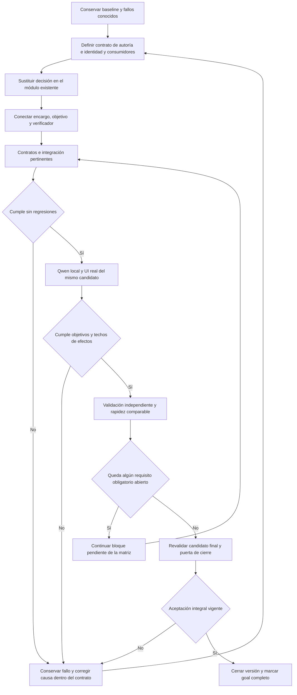
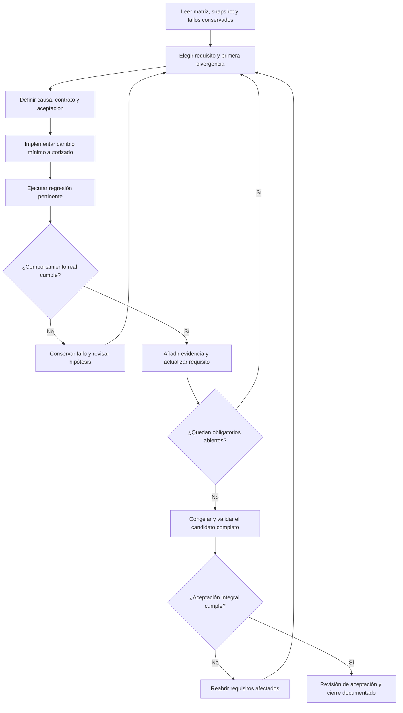

# Mandato vigente: cierre de los 88 requisitos — 2026-10-20

Meta persistente creada y **ACTIVA**. Base inicial: **30 CERRADO / 58 abiertos**. Checkpoint vigente: **33 / 55**, reconciliado con la matriz canónica el 2026-10-21.
Fuente única de aceptación: `VERSION_CLOSURE_MATRIX.json`, sin cambiar los 88 IDs
ni sus `closeWhen`. Los checkpoints inferiores son históricos.

Alcance vigente: **sólo versión web**, por decisión expresa del usuario.
[Decisión](WEB_SCOPE_DECISION_20261020.md). MAUI y su propuesta de SDK/workloads quedan
fuera de esta meta; las notas previas sobre autorización pendiente son históricas.
La matriz ya era web y no incluye requisitos MAUI: no se modifican las 88 filas.

Orden de ejecución por causas compartidas:
1. Capacidades/evidencias válidas repetidas, continuidad/identidad temporal y
   recuperación de transporte; propietarios actuales, regresiones y Qwen/UI.
2. Referencias/contexto y autoría/fidelidad; desarrollo antes de validation/holdout,
   mismos corpus/umbrales, revisión independiente y efectos reales.
3. Guardado/CRUD completo, campos y ejecución; aprobación, cancelación, revisiones,
   reinicio y cero efectos no autorizados.
4. Capacidades pendientes de producto y datos, proveedores/alcance, privacidad y
   seguridad, accesibilidad/guías; sólo los bloques pendientes, sin nuevas familias.
5. Tres baselines comparables, metas de rapidez congeladas y estabilidad; candidato
   único final, matrices backend/frontend/agente y aceptación de los 88 criterios.

Política finita: cada hipótesis requiere evidencia previa y como máximo dos
variantes de corrección, con una aceptación dirigida por variante. Una repetición
sin cambio ni nueva observación no se ejecuta. Se conservan todos los resultados;
una hipótesis agotada se registra como tal y se avanza a una causa/dependencia
concreta. No se marcan criterios PASS por crear la meta, por compilar o por emitir
COMPLETED. Una dependencia humana/permiso específico conserva su estado pendiente;
no se sustituye por una aceptación inventada.

```text
para cada bloque pendiente por orden de dependencia:
  conservar baseline, contrato, propietario y criterio original
  reproducir primera divergencia con los puntos de diagnóstico
  para variante en [1,2], sólo con hipótesis nueva y verificable:
    implementar dentro del propietario; ejecutar pruebas del bloque y límites
    si cumple, registrar candidato/evidencia y cerrar sólo lo demostrado; terminar hipótesis
    conservar fallo; continuar sólo si el fallo justifica la segunda variante
  si no cumple, registrar enfoque agotado y siguiente dependencia accionable
  no repetir suites ajenas al cambio
al terminar: revalidar candidato final y puerta de los 88 requisitos
marcar goal completo sólo con 88/88 cerrados y aceptación vigente
```


## Incremento modular vigente — 2026-10-20

La petición posterior amplió el objetivo activo a la modularización de frontend,
conexión, backend, agentes y CRUD. Los 88 criterios siguen siendo la aceptación
original de la versión, con 34 cerrados y 54 abiertos; no se sustituyen por
comprobaciones de arquitectura ni se borran sus fallos.

Se implementaron fábricas de composición backend, puertos de biblioteca y
conexión de agente/preparación, traslado de diez servicios a Infrastructure/Local
y retirada de dos vistas huérfanas con inventario y copia exacta. Las invariantes
y permisos siguen en sus propietarios. Detalle vigente:
[mapa modular](MODULAR_SYSTEM_MAP.md) y
[aceptación del incremento](MODULAR_REFACTOR_ACCEPTANCE_20261020.md).

El núcleo candidato queda rechazado y fuera del grafo productivo: los tres casos
originales no cumplen aceptación independiente, aun usando el orquestador real
con su corrección existente. No se amplían reintentos ni se ejecuta otra variante
de la hipótesis agotada. El núcleo activo anterior no se declara retirado ni la
versión cerrada; su sustitución funcional sigue siendo trabajo pendiente.

## Avance del primer bloque — 2026-10-20

**31 CERRADO / 57 abiertos. Goal ACTIVO, versión NO_CERRADA.**

- Evidencias repetidas: normalización de conjunto tras validar cada cita; una
  variante. Seis casos originales de eliminación Qwen/UI pasan, incluida pregunta
  explicativa, negación y datos que contienen una orden destructiva.
- Referencia temporal: dos variantes, primera rechazada por conservar un
  checkpoint anterior a la edición propia; segunda sigue sólo checkpoints
  observados. Crear/adaptar y recuperar tras cancelación cumplen controles y
  revisión de contenido independiente ligada al hash; no cierra multivuelta general.
- Transporte: una variante, máximo dos peticiones de inferencia; cancelación y
  errores permanentes no provocan otro intento. **EXE-07 CERRADO**: ausente,
  timeout, transitorio y persistente en UI del mismo build, feedback útil y
  biblioteca/preview utilizables. 114 contratos iniciales y 59 de feedback
  ejecutados (selecciones solapadas, no sumarlas como cobertura distinta).
- Contexto de origen: definición real antes ausente; variante 1 selecciona los
  dos IDs correctos. Un recorrido continúa fallando después por pedir copia
  persistente sin solicitud; se conserva FAIL y no se promueve fiabilidad general.
- Ciclo de vida del workflow: dos variantes rechazadas y retiradas; metadatos
  reflejados no eliminan copia extra y razonamiento cambia a versión extra.
  Hipótesis agotada, sin tercera ejecución ni holdout. Código restaurado.
- Identidad de catálogo: una variante en el propietario de lectura, 42 contratos
  dirigidos PASS. UI original abrir/ambigüedad/inexistente PASS con revisión
  independiente; abrir desde otro detalle también PASS. Desarrollo completo
  wave3 14/16; datos de catálogo wave4 mejoran a 15/16 sin efecto extra. Sigue
  fallando el guardado adicional; referencia general no se cierra.

Evidencia y presupuestos: [bloque 1](CLOSURE_WAVE1.md),
[contexto/workflow](CLOSURE_WAVE2.md). Los 88 criterios originales permanecen.
El siguiente bloqueo observado de navegación conserva un `CATALOG_ENTRY_1`
correcto pero pierde su identidad al convertirlo otra vez en una búsqueda por
texto. Se estudiará en `TaskSourceResolver` con lectura fresca y protección de
ambigüedad/revisión; no se añadirá routing por frases ni otro selector propietario.


## Checkpoint de ejecución — 32 cerrados / 56 abiertos

- Definiciones acotadas del catálogo: 44 controles PASS; desarrollo Qwen original
  15/16 cumplen resultado/techo. El 14 mantiene copia extra. Sin validation/holdout.
- Continuidad de autoría hacia workflow: 46 controles PASS pero Qwen 14 añade
  versión extra; candidato rechazado/retirado, sin ejecutar matriz completa inútil.
- Retirada verificada con 67 controles de consumidores PASS; selecciones solapadas
  con las anteriores, no sumarlas como una única suite.
- LIB-02 CERRADO: seis controles UI sin modelo, incluyendo paginación y retorno,
  filtros combinados, Unicode, vacíos y recuperación de error. Criterio intacto.
- Ambos completar/copiar originales pasan con Qwen/UI y texto/valores exactos.
  Crear y adaptar pasan; guardar el borrador posterior queda BLOCKED porque se
  exige GeneratedDraft del mismo run. Caso retenido, sin aprobación/INSERT.
- Corrección en propietarios actuales: revalidar DraftRef antes de revisión,
  preservar copia con/sin Goal opcional y ligarla al origen antes de aprobar y
  persistir. 97 controles PASS (cuatro reproducciones antes FAIL); nueva UI de
  borrador temporal y copia desde origen en marcha. No se cierra SAV-01/02 aún.

## Checkpoint de ejecución — 34 cerrados / 54 abiertos

SAV-01 y DAT-06 CERRADOS: recorrido Qwen/UI de creación/adaptación/guardar con
aprobación exacta, INSERT único, reapertura del respaldo y rollback QA anterior
con iguales registros/revisión/texto, sin resucitar aprobación. 97 contratos PASS.
La otra adaptación desde origen falla antes de revisar y conserva FAIL; SAV-02
sigue abierto. La revisión independiente cubre todos los turnos, no sólo el final
(regresión del gate corregida, 7/7 controles). Todo queda en CLOSURE_WAVE6.md.

En curso después de wave6: reparación de restricciones en el mismo propietario,
sin reenviar una propuesta rechazada al modelo. El fallo original repetía una
cita inventada también durante su corrección; antes 2 FAIL, después 19 contratos
PASS. Se evalúa el mismo saveCopy real, sin cambiar tareas/corpus/umbrales.
La versión permanece abierta y no se atribuye cierre a superar una etapa.

Wave7 recupera grounding, pero la copia aún falla por órdenes de sesión en un
cuerpo de creación. Wave8 conserva la revisión validada del propietario de
autoría: una decisión de identidad adicional ya no puede sustituirla por creación.
Antes 4 FAIL / 5 PASS, después 90 contratos PASS; UI en curso del mismo saveCopy.
Sin más cierres atribuidos por pasar una etapa o reducir una llamada.

Siguientes registros de avance se añaden aquí sin alterar los criterios canónicos.
No hay nuevas descargas, cambios de modelo, publicación o migración privada
implícitas. El piloto humano y permisos específicos mantienen su condición real.

---

# Goal activo — completar la versión inicial de NOVA

Creado: 2026-10-19, America/La_Paz. Estado del goal: **ACTIVO**. Estado del producto: **NO CERRADO**.

Decisión posterior sobre el núcleo: [agente guiado por el sistema real](PRODUCTION_AGENT_ARCHITECTURE.md). El candidato `prepare_task` falla en los cuatro casos retenidos, también después de reparación acotada. Un segundo archivo que duplicaba capacidades de planificación fue retirado sin activarlo. La composición productiva todavía usa el intérprete anterior. Pasan 75 controles dirigidos de límites/consumidores; no equivalen a fiabilidad semántica. No añadir capacidades por frase ni otro registro paralelo: reutilizar capacidades, contexto y recibos reales. Sin nuevos requisitos cerrados.

Checkpoint 2026-10-20: [sustitución por capacidades reflejadas](REFLECTED_AGENT_REPLACEMENT.md). Dependencias autorizadas/restauradas y frontera de lectura migrada a esquemas SDK desde métodos/DTO reales. [Acta](../evidence/closure-20261020/reflected-tools-increment/review.md): contratos y consumidores pasan; compatibilidad STJ completa 696 PASS y control adicional de hook 16 PASS en ejecución separada; Qwen real lee dos versiones de SQLite y responde con sus títulos correctos. No acredita autoría, UI del nuevo agente ni una sustitución semántica ya realizada. El recurso de conocimiento anterior no calificó. Continúan **29 requisitos cerrados/59 abiertos**. La composición semántica y retirada del legacy son el siguiente trabajo pendiente.

## Mandato vigente — sustitución de autoría e identidad

Último estado: [autoridad original del encargo](REVIEW_AUTHORITY_BINDING.md) restaurada también en la ruta previa: se elimina el subconjunto del generador del contrato privado de revisión. Cuatro regresiones antes fallan; final **82 controles dirigidos PASS**, incluidos los 78 consumidores previos. Se conserva la [recuperación por grupos](FIDELITY_REPAIR_CONTRACT.md), con el mismo máximo de dos llamadas. API/evaluador compilan y tres ensamblados compartidos coinciden con los probados. La ruta v4 ya usaba petición completa: no se repite su campaña inalterada ni se transfieren resultados históricos al binario nuevo. El revisor real conservado tiene dos aceptaciones incorrectas; **gate semántico FAIL**. Un [protocolo nativo de contenido](NATIVE_CONTENT_PROTOCOL_DIAGNOSTIC.md) también conserva autoría/órdenes actuales y queda rechazado sin integrar. No se promueven perfiles ni creación ni se repiten matrices generales ajenas al cambio. Las [matrices separadas](testing/README.md) conservan evidencia histórica y actual sin mezclarlas. Continúan **29 requisitos cerrados y 59 abiertos**, sin validación/holdout ni latencia aceptada.

Estado UI retenido del v4, sin repetir en este incremento: ambos completar/copiar conservan fuente, valores y compilado exactos; creación/continuación se ejecutan pero el contenido contiene órdenes de sesión y la aceptación independiente falla. Sus 385 fuentes estables y binarios probados se conservan. No transferir ese recorrido a los binarios de reparación sin ejecución UI posterior. Seis controles del gate impiden falsos verdes.

Continuación de capacidad, anterior a la reparación del revisor: [24 contratos dirigidos y revisión de propietarios](AGENT_RELIABILITY_ROOT_CAUSE.md). La creación compartida real tampoco supera autoría y no admite cero entradas; se descarta su sustitución directa. En esa exploración la API y autoría del v4 no cambiaron. Predicados/rangos, documento natural y parámetros literales quedan rechazados sin integrar. El siguiente contrato debe preservar destinatario, objeto, cobertura y vigencia además de referencias. La reparación posterior sólo resuelve deriva durante recuperación; no sustituye esa obligación semántica.

Checkpoint histórico v1 (no es el siguiente paso vigente): [candidato aislado de autoría e identidad](AUTHORING_IDENTITY_CANDIDATE.md). Se implementaron decisión tipada, encargo y vinculación al cierre bajo selector no activo por defecto. Contratos controlados **9/9**, backend **648/648**, API sin warnings/errores y tres ensamblados compartidos idénticos. UI/Qwen real **2/3**: inline y creación/continuación pasan; datos separados añade autoría y termina bloqueado. Candidato v1 archivado y **no promocionado**. La siguiente corrección es ordenar datos/workflow antes de autoría y preservar la declaración durante reintentos. Ningún requisito de la matriz se cierra; continúan **29 cerrados/59 abiertos**.

Actualizado: 2026-10-20. Goal de ejecución registrado como **ACTIVO**. El objetivo es completar el incremento siguiente y después satisfacer todos los requisitos obligatorios de esta versión. Registrar el goal y definir su plan no constituye implementación ni aceptación del producto.

Diseño de referencia: [composición del contrato semántico](SEMANTIC_CONTRACT_COMPOSITION.md). Fuente única de requisitos y estados: [matriz canónica](VERSION_CLOSURE_MATRIX.json). Estado inicial de este mandato: **29/88 cerrados y 59 abiertos**. Los checkpoints inferiores son históricos; sus siguientes pasos quedan subordinados a este mandato y a las decisiones de rechazo posteriores.

**Primer incremento autorizado:** sustituir autoría e identidad dentro de `InstructionUseInference`/`PreparationInference`, conservando los propietarios de datos y workflow. Conectar la decisión al encargo exclusivo de contenido, al objetivo de ejecución y al verificador final. No incorporar directamente el contrato conjunto rechazado, reinstalar la reducción de contexto fallida ni añadir otro árbitro.

| Entregable | Propietario que se conserva | Condición de aceptación | Estado inicial |
| --- | --- | --- | --- |
| I1. Decisión única de autoría e identidad | `PreparationInference` / `InstructionUseInference` | Contrato tipado distingue conservar, revisar o crear y su identidad; evidencia y referencias válidas; ninguna reclasificación posterior sustituye la decisión en la ruta nueva | PENDIENTE |
| I2. Aislamiento de datos y workflow | Propietarios actuales de ámbito/valores y workflow | El contrato de autoría no decide llenar, copiar, navegar, guardar o ejecutar. Conservar texto no elimina esas acciones; pedir autoría no las concede. Ambigüedad esencial suspende efectos y pregunta | PENDIENTE |
| I3. Encargo obligatorio de contenido | Generador y `PromptPreparationPipeline` actuales | Crear/adaptar recibe contenido, restricciones y fuente vinculada; no recupera la orden completa como fallback silencioso. Metadatos y órdenes de sesión quedan fuera del cuerpo cuando su destinatario es NOVA | PENDIENTE |
| I4. Composición y cierre vinculados al objetivo | `SemanticStageComposition`, compilador, `TaskGoal`, `GoalCompletionValidator` y coordinador actuales | No se pierden objetivos compuestos; dependencias no inventan efectos solicitados; identidad/revisión/valores/aprobación conservados. Ningún COMPLETED con objetivos faltantes o efectos sobrantes | PENDIENTE |
| I5. Recorridos conservados en candidato único | Evaluador y arneses UI existentes | Completar/copiar inline y separado conserva cuerpo y evita generación; creación y continuación mantienen fidelidad/contexto; aprobación, guardado y rechazo cumplen sus contratos con Qwen local y UI real | PENDIENTE |
| I6. Calidad, rapidez y no regresión | Campañas congeladas y matriz vigente | Pruebas pertinentes y development → validation → holdout sin tuning, umbrales originales, latencia comparable y resultados identificados por candidato. Los fallos no se eliminan ni se convierten en éxitos parciales | PENDIENTE |
| V1. Cierre de versión | Matriz y puerta de cierre existentes | Todos los requisitos obligatorios cerrados con evidencia vigente del candidato final, incluidos los requisitos de producto y operación ajenos a esta sustitución | PENDIENTE |

Los entregables organizan el trabajo; no son otra matriz ni modifican estados de aceptación. No se añade un servicio por fila. La sustitución cambia la capacidad en su módulo existente. Reflection sigue describiendo capacidades reales; retrieval sigue aportando contexto, sin convertirse en autoridad de intención o aprobación.



```text
preservar árbol de trabajo, candidato base, oráculos y fallos previos
mapear entrada, salida, procedencia, errores y consumidores de autoría/identidad
sustituir sólo su propietario; no duplicar decisiones de datos ni workflow
transportar la decisión al encargo de contenido y al objetivo verificable
comprobar contratos, aislamiento, cancelación, revisiones y aprobación exacta
ejecutar los recorridos conocidos con Qwen y UI en el mismo candidato
ante fallo, conservarlo y corregir su causa sin ajustar por frase ni rebajar criterios
tras cualificación, ejecutar validación independiente y mediciones comparables
actualizar sólo los criterios demostrados y continuar los obligatorios restantes
marcar completo únicamente tras aceptación integral y puerta de cierre conforme
```

Invariantes de ejecución: sin routing de intención por keywords/regex, similitud como autoridad, bucles sin límite, nuevos árbitros, modelos o frameworks. Mantener cancelación, plazos y presupuestos actuales; no ampliar reintentos para obtener un resultado aceptable. Escrituras, eliminación y aprobación siguen en el dominio existente. Ningún permiso se hereda de un resumen, cuerpo de prompt, valor de campo o ejecución anterior.

Aceptación semántica: intención ≥90%; planes/destino/finalización/herramientas ≥95%; fidelidad/éxito/metamórficas ≥90%; contaminación, efectos no autorizados, IDs inventados aceptados y cierre prematuro =0. La latencia exige los baselines comparables previstos antes de fijar y contrastar objetivos. No se afirma comprensión perfecta de cualquier texto libre.

Este mandato deja el goal y la secuencia listos para ejecución. **I1–I6 y V1 no están completados por registrar este plan.** La sustitución y su validación real continúan pendientes; la versión permanece abierta.

Incremento 2026-10-20: [refactor de uso de instrucciones](INSTRUCTION_USE_REFACTOR.md), backend conservado 639/639 y frontera de datos de identidad corregida. Protocolo conjunto y reducción de contexto rechazados con fallos conservados; no se adopta un intérprete por pasar sólo autoría aislada ni por emitir COMPLETED. Persisten 29 cerrados/59 abiertos; ningún requisito de fiabilidad general o latencia se cierra con este incremento.

Último incremento: [contrato común de borrador](CONVERSATION_ARTIFACT_LIFECYCLE.md) corregido con reproducción antes/después y candidato final 636/151/136 pruebas mecánicas PASS. No cierra requisitos semánticos: Qwen/Edge real falla los tres recorridos dirigidos (dos completar/copiar y creación antes de adaptar). Se mantienen 29 cerrados/59 abiertos y todos los umbrales. El checkpoint conserva la divergencia inicial del plan, las contradicciones del revisor, tiempos, resultados y la incidencia intermitente de foco manual.

## Objetivo y línea base

Completar los requisitos abiertos y mantener/revalidar los cerrados de la [matriz obligatoria](VERSION_CLOSURE_MATRIX.md), hasta cumplir los 88 criterios de la versión. Línea base inicial: 69 abiertos y 19 cerrados; estado tras los checkpoints: **59 abiertos y 29 cerrados**. No existe presupuesto de tokens solicitado. El goal no se considera cumplido al crear este documento, compilar, pasar tests de contratos ni finalizar una ejecución del agente.

Fuente canónica de requisitos: [VERSION_CLOSURE_MATRIX.json](VERSION_CLOSURE_MATRIX.json). El comprobador local es `node scripts/Check-VersionClosure.cjs --write-report`; retorna 2 mientras haya pendientes. No está conectado a CI y no sustituye la revisión de la evidencia.

Línea base ejecutada: backend 465/465 y React 95/95. Modelo generativo conservado: Qwen3 8B. La creación fiel no está aceptada. Los fallos anteriores y las alternativas de modelo rechazadas se conservan. Las cifras no son una precisión general del agente.

## Secuencia de trabajo

| Etapa | Requisitos principales | Condición de avance |
| --- | --- | --- |
| 1. Recuperar autoría e interpretación | AI-01..07, AUT-01..08 | Causa y candidato mínimo comprobables; sin contaminación, pérdida de restricciones ni nuevas rutas por palabras |
| 2. Completar contexto, efectos y CRUD | CTX-05/07, EXE-02/04/06/07, SAV-01..04 | Recorridos reales mantienen objetivo, origen, revisión, valores y efectos; guardar/eliminar requieren confirmación vigente |
| 3. Cerrar producto y paridad | LIB, VAR, PAR, UX | Funciones prometidas usables en React, sin sustituirlas por conservación en SQLite; prueba real de cada criterio |
| 4. Operación, privacidad y destinos | DAT, EXT, SEC | Integridad, backup/rollback, controles de autoridad y estados reales; permisos externos o datos privados sólo tras autorización específica |
| 5. Rapidez con calidad | PER-01..03 | Baseline comparable y metas congeladas antes de medir mejora; incluir fallos y recursos, sin reducir controles |
| 6. Candidato final único | REL-01..09 | Builds/tests/UI/semántica, documentación y operación corresponden al mismo candidato identificado |
| 7. Aceptación | REL-10 | Todos los obligatorios cerrados con evidencia, sin defectos abiertos ni alcance reducido por silencio |

Las etapas definen dependencias de aceptación, no impiden avanzar trabajo independiente útil. No se añadirá una cadena experimental de llamadas sólo porque una etapa anterior falle. Antes de otro ensayo de autoría se revisarán los experimentos conservados: think/no-think, muestreo, particiones, proyecciones y modelos alternativos ya fallaron en distintos contratos. Una hipótesis nueva debe distinguirse de esos ensayos y tener un criterio falsable.

## Workflow



```text
mientras haya requisitos obligatorios abiertos:
    releer estado real y preservar trabajo ajeno
    elegir el bloqueo más temprano que permita progreso autorizado
    contrastar causa contra código, trazas y experimentos previos
    definir entradas, salidas, autoridad, invariantes y postcondiciones
    implementar sólo un cambio coherente con el contrato existente
    ejecutar pruebas pertinentes y UI/modelo local si el efecto depende de ellos
    si falla: conservar resultado; no modificar expectativas para obtener PASS
    si pasa: registrar alcance/build/config/modelo y actualizar sólo criterios demostrados
    si falta autorización: preparar resultado concreto revisable y solicitar sólo ese permiso
    continuar trabajo independiente que no dependa de ese permiso
congelar candidato final, ejecutar regresión y campaña integral
si falla un criterio: reabrirlo y continuar
cerrar sólo tras cumplir todos los criterios y la revisión de aceptación
```

## Límites persistentes

- Aplicar `algorithmic-engineering`, `adaptive-ai-systems` y skills especializados pertinentes.
- No introducir clasificación de intención por keywords/regex, parches por frase ni bucles ilimitados.
- No debilitar grounding, aprobación, control de identidad/revisión, privacidad o umbrales para pasar pruebas.
- No instalar modelos/dependencias, utilizar nube, leer/migrar datos privados, retirar Blazor ni cambiar alcance sin autorización específica.
- No hacer commit, push ni publicación como consecuencia implícita de este goal.
- El piloto humano, las sesiones externas y las decisiones de alcance no se simulan ni se marcan PASS por no recibir respuesta.
- Los 88 requisitos siguen siendo obligatorios. Una decisión explícita de alcance se documenta y no se presenta como funcionalidad implementada.

## Checkpoint inicial

Goal creado mediante el control de goals y mantenido ACTIVO. No se ha cerrado ningún requisito adicional por crear el goal. Primera línea de investigación: revisar la pérdida de separación entre órdenes de autoría y tarea futura en `TaskGoal.ContentRequest`, `GenerateCore`, vinculación de referencias y revisión de fidelidad, sin repetir los experimentos rechazados como si fueran hipótesis nuevas.

## Checkpoint 1 — progreso implementado

2026-10-19: **PAR-01 cerrado** mediante selector de categorías real en React y catálogo de IDs del dominio. [Implementación y aceptación](CATEGORIES_ACCEPTANCE.md). Backend 466/466; React 97/97 en repetición, con timeout inicial preservado; ocho controles Edge reales del candidato final de esta mejora. Builds aislados: `.playwright/parity-categories-20261019/{api,web}`. No se actualizó el servidor previo 5190.

La matriz pasa de 19 cerrados/69 abiertos a **20 cerrados/68 abiertos**, sin eliminar requisitos ni rebajar criterios. La revisión de los experimentos de autoría confirma que particiones, proyecciones, destinatarios, muestreo y modelos alternativos ya fueron rechazados; ninguno se reincorporó. AUT-01..08 y la aceptación semántica siguen abiertos. El siguiente trabajo debe continuar esas fronteras y el CRUD/contexto pendientes, además de cerrar las funciones de paridad independientes; no convertir PAR-01 en sustituto de la recuperación del agente.

## Checkpoint 2 — frontera de autoridad reproducida; candidatos rechazados

2026-10-19: el revisor sustituye la autoridad original por requisitos seleccionados por el generador. Una regresión reprodujo el error de citas y seis contrastes nuevos con Qwen real confirmaron dos restricciones omitidas aceptadas. Se cualificaron cuatro variantes aisladas (contexto completo, roles conversacionales y cobertura con/sin reasoning); ninguna satisfizo el criterio congelado. Se restauró `DraftFidelity.cs` al hash anterior y se archivaron pruebas/variantes rechazadas fuera del proyecto activo. **No se cerró ningún requisito adicional: 20 cerrados/68 abiertos.**

Mejora conservada: el evaluador de diagnóstico registra código y resultado con tres disposiciones; una revisión inválida no satisface una expectativa negativa. Tres controles HTTP sintéticos PASS, evaluador sin warnings/errores y backend restaurado 466/466 PASS. [Causa, resultados y límites](AUTHORING_AUTHORITY_DIAGNOSTIC.md). No se repitió frontend ni UI general, ni se modificaron modelo, permisos, datos privados, instancia 5190, umbrales o holdout.

Siguiente acción concreta: implementar la capacidad de dominio de **SAV-04**, revisión y confirmación de eliminación ligada a identidad/revisión y run, manteniendo cancelación sin navegación. Integrar después su operación tipada en el planificador y el driver de la misma pestaña, y comprobar lenguaje libre/confirmación con modelo real antes de cerrar. No repetir las cuatro variantes de este checkpoint sin una hipótesis nueva que las distinga. Este trabajo no exime la recuperación de autoría pendiente ni redefine el objetivo de los 88 requisitos.

## Checkpoint 3 — eliminación revisada implementada; segunda formulación falla

2026-10-19: se añadió `REQUEST_DELETE` con selección fundamentada de pasajes, resolución de destino, revisión nativa, recibo de la pestaña, confirmación humana, aprobación de un uso, revisión optimista y plazo monotónico. El modelo no puede confirmar el borrado. Cancelar conserva pantalla y datos. El vencimiento se comprueba en el dominio aunque el coordinador todavía no haya publicado timeout.

Backend **486/486 PASS** (21 casos relativos a eliminación); React **103/103 PASS**; siete recorridos manuales Edge→API→SQLite PASS en API-v4/web-v2. Los fallos previos de sincronización de los arneses se conservan: esperar el ítem real/recibo del borrado fue necesario; esperar sólo `library-ready` no bastó. No se ampliaron timeouts ni cambiaron expectativas. [Implementación, contratos, capturas y resultados](AGENT_DELETION_ACCEPTANCE.md).

Qwen real en el candidato previo API-v3: **1 PASS / 1 FAIL / 4 NOT_TESTED**. La primera petición abrió revisión del registro correcto y Cancelar conservó la biblioteca. La segunda formulación falló en `UNGROUNDED_CASE_APPLICATION` antes de presentar la eliminación o escribir. **SAV-04 pasa de PENDIENTE a FALLA; no se cierra ningún requisito adicional. La matriz sigue en 20 cerrados / 68 abiertos y el goal ACTIVO.** No hubo cambios en la instancia 5190, datos privados, modelo, perfiles experimentales, dependencias, legacy ni Git remoto.

Siguiente acción concreta: capturar `ContentRequest` de la segunda formulación con `NOVA_QA_CAPTURE=1` (el arnés ahora conserva también esas respuestas sintéticas sin reasoning); reproducir la primera transición inválida con transporte controlado y reutilización habilitada. El código asigna `rejected` en `Interpret` pero no lo comunica al siguiente intento ni descarta allí la respuesta de caché. [Diagnóstico y experimento propuesto](SEMANTIC_RETRY_DIAGNOSTIC.md). Probar esa frontera antes de implementar una reparación de fase acotada que conserve todos los objetivos y no repita JSON semánticamente rechazado. No silenciar llenado por detectar una eliminación, no usar keywords/regex y no reincorporar experimentos de autoría rechazados. Después completar la campaña del mismo candidato, incluidos confirmación real, preguntas/negaciones/datos, ambigüedad, revisión obsoleta y reinicio. Los fallos de autoría siguen abiertos.

## Checkpoint 4 — reparación acotada comprobada; mismo recorrido aún bloqueado

2026-10-19. Se capturó `FORBID_FILL` inventado en la segunda petición. La regresión reprodujo reutilización de una respuesta semánticamente rechazada desde caché. Se implementó descarte, reparación de fase única con código de fallo y petición original, límite compartido y detención tras agotarlo. Las asignaciones aisladas sólo autorizan llenado, nunca prohibiciones. Los dos primeros candidatos mostraron copia de la respuesta rechazada y reclasificación de autoría; el tercero elimina esa respuesta del paquete y fija los objetivos independientes durante la reparación. Siete contratos nuevos y backend completo **493/493 PASS**, cero omitidas. Build API-v3 aislado sin warnings/errores; frontend web-v2 conservado. [Causa y evidencia completa](SEMANTIC_RETRY_DIAGNOSTIC.md).

La misma campaña Qwen/Edge mantiene **1 PASS / 1 FAIL / 4 NOT_TESTED**. La reparación de campos funciona sin cambiar autoría, pero tras cargar el origen el workflow añade una copia no solicitada y termina en `DELETE_EFFECT_CONFLICT`. No hubo escrituras no autorizadas. **20 cerrados / 68 abiertos; ningún cierre adicional. Goal ACTIVO.** No se añadieron requisitos ni se investigaron familias ajenas a este bloqueo.

La instrucción vigente del usuario es concentrarse en errores pendientes y no ampliar la auditoría. Siguiente paso: reproducir y corregir la deriva entre el workflow anterior y posterior a cargar el origen, conservando el refinamiento necesario para no reintroducir omisión de campos. Después repetir las mismas peticiones congeladas y completar sus criterios. Autoría, continuidad y CRUD con aprobación siguen siendo las prioridades; no pasar a cosmética, nuevas funciones o auditorías generales para aparentar progreso.

## Checkpoint 5 — SAV-04 cerrado funcionalmente; goal continúa

2026-10-19. Se reprodujo la deriva del workflow con tres fallos de transporte antes de la corrección. La interpretación ahora conserva una instantánea de navegación/copia, control y persistencia; al cargar un origen, el decoder del refinamiento fija esos ejes para la misma petición. Contenido y campos siguen refinándose con el cuerpo/esquema reales. La instantánea es efímera y no concede aprobación. El validador rechaza intentos de cambiar los ejes y reutilización entre tareas/orígenes no ligados. No se añadieron llamadas, modelos, dependencias, endpoints o cambios de SQLite. Backend **501/501 PASS**, cero omitidas; build API workflow-refinement-v1 sin warnings/errores; frontend web-v2 conservado. [Diagnóstico y contratos](SEMANTIC_RETRY_DIAGNOSTIC.md).

Los seis mensajes congelados pasan con Qwen3 8B y Edge visible, incluida la segunda eliminación que bloqueaba el avance. Cuatro controles adicionales desde detalle pasan en el mismo candidato: revisión obsoleta, pausa por API de control y confirmación desde UI, eliminación vigente y persistencia/rechazo de aprobación antigua tras reiniciar. DLLs e índice web coinciden entre campañas. [Aceptación funcional y pruebas](AGENT_DELETION_ACCEPTANCE.md), [manifiesto](../evidence/workflow-refinement-20261019/validation.json).

Se conserva un timeout de interpretación antes de revisar/escribir en un intento desde biblioteca, bajo EXE-07/PER; no es una medición de latencia estable ni una ejecución cumplida. Otro intento pasó tres controles pero el arnés no reconoció `signalCode` al terminar el proceso; se corrigió la espera y se verificó el reinicio en la repetición. No se descartaron fallos ni se elevaron límites. **SAV-04 pasa a CERRADO en su alcance funcional: 21 cerrados / 67 abiertos. Goal ACTIVO; versión NO CERRADA.** AUT, AI-01, contexto y guardado con aprobación siguen abiertos; este resultado no se usa para declararlos aceptados.

Siguiente acción concreta: volver a los fallos documentados de AUT-01/AUT-07 y SAV-01/02/03, empezando por separar la autoridad original del usuario de las selecciones del generador y del contenido futuro. Revisar los cuatro experimentos rechazados conservados antes de formular otra hipótesis; no repetirlos ni ampliar a nuevas funciones/auditorías. Mantener los umbrales y corpus congelados; conservar el timeout como pendiente de fiabilidad/rendimiento y el cierre funcional de eliminación como evidencia acotada que debe revalidarse en REL-04/05.

## Checkpoint 6 — recuperación de selección sin cerrar autoría ni ampliar auditoría

2026-10-19. Se probó aisladamente un predicado único de fidelidad con autoridad completa: **5/6**, falso rechazo de un cuerpo correcto. No se ejecutó su validación ni se integró; `DraftFidelity.cs` mantiene el hash restaurado. [Experimento rechazado](AUTHORING_PREDICATE_DIAGNOSTIC.md). No se retomaron las cuatro variantes anteriores.

Se continuó con dos fallos de navegación ya documentados en Phase 5: empates de puntuación anulaban una referencia contextual correcta y selección vacía podía promover registros ajenos. Una regresión los reprodujo; se conservaron las decisiones de identidad ya validadas y se retiró la sustitución por scores. El corpus de planificación con objetivos anotados pasa **15/16→16/16**, sin llamadas al modelo; no es precisión de interpretación. Una primera variante con verificación redundante dio 14/16 y se rechazó. [Causa, contratos y resultados](SOURCE_SELECTION_RECOVERY.md).

La UI real volvió a mostrar la navegación incorrecta al inexistente: el selector escogía el candidato más cercano, aunque no correspondiera. El contrato de dos estados pasó contrastes de componente pero regresó al recibir sólo dos anuncios coincidentes: confundió falta de unicidad con ausencia. Se conserva ese fallo. El contrato final representa cero/una/varias coincidencias y valida las cardinalidades en código, sin keywords/regex de intención, nuevos modelos, servicios o llamadas adicionales. Pasa **48 condiciones de 16 peticiones** con pools completos/invertidos/enfocados; la validación reutilizada se distingue de un holdout nuevo.

Candidato `.playwright/source-selection-20261019/api-v5` + web-v2: backend **517/517 PASS**, cero omitidas; API/evaluador sin warnings/errores. UI Qwen/Edge inspeccionada: inexistencia visible sin sustitución, pregunta por Anuncios A/B y apertura por descripción de Informe semanal con ID/texto/revisión correctos. No se cambió el frontend ni se repitió React. Los seis mensajes de eliminación y cuatro controles de ciclo de vida se repitieron y pasan en el mismo candidato; se corrigió una espera del arnés que retornaba pendiente tras Confirmar, sin cambiar mensajes/expectativas/timeouts. [Manifiesto](../evidence/source-selection-20261019/validation-v5.json).

**21 cerrados/67 abiertos; ningún cierre nuevo y goal ACTIVO.** AI-02/03 progresan dentro de su alcance parcial; no se cierran antecedentes generales, navegación desde otro detalle, interpretación global, autoría ni guardado. No hubo cambios en la instancia 5190, datos privados, dependencias, modelos, perfiles globales, legacy o remoto. No se infiere rapidez/p95 de estas tandas.

Siguiente paso: continuar los errores ya conservados de fidelidad/guardado y de referencia entre pantallas, sin nuevas funciones ni auditoría general. Para autoría, inspeccionar la primera relación incorrecta en las revisiones capturadas antes de otro experimento; el predicado único y la cobertura/roles ya fallaron y no deben repetirse. La recuperación del selector muestra que los contratos deben distinguir estados y responsabilidades reales; no autoriza trasladar un cambio al escritor sin una causa propia y contrastes independientes. Mantener los umbrales, los fallos y las verificaciones del mismo candidato.

## Checkpoint 7 — actualización y rechazo comprobados; copia aún bloqueada

2026-10-19. Se repitió la petición existente de actualizar/guardar una versión: nueve inferencias terminaban en `UNGROUNDED_CONTENT_CLAUSE` antes de cargar el origen. La revisión de ámbito estaba aplazada, pero el grounding de una paráfrasis de workflow se exigía antes de esa revisión. La extracción dependiente ahora espera al cuerpo real; un marcador fuerza refinamiento incluso para un candidato ya identificado, con rechazo si sigue pendiente o cambia la revisión. Cinco controles nuevos y la suite completa pasan: **522/522**, cero omitidas. No se admiten citas aproximadas ni se omiten condiciones futuras.

Una repetición llegó a aprobación con un cuerpo correcto y falló en el clic nativo: el foco seguía en el formulario y el layout cerraba el panel del botón. El controlador da foco al control de clic antes de desplazamiento/progreso/espera. Dos regresiones fallaron antes y **103/103 React** pasan después; cancelación, visibilidad y aprobación se conservan. [Diagnóstico](SAVE_RECOVERY.md).

API `.playwright/approved-control-focus-20261019/api-v1` y web-v1: actualización/versión con Qwen/Edge **COMPLETED**, 143303 ms/19 llamadas; texto aprobado exacto, mismo ID/revisión 2 y reapertura real tras reiniciar. Rechazo de actualización **CANCELLED**, 138578 ms/19 llamadas; biblioteca y texto originales tras reiniciar y replay anterior 409 sin escribir. Copia **BLOCKED/INVALID_DECISION**, 139693 ms/19 llamadas, por cuerpo que describe adaptar/solicitar aprobación en lugar de la instrucción pedida. Rechazo seguro no equivale a copia cumplida. No son p95 ni campaña semántica general. SAV-02/SAV-03 siguen PARCIAL.

## Checkpoint 8 — auditoría del núcleo; candidato de contexto rechazado

El usuario pide agrupar causas y sustituir compensaciones en lugar de corregir frases individuales. [Auditoría y diseño detallado](AGENT_CORE_ARCHITECTURE_REVIEW.md): el plan semántico ya existe en ambas entradas, pero `TaskGoal` opcional cambia instrucciones del writer, contexto de edición y tratamiento de evaluación. Los fragmentos elegidos por el generador sustituyen además la petición íntegra del revisor. Se distinguen esos problemas estructurales de correcciones válidas de estado, identidad/revisión y recibos.

Se evaluó un único candidato de contexto de ejecución compartido y autoridad original completa, sin activar los intérpretes rechazados. Con Qwen real y los seis contrastes existentes dio **1/6 juicios correctos válidos y cinco inconcluyentes**. La validación independiente y generación/UI de ese candidato son **NOT_TESTED**. Uniformar contexto por sí solo no recuperó el juicio semántico. Se archivó el código, se retiraron los dos archivos nuevos del proyecto y se restauraron exactamente los tres modificados. Backend restaurado **522/522 PASS**; se conservan las correcciones de estado y foco probadas. No se promoverá otro paquete/etiquetado por cambiar su redacción.

**Goal ACTIVO, 21 cerrados/67 abiertos; versión NO CERRADA.** No se añadieron requisitos ni se redujo alcance. No se modificaron 5190, datos privados, modelos, dependencias o remoto. El siguiente trabajo del núcleo debe demostrar una especificación de tarea futura y una revisión fiable separadas de metadatos y workflow; no otro parche para la petición de entrevista. La finalización seguirá exigiendo creación, copia, contexto y efectos correctos en los umbrales originales.

## Checkpoint 9 — catálogo y lecturas con atributos/Reflection

Por instrucción expresa del usuario se migra la descripción de capacidades a atributos y descubrimiento por Reflection. [Diseño, límites y evidencia](REFLECTION_CAPABILITIES.md). Se reemplazan la lista/etiquetas duplicadas de 20 herramientas UI y el diccionario de relaciones de 20 operaciones; tres lecturas reales se enlazan por métodos anotados y delegados tipados. El catálogo alimenta el transporte existente del LLM. La API valida las declaraciones antes de servir peticiones. No se expone invocación arbitraria ni se retiran controles de autoridad, aprobación, estado, identidad, cancelación o presupuestos.

Snapshot previo congelado: herramientas, descripciones, esquemas, permisos y etiquetas se conservan exactamente. Backend **533/533 PASS**, cero omitidas; API build sin warnings/errores. Los fallos de arnés quedan en la evidencia. Reflection describe y enlaza capacidades; por sí sola no interpreta la petición ni corrige la fidelidad. No se presenta este cambio como cierre de autoría ni como eliminación de todas las condiciones. Las transiciones y adaptadores restantes requieren equivalencia comprobada antes de migrarlos. **Goal ACTIVO, 21 cerrados/67 abiertos, versión NO CERRADA.**

UI Qwen/Edge del catálogo reflejado: apertura existente PASS (82993 ms/13 llamadas); variables FAIL por destino inválido antes de actuar (3735 ms/4 llamadas). Control con API previa y la misma petición/fixture/web/modelo reproduce el mismo fallo (3661 ms/4 llamadas). [Manifiesto](../evidence/reflection-capabilities-20261019/validation.json). No se reinterpreta el bloqueo seguro como petición cumplida.

## Checkpoint 10 — conocimiento vectorial experimental y diseño de fábrica

Por petición expresa se implementa recuperación numérica de capacidades y un grafo derivado de Reflection: 40 nodos/22 relaciones, Nomic ya instalado, SQLite separada, sin peticiones persistidas ni base personal. La primera comparación congelada da Recall@5 0,80/0,90 frente a 0,40/0,30 léxico; desarrollo FAIL con timeout inicial de 25 s y omisión. La validación parcial no cierra recuperación ni comprensión. No se activa por defecto. [Implementación y límites](VECTOR_KNOWLEDGE.md).

UI real de variables con contexto READY: FAIL/NEEDS_CLARIFICATION, 60300 ms/8 llamadas; COPY_PROMPT recuperado primero, pero destino interpretado PREPARE/ollama. La referencia correcta Proyecto técnico se identificó y una etapa posterior rechazó el registro por compararlo con el contenido del caso. Sin campos completos ni escrituras. Se preserva el fallo. Backend final 547/547 PASS y build API sin warnings/errores; la prueba de UI corresponde al build v1 anterior al endurecimiento de fallos de metadatos, no se acredita una entrega final. [Manifiesto](../evidence/vector-knowledge-20261019/validation.json).

La nueva petición de analizar una fábrica se desarrolla en [AGENT_FACTORY_DESIGN.md](AGENT_FACTORY_DESIGN.md): propósito, entradas/salidas, orden de trabajo, responsables, diagramas, pseudocódigo y prioridades que atacan las causas compartidas. Es DISEÑO PROPUESTO; no se instala un framework ni se presenta el índice como razonamiento. Goal ACTIVO, 21 cerrados/67 abiertos, versión NO CERRADA. Ningún requisito se elimina o agrega; 5190, modelos, dependencias y remoto sin cambios.

## Checkpoint 11 — skill instalado y adaptador UI comprobado

Se inspeccionó el ZIP del usuario y se instaló `universal-modular-architecture` en `.agents/skills` del proyecto: diez archivos idénticos al paquete, rutas verificadas y validador original PASS con Python existente. Se aplicó junto con los skills algorítmico/adaptativo. No se copió su ejemplo de AGENTS como política global. [Diseño, contrato, flujo y reproducción](UI_SURFACE_CONTRACT.md).

Cuatro regresiones reprodujeron lectura de campos ajenos, escritura en un homónimo, modificación de sólo lectura y pérdida del binding durante el progreso. La superficie compartida ahora pertenece a biblioteca/workspace/diálogo/actividad, usa identidades estables de controles, rechaza ambigüedad y revalida el nodo/binding antes de actuar y entre fragmentos. No duplica el workflow ni cambia la autoridad del backend. React final **112/112 PASS**, backend final **548/548 PASS**, builds API/TypeScript/Vite PASS. Edge final **8/8 controles PASS**, seis ejecuciones tipadas completadas en API-v3/web-v3: abrir en tarjetas/filas, llenar campo real/preview, preparar sin enviar, guardar/reabrir manualmente y respuesta Qwen real `LISTO`. Guardado libre final **COMPLETED/PASS**, cuerpo íntegro inspeccionado sin órdenes de sesión, aprobación consumida, mismo ID/revisión 2 y campos/preview/persistencia exactos; hashes coincidentes con el recorrido UI final. Tardó **164497 ms/19 llamadas**; no demuestra mejora de latencia ni p95. No se acredita reinicio de ese guardado.

La apertura libre sigue fallando antes de UI por `PREPARE/null`. Un esquema relacional experimental superó 561 pruebas, pero añadió un proveedor no solicitado y las variables siguieron perdiendo la referencia al comparar el contenido futuro del caso con la identidad del origen. Se rechaza, archiva y restaura exactamente el intérprete previo. El PASS insuficiente del arnés para apertura queda conservado y revisado como FAIL semántico; su aserción ahora exige únicamente navegación. No se introducen frases especiales ni se relajan criterios. [Manifiesto y fallos preservados](../evidence/ui-surface-20261019/validation.json).

**Goal ACTIVO, 21 cerrados/67 abiertos; versión NO CERRADA.** Esta entrega mejora el control real de UI, sin cerrar comprensión/autoría general, rendimiento o la matriz. El siguiente incremento del núcleo debe mantener vinculados origen identificado, autoridad y objetivo entre fases, con los mismos casos ya pendientes. La instancia 5190, los datos privados, modelos, dependencias y remoto permanecen sin cambios.

## Checkpoint 12 — planificación modular y contrato uniforme del editor

Se retira SemanticPlanning, conservando original y snapshots. ITaskPlanner/NovaTaskPlanner compone TaskConversationContext, TaskSourceResolver (lookup compartido) y TaskClarification; AgentSessions, herramientas, validador y dominio siguen siendo autoridades. ISourceReferenceResolver opcional permite cargar origen/campos antes de interpretar objetivos, sin convertir una lectura interna en selección humana ni aprobación. Fuente ligada a petición/ID/revisión y releída antes de efectos. Selector compara descripción del origen, no el tema de los datos. Sin keywords de intención ni cambios HTTP/SQLite. [Contrato, flujo y pseudocódigo](SEMANTIC_SCOPE_RELIABILITY.md).

Se reproduce y corrige otro límite común: revisar el uso solicitado antes de convertir una propuesta de destino en capacidad. Baseline 2/6, final 6/6; un destino inválido realmente solicitado sigue rechazándose. También se reproduce workflow ausente en editor cuando TaskGoal no existe (1/2): ambos perfiles ahora reciben los efectos ya validados. No se activa el perfil experimental ni se cambia el revisor de fidelidad.

Backend final **575/575 PASS**, cero omitidas; builds API/evaluador sin warnings/errores. UI final modular-v4 con Qwen real **3/3 PASS**: adaptación/guardado con aprobación en el mismo ID/revisión 2 (134256 ms/14 llamadas), Claude sin envío (58262 ms/9), ejecución local LISTO (35578 ms/9). Cuerpo aprobado, formulario, preview y persistencia iguales, otros registros intactos y aprobación consumida. El primer cuerpo se rechazó por workflow y la corrección fue fiel: no prueba creación general ni fidelidad al primer intento. No se prueba reinicio ni p95. [Manifiesto](../evidence/semantic-scope-20261019/validation.json).

Apertura libre modular-v3 PASS 43160 ms/7 llamadas. Variables inline y datos separados siguen FAIL: contaminación de campo/omisión de copiar y destino inválido respectivamente. No se rebajan mensajes/oráculos ni se agregan requisitos a la matriz. Los prototipos de destino fallidos se conservan y no se incorporan. La UI tipada modular-v2 dio 8/8 y el frontend sin cambios conserva su evidencia previa 112/112; no sustituyen las pruebas libres pendientes.

**Goal documental abierto, versión NO CERRADA: 21 cerrados en su alcance probado / 67 abiertos.** No se declara recuperación general del agente ni mejora de velocidad. No se toca la instancia personal 5190/PID 3480, datos privados, modelos, dependencias, perfiles experimentales ni remoto.

## Checkpoint de ejecución de cierre — 2026-10-19

Goal activo con los 88 criterios originales. Se cerraron VAR-03 (597 backend + 150 legacy ejecutados conjuntamente) y PAR-03 (historial/restauración React→API→SQLite con comparación, cancelación/foco, confirmación exacta, replay, conflicto, actualización de comparación y reinicio en Edge real sin Ollama). Estado de la matriz: **23 cerrados / 65 abiertos**, sin exclusiones ni reducción de criterios. [Contratos, cambios, rechazos y ejecución](CLOSURE_EXECUTION.md).

Se añadió un camino de evaluación por `NovaTaskPlanner`, porque la campaña anterior invocaba directamente el componente y omitía la resolución previa de referencia usada por la UI. Se conserva ambos caminos y el corpus congelado: componente 10/16; aplicación sin cambios 12/16; candidato de cardinalidad/alcance editorial v1 14/16. Son campañas de planificación, no fidelidad de contenido, UI integral, holdout ni rendimiento aceptado. El siguiente candidato de referencia atómica sigue en cualificación; sus regresiones se conservan y no justifican cierre.

El intento H2 de revisión con autoridad completa y contexto temporal no superó los seis contrastes: no se incorporó. `DraftFidelity.cs` volvió exactamente al hash previo. Backend de referencia atómica v2: 604/604 tras aislar la carrera entre casos de prueba al registrar prefijos HTTP; los dos fallos previos del arnés permanecen en TRX. Pruebas de restauración: cinco SQLite, cuatro React y cinco recorridos Edge PASS. La configuración generativa de producción, modelos, biblioteca personal, instancia 5190 y Git remoto no se modifican. La autoría fiel y los gates generales continúan abiertos.

## Checkpoint — intercambio portátil y límite del revisor

PAR-08 se cierra con descarga/importación real en Edge, exclusión de datos privados, conflictos y cancelación comprobados. **24 requisitos cerrados / 64 abiertos; goal ACTIVO y versión NO CERRADA.** Las pruebas de componente no cierran fiabilidad general. La revisión nativa de Qwen terminó con 2/6 juicios correctos, un rechazo falso y tres inconcluyentes; se conserva y no se incorpora. La planificación retenida permanece en 14/16, por debajo del gate. No se cambia el modelo activo. Una comparación con un único candidato temporal queda descrita en `LOCAL_MODEL_COMPARISON_PROPOSAL.md` y requiere autorización de descarga.

## Checkpoint — respuestas tardías y texto vigente

Se cierra VAR-02 mediante la vida de operación compartida entre foco/proveedores y VAR-05 con descarga UTF-8 y recuperación de fallo de copia. Siete controles específicos de React y catorce recorridos Edge/API/SQLite PASS; cinco regresiones previas reproducían el defecto. **26 requisitos cerrados / 62 abiertos; goal ACTIVO y versión NO CERRADA.** Copia nativa Windows, contexto conversacional general, autoría/interpretación, rendimiento y gates de entrega permanecen abiertos. No se usa el éxito de estas funciones manuales para afirmar fiabilidad del modelo.

## Checkpoint — paridad del editor y comparación autorizada

PAR-07 se cierra con renombrado del dominio, defaults, historial local acotado, selección real y conservación literal. Diez recorridos Edge/API/SQLite PASS; backend 615/615 y controles React específicos PASS. El primer fallo de selección se conserva. **27 requisitos cerrados / 61 abiertos; goal ACTIVO y versión NO CERRADA.** Se recibió autorización para descargar y comparar sólo Qwen3.5 9B; manifiesto revalidado y descarga completada. El modelo configurado de NOVA sigue siendo Qwen3 8B. No se infiere mejora del agente ni rapidez de esos resultados del editor.

## Checkpoint — comparación terminada y verificación reproducible

La comparación autorizada se completó y el candidato Qwen3.5 9B se descartó: planificación 12/16 frente a 13/16 de Qwen3 8B en el mismo runtime; revisión de fidelidad 2/6 válidas correctas y cuatro inconcluyentes. No se promocionó ni se ejecutó holdout. Tras verificar el digest se retiró sólo el modelo temporal; Qwen3 8B y Nomic permanecen instalados. La presión de memoria observada impide afirmar mejora comparable de rapidez. [Resultados y límites](LOCAL_MODEL_COMPARISON_PROPOSAL.md).

Se reprodujo un defecto compartido de propiedad de explicación, pero su nuevo contrato privado falló la cualificación: desarrollo intención 11/16, tres planes con efectos prohibidos y UI que adaptó una instrucción cuando se pidió abrir/explicar sin editar. Se archivó y retiró el candidato, sin rebajar oráculos. El contraste aislado de declaraciones nativas dio 6/17 y también quedó rechazado; no se añadió al runtime. La ambigüedad entre objeto y operación y los fallos que confunden cambio deseado con fuente siguen abiertos. No se declara recuperación del agente por pruebas de componente. [Evidencia y retirada](SEMANTIC_CAPABILITY_OWNERSHIP.md).

**REL-03 y REL-07 cerrados en su alcance probado:** nuevo procedimiento reproducible conserva suites, builds, hashes y logs, exige igualdad de fuentes/ensamblados y aplica el gate de matriz. Código conservado: **621 backend, 151 legacy y 136 React PASS**, cero omitidas; API/evaluador Debug y web compilan. Se conserva advertencia de chunk 569,58 kB >500 kB. Tres negativos de argumentos/rutas/sobrescritura y un fallo real de proyecto ausente impiden señal verde y preservan evidencia. El fallo inicial de inventario de archivo eliminado también se conserva; ahora queda representado como eliminación en el snapshot. No se modificó el CI remoto ni se declara instalador Release. [Procedimiento](CANDIDATE_VERIFICATION.md).

Edge/API/SQLite de esos artefactos exactos: **21 recorridos manuales PASS**, sin Ollama ni peticiones externas. No equivalen a peticiones del agente. **29 requisitos cerrados / 59 abiertos; goal ACTIVO y versión NO CERRADA.** No se cambió configuración generativa activa, biblioteca privada, permisos, perfiles experimentales ni remoto. La aceptación semántica, fidelidad, latencia comparable, operación y campaña final/piloto siguen pendientes.


## Continuación modular: consultas y colecciones

El turno anterior fue progreso verificable: puertos de frontend, servicios
trasladados y vistas huérfanas retiradas. Esta continuación conserva el alcance
global: IPromptCatalog y puertos reader/writer de colecciones, consumidor reflejado
sin dependencia de LocalStore completo y rutas HTTP de biblioteca fuera de Program.
Backend 784/784; cuatro controles UI de colecciones y siete de comandos tipados del
mismo API/web PASS. No se suman contratos solapados ni se ejecuta matriz frontend
sin cambio de sus fuentes. Evidencia: COLLECTION_PORTS_20261020.md.

La hipótesis distinta de contexto por responsabilidad se ejecutó sobre los tres
encargos originales: reunión aceptable sólo en contenido; envío/título siguen
fallando. Rechazada, sin segunda variante sólo de texto, sin abrir holdout y sin
activar núcleo. Una frontera de recuperación que reenviaba campos privados del
proveedor se corrigió sólo en el candidato y se comprobó por contrato. El compositor
no cualificado permanece fuera de producción. No se considera cerrado el agente.

El goal sigue ACTIVO. Los 88 criterios se conservan: 34 cerrados y 54 abiertos.
Quedan sustitución semántica, archivo/compartir y demás fronteras del alcance global;
no corresponde declarar completada la fábrica con este incremento.

## Checkpoint de archivo y compartir — 2026-10-20

Se completó este bloque a través de frontend, API, fábrica, puertos y persistencia,
incluyendo los consumidores de archivo/compartir de la aplicación server-rendered.
La restauración anterior pasa ahora por confirmación, snapshot y respaldo verificado.
No se promueve ningún experimento ni se modifica la interpretación semántica.

Evidencia: 789/789 backend, 151/151 compartidas, 151/151 frontend y 14 comprobaciones
UI reales. Cinco contratos backend se repitieron tras corregir una advertencia del
analizador. Permanece una advertencia previa de tamaño del bundle. Véase
[ARCHIVE_PORTS_20261020.md](ARCHIVE_PORTS_20261020.md). La tanda intermedia detenida
por selector ambiguo del harness queda conservada; no fue un cambio de expectativas.

El goal sigue ACTIVO; 34 requisitos cerrados / 54 abiertos. Quedan el reemplazo
semántico no cualificado y los consumidores/capacidades aún no migrados del alcance
global. No se repiten matrices de inferencia para este cambio de archivo.

Fronteras restantes observadas, sin añadir nuevas familias de requisitos:

1. Conexión React de proveedores/ejecución y preferencias: QuickActions,
   PreparedUse, ProviderPicker y NovaPreferences conservan ocho llamadas directas
   a request/openApiResponse. Extender los propietarios existentes y comprobar
   confirmación, cancelación y streaming; no crear otra política de destino.
2. Consumidores anteriores: Home todavía accede directamente a CRUD, compilación,
   propuestas, resultados y settings. Migrar por capacidad preservando su semántica
   histórica (por ejemplo, compilar guarda historial aquí, pero la previsualización
   de React no debe hacerlo). No borrar esa aplicación con usuarios activos.
3. Núcleo del agente: la composición productiva anterior sigue activa; el candidato
   reflejado no superó fidelidad. Sustituir sólo tras resolver la primera divergencia
   conservada y verificar las dependencias afectadas, sin otra tanda de variantes
   de redacción ni dar autoridad a similitud/keywords.
4. Retirada final: inventariar consumidores, retirar sólo implementaciones ya
   sustituidas y verificar aislamiento de fronteras y matriz canónica. Health,
   arranque y seed en el host pueden conocer infraestructura: SOLID no requiere
   introducir un proxy sin responsabilidad para cada operación técnica.

## Checkpoint de proveedores/preferencias y conexión React — 2026-10-20

Se completó la primera frontera de la lista anterior: ProviderClient/PreferenceClient,
IPromptTransfer, revisión de ejecución en PromptLibrary y confirmación en el dueño
existente de preferencias. Además categorías y propuestas usan sus puertos actuales.
App, features y hooks ya no contienen request/openApiResponse. PreparedUse consume
el catálogo real sin duplicar URLs. La fábrica común construye la transferencia.

791/791 backend, 159/159 frontend, builds API/Blazor y nueve comprobaciones headed
pasan. Qwen real completó el recorrido de ejecución/copia; el control literal sigue
false y queda conservado, sin convertirlo en PASS semántico ni baseline de latencia.
El frontend conserva una advertencia previa de chunk. Véase
[PROVIDER_PORTS_20261020.md](PROVIDER_PORTS_20261020.md).

El objetivo sigue ACTIVO. La lista anterior es histórica respecto a sus conexiones
React: quedan consumidores anteriores de CRUD/compilación/propuestas/ejecución y
settings; sustitución semántica demostrada; retirada de las implementaciones que
resulten huérfanas y aceptación final. Los 88 criterios permanecen 34/54.

## Checkpoint del núcleo antiguo de Home — 2026-10-20

Se migraron CRUD/lectura, versiones/conteo, compilación/historial, preferencias y
propuestas a sus puertos. LocalPromptLibrary publica los aliases del propietario
transaccional; no se replica SQL ni se cambia la semántica de la compilación antigua.
Borrar/compilar reciben ahora revisión observada, con conflictos comprobados en UI.

155/155 compartidas, 23/23 fronteras backend y nueve comprobaciones de Edge/SQLite
reales pasan. Builds API/Blazor correctos e iguales sus DLL compartidas. React y
Qwen no se repiten por no cambiar sus decisiones ni consumidores. Ver
[LOCAL_WORKSPACE_PORTS_20261020.md](LOCAL_WORKSPACE_PORTS_20261020.md).

El goal sigue ACTIVO y la matriz 34/54. Fronteras observadas restantes: organización
(grupos, perfiles y combinaciones), Quick Assist/workflow y puerto de inferencia,
transferencias/bridge/panel/diagnóstico, revisión de conformidad del host MAUI y
sustitución semántica no cualificada. Las inyecciones concretas aún presentes se
registran como deuda, no se ocultan detrás de una declaración de cierre.

## Checkpoint de organización — 2026-10-20

Se completó organización por capacidad: grupos/metadatos/relaciones, perfiles y
versiones, combinaciones y composición. Componentes compartidos dejan de inyectar
LocalStore. El borrado de grupo reutiliza ICollectionWriter; el de perfil exige
ConfirmInput y revisión en su propietario. Retiradas dos firmas C# desprotegidas
sin consumidores productivos; cinco llamadas de pruebas migradas conservando
sus expectativas. La API HTTP y el esquema persistido se mantienen.

160/160 compartidas, 23/23 backend del bloque y 13 comprobaciones Edge/SQLite pasan
con el build final. La retirada está cubierta por reflexión. Las tandas intermedias
del harness y las copias previas a la retirada se conservan. Ver
[ORGANIZATION_PORTS_20261020.md](ORGANIZATION_PORTS_20261020.md).

El goal sigue ACTIVO y la matriz 34/54. Restan Quick Assist/workflow y puerto de
inferencia, transferencias/bridge/panel/diagnóstico y acoplamientos técnicos
heredados, revisión MAUI y sustitución semántica no cualificada. Organización ya
no figura como pendiente. No se repiten corpus Qwen para cambios de organización.

## Checkpoint runtime, panel y contratos de inferencia — 2026-10-20

Quick Assist/workflow, transferencias/auditoría y diagnóstico usan puertos. Se retira
la inyección concreta de Home y ProviderActionMenu; ningún componente ni PanelSession
accede al almacén. Application posee el caso de uso del panel, contratos del modelo
y contrato browser; implementaciones permanecen en adaptadores. Forwarders mantienen
la identidad de resolución anterior; DTO/constructor del panel migran de forma explícita.

791/791 backend y 166/166 compartidas pasan. Seis checks Edge reales validan JS/interop,
privacidad, revisión y campos, fallback/registro y diagnóstico. Una petición Qwen real
de favorito tardó 21.722 ms y sólo escribió tras aprobar. No representa fiabilidad
semántica ni un baseline. Ver [RUNTIME_PORTS_20261020.md](RUNTIME_PORTS_20261020.md).

El goal sigue ACTIVO. La frontera de puertos de los consumidores web anteriores
queda implementada; resta auditoría final de conformidad, revisión histórica MAUI
(target .NET9 frente a SDK8 y cero workloads; sin build nativo ni descargas) y
sustitución semántica no cualificada. La matriz canónica permanece 34/54.

## Checkpoint de ciclo MAUI — 2026-10-20

App/Ajustes reciben puertos segregados de inicialización/restauración, resueltos
al singleton propietario existente. Un campo/constructor huérfano de BaseViewModel
se retira. Diez controles estáticos y cinco comparaciones exactas de cambios pasan;
no son pruebas de build/UI nativa. SDK9/workloads ausentes; no se instalaron.
Ver [NATIVE_LIFECYCLE_PORTS_20261020.md](NATIVE_LIFECYCLE_PORTS_20261020.md) y propuesta
de entorno revisable. La conformidad completa MAUI y la sustitución semántica
permanecen abiertas. Goal ACTIVO; matriz canónica sin cambios, 34 cerrados /54 abiertos.

## Checkpoint de transporte independiente — 2026-10-20

HTTP/caché migran a OllamaAgentModelTransport; API publica sus puertos como aliases
del mismo propietario. El intérprete recibe el puerto de invalidación y conserva
validadores. Evaluación/candidato usan el adaptador sin construir núcleo anterior.
46 pruebas dirigidas y 794 backend PASS, cero omitidas; fábrica real comprobada con
intérprete deliberadamente indisponible. API/Blazor sin warnings, DLL compartidas
idénticas, once controles estáticos PASS. Ver
[MODEL_TRANSPORT_PORTS_20261020.md](MODEL_TRANSPORT_PORTS_20261020.md).

No es otra variante de prompts ni aceptación semántica. El candidato sigue rechazado
y el núcleo activo no se retira sin reemplazo cualificado. MAUI sigue sin build por
herramientas ausentes; propuesta de descarga/autorización pendiente. Objetivo ACTIVO,
matriz canónica 34/54; no se cierran requisitos por pruebas de transporte o manifiestos.

## Checkpoint de recursos semánticos rechazados — 2026-10-20

Se contrastó un recurso fijo de ejemplos canónicos, validado por los DTO reales,
sin modificar modelo, presupuestos, orquestador ni los tres encargos conservados.
La reunión y aprobación futura tuvieron contenido aceptable para esas peticiones;
el título literal siguió contaminado y su revisión emitió requisitos/citas falsos.
Hipótesis RECHAZADA; no hay segunda variante de ejemplos ni promoción por 2/3.

Se retiraron interpositor, selector y pruebas del experimento de la compilación
activa; fuente, binarios, 31 controles y resultados reales permanecen congelados.
Ver [AUTHORING_RESOURCES_EXPERIMENT_20261020.md](AUTHORING_RESOURCES_EXPERIMENT_20261020.md).
El fallo de roles sigue siendo semántico; JSON válido y más recursos demostrativos
no bastan para resolverlo. La matriz y objetivo global permanecen abiertos. No se
repite frontend/backend completo por un experimento aislado ya retirado.

## Checkpoint de errores técnicos fuera de UI — 2026-10-20

Seis consumidores Blazor reciben IStorageFailureClassifier; el proveedor SQLite
queda dentro de Infrastructure. La fábrica publica un adaptador puro; se mantienen
mensajes y caminos de éxito/validación/conflicto. 168 compartidas y seis recorridos
Edge/SQLite PASS; abortos reales revierten creaciones y el mismo formulario guarda
una sola versión tras retirar el fallo. Doce controles estáticos PASS y builds
API/Blazor sin warnings con DLL compartidas iguales. Ver contrato/evidencias en
[STORAGE_FAILURE_BOUNDARY_20261020.md](STORAGE_FAILURE_BOUNDARY_20261020.md).

Se elimina esa dependencia técnica pendiente, no se declara independencia total
de toda la aplicación histórica ni fiabilidad del agente por una prueba de errores.
La autorización de herramientas MAUI permanece pendiente. La sustitución semántica
sigue sin cualificar; recurso demostrativo rechazado y retirado, sin nueva variante.
Goal ACTIVO; matriz canónica intacta, 34 cerrados y 54 abiertos.

## Checkpoint de composición del host — 2026-10-20

Program delega el mismo arranque en QuickPromptHost; hook confiable de DI antes
de Build permite probar ausencia/sustitución sin referencias QA en producción.
La comprobación real encontró y corrigió en startVisible el par POST rechazado/
recibo ausente que publicaba identidad fantasma y activaba polling. Respuestas
perdidas e incertidumbre auténtica conservan identidad sin repetir escrituras.

794 backend, 164 frontend y 15 HTTP/Edge PASS; trece controles estáticos, secuencia
original preservada y builds API/evaluador/Web PASS. Fallos iniciales y timeouts
frontend conservados; los mismos criterios pasan con dos workers. Ver
[HOST_COMPOSITION_20261020.md](HOST_COMPOSITION_20261020.md).

La referencia API_CODE sigue al nuevo dueño del arranque; las 88 filas, criterios
y estados se conservan, 34/54. Ese checkpoint dejó pendiente compartir el intérprete
de NovaInference; se resuelve en el siguiente incremento. Restan auditoría global,
semántica y MAUI con autorización de herramientas pendiente. Goal ACTIVO; no cierre.

## Checkpoint de puertos compartidos y metadatos — 2026-10-20

NovaInference deja de poseer transporte/intérpretes privados: inyecta los propietarios
existentes, conserva proyección y propuestas y no dispone dependencias prestadas.
30 pruebas dirigidas finales PASS, cero omitidas; builds API/Blazor sin advertencias,
Evaluation compilado con las pruebas. Ver [contrato](NOVA_INFERENCE_PORT_20261020.md).

El generador OpenAPI deja de duplicar modelos/enums: CLI aislado deriva metadatos
C# y Node valida antes de escribir. Siete comprobaciones finales y quince límites
estáticos PASS; OpenAPI idéntico. Se conserva el fallo inicial de una tercera lista
en LiveStart y se amplía la prueba con sustitución de todos los destinos. Ver
[contrato](CONTRACT_METADATA_SOURCE_20261020.md).

No se repiten frontend ni Qwen por cambios de composición/herramientas; no se
convierte evidencia controlada en fidelidad del agente. La sustitución semántica
rechazada sigue sin promover, MAUI sin validar y el objetivo global ACTIVO. Las 88
filas y criterios canónicos no cambian: 34 cerradas, 54 abiertas.

## Checkpoint de selección UI independiente — 2026-10-20

La fábrica visible deja de depender del intérprete completo para seleccionar una
acción: UiDecisionModel implementa IUiDecisionModel sobre transporte prestado,
política y contexto. PreparationInference conserva sólo delegación compatible.
Instrucciones y algoritmo extraídos se conservan; no hay otro verificador/árbitro,
permisos nuevos ni acciones por frase. [Contrato](UI_DECISION_MODULE_20261020.md).

174 pruebas dirigidas con compilación previa PASS, cero omitidas; builds API/Blazor
sin advertencias y DLL compartidas iguales a las probadas. 16 límites estáticos.
Se corrigen dos fixtures que impidieron la primera compilación. El anterior TRX
de 30 no acreditaba su fuente congelada; la misma cohorte se revalida dentro de
las 174 con registro de compilación y hashes. No se atribuye éxito a evidencia vieja.

No hay campaña Qwen/UI nueva por este cambio de composición. La sustitución
semántica sigue sin cualificar, MAUI sin validación/autorización de herramientas y
la auditoría general incompleta. Goal ACTIVO; estado canónico 34/54 sin cambios.

## Checkpoint de candidatos independientes — 2026-10-20

El selector se compone sobre transporte sin intérprete/editor. Se comparte el lector
de respuesta JSON con sus errores existentes; método/prompt de selección conservados.
Se retira RankedCandidateCompatibility: recuperación por score no concede identidad.
El consumidor compatible publica/inyecta ICandidateSelector o recibe error explícito
cuando necesita la capacidad; el flujo con ID seleccionado conserva funcionamiento.
[Contrato y migración](CANDIDATE_SELECTION_MODULE_20261020.md).

625 pruebas dirigidas compiladas PASS, cero omitidas; 17 controles de límites y
builds API/Blazor PASS, con DLL compartidas iguales a las probadas. Dos fixtures
dependientes del ranking migrados a pertenencia explícita, mismas assertions; sus
fallos iniciales y la compilación fallida de una prueba nueva quedan conservados.
OpenAPI sin cambios. No se ejecutan frontend/modelo ajenos ni se declara latencia
mejorada. La sustitución semántica principal, MAUI y auditoría global siguen pendientes.
Objetivo ACTIVO y criterios canónicos intactos, 34 cerrados/54 abiertos.

## Checkpoint de extracción de campos — 2026-10-20

PromptInputValueExtractor es el proveedor independiente de IInputValueExtractor.
La fábrica lo conecta al orquestador y al puente compatible de autoría/alcance;
el generador ya no necesita implementar esa capacidad para usarla. Método/prompt,
schema y observación se conservan, grounding y permisos siguen en dominio.
[Contrato y migración C#](INPUT_EXTRACTION_MODULE_20261020.md).

582 dirigidas compiladas de 44 clases PASS, cero omitidas; 18 controles estáticos,
builds API/Blazor sin advertencias y DLL iguales a las probadas. Se comprueba el
puerto explícito con generador sin extracción, rechazo de valores inventados y
propiedad de recursos prestados. El primer log de 23 conserva una advertencia del
fixture; control corregido antes de congelar/final. OpenAPI sin cambios.

No se cualifica otra interpretación ni se atribuye éxito de Qwen a respuestas
controladas. Restan cadena semántica principal, auditoría global y MAUI pendiente
de herramientas autorizadas/validación. Goal ACTIVO y matriz canónica 34/54 intacta.

## Checkpoint de alcance de campos y decisión web — 2026-10-20

PromptInputScopeInterpreter recibe extracción y política; planificador/resolvedor
consumen su puerto explícito y SemanticContext posee las proyecciones puras. Se retira
InputScopeInference.cs conservando su fuente; reglas y propiedades JSON sin cambios.
662 dirigidas compiladas y 19 controles estáticos PASS, API/Blazor sin advertencias
con DLL compartidas iguales a las probadas. Una prueba tuvo duración anómala de
3:02:27.57; repetición aislada 1.27 s, causa no confirmada y ninguna aceptación de
latencia por el resultado verde. [Contrato](INPUT_SCOPE_MODULE_20261020.md).

El usuario decidió continuar sólo con web. MAUI ya no es un pendiente de esta meta
ni tiene autorización de instalación pendiente; permanece sin validar fuera de
alcance. Restan cualificación semántica, auditoría/refactorización global web y
los criterios de la matriz. Goal ACTIVO; 34 cerradas/54 abiertas sin cambios.

## Checkpoint de revisión sustituible — 2026-10-20

Generación consume IDraftFidelityReviewer; DraftFidelityReviewer posee la revisión
existente sobre transporte validado y metadatos compartidos por AgentStagePacket.
Se retira DraftFidelity.cs y se conserva una sola delegación compatible. Reglas,
errores y presupuesto preservados, sin revisión adicional.
[Contrato/migración](FIDELITY_REVIEW_MODULE_20261020.md).

666 compiladas de 54 clases y 20 controles estáticos PASS; API/Blazor sin advertencias
y DLL compartidas iguales a las probadas. Comparación fallida de finales de línea
y una invocación MSBuild rechazada se conservan; tanda final compilada correctamente.
Metadatos opcionales identifican al nuevo dueño; su prueba no acredita fidelidad.
No se promueve otro candidato semántico ni se repiten solicitudes para buscar PASS.

La matriz de autoría conserva FAIL; cualificación del núcleo y auditoría web siguen
pendientes. MAUI fuera del alcance vigente. Goal ACTIVO, criterios/estados 34/54 intactos.

## Incremento de generación independiente — 2026-10-20

IPromptGenerator se compone como PromptDraftGenerator sobre transporte validado,
editor, extractor y revisor prestados. PreparationInference conserva delegación y
schemas públicos como alias; su parcial Authoring se retira con archivo exacto.
El puerto conserva el método anterior y admite diagnóstico por llamada mediante
sobrecarga predeterminada; no exige modificar implementaciones existentes.
[Contrato y migración](DRAFT_GENERATION_MODULE_20261020.md).

676 pruebas dirigidas compiladas de 55 clases y 21 controles estáticos PASS.
Diez casos nuevos prueban fábrica con intérprete prohibido, perfiles de metadatos,
identidad/revisión, fallo/cancelación, rechazo, compatibilidad y concurrencia.
API/Blazor sin errores/advertencias y DLL compartidas iguales a las probadas;
Evaluation compila con tests. Cuerpos/instrucciones/schema preservados, una única
revisión y mismo presupuesto. OpenAPI y 88 criterios canónicos sin cambios.

Estos resultados controlados no acreditan precisión Qwen ni nuevos recorridos UI.
Autoría conserva FAIL; interpretación principal y auditoría web siguen pendientes.
Meta ACTIVA, versión NO_CERRADA con 34 cerradas/54 abiertas. MAUI fuera de alcance.

## Interpretación independiente — 2026-10-20

SemanticIntentInterpreter recibe transporte validado, selección prestada, política
 y conocimiento opcional. La fábrica comparte IIntentInterpreter,
ISemanticIntentInterpreter e ISemanticContentInterpreter sin construir generación,
edición ni campos. PreparationInference es fachada no parcial; seis archivos
anteriores retirados/archivados, algoritmos e instrucciones preservados al cambiar
propietario. [Contrato y migración](SEMANTIC_INTERPRETER_MODULE_20261020.md).

688 pruebas dirigidas compiladas de 56 clases y 22 controles estáticos PASS.
Seis nuevas de composición y doce recorridos HTTP de autoría por proveedor/fachada
validan límites y compatibilidad; respuestas controladas, no Qwen real. API/Blazor
sin errores/advertencias y DLL compartidas iguales a las probadas; Evaluation
compila con tests. OpenAPI y 88 criterios canónicos sin cambios.

La identidad/version del metadato opcional migra al nuevo propietario; no se
presume mejora lingüística ni se promueve el candidato rechazado. Autoría y
sustitución semántica siguen FAIL. Meta ACTIVA, versión NO_CERRADA con 34/54;
auditoría web y cualificación semántica pendientes. MAUI fuera del alcance actual.

## Ciclo de vida del cliente local — 2026-10-20

OllamaClient.CreateOwned centraliza construcción HTTP para API y Blazor y declara
propiedad mediante IDisposable. El constructor anterior conserva HTTP prestado;
no lo libera al disponer el adaptador. No se añade otro wrapper ni HttpClient
global. [Contrato y evidencia](LOCAL_CLIENT_LIFECYCLE_20261020.md).

Fallo reproducido en el registro API antes de corregir: su HttpClient seguía vivo
tras cerrar el contenedor. La misma prueba pasa después. 152 backend y 44 pruebas
compartidas dirigidas PASS, cero omitidas; seis casos de ciclo de vida, HTTP real
loopback y perfiles 8192/12288. API/Blazor sin advertencias/errores y DLL compartidas
iguales a ambos proyectos probados; Evaluation compila con backend. Veintitrés
controles estáticos PASS. Fallo inicial y compilación fallida del fixture conservados.

Métodos/instrucciones de inferencia y constructor prestado idénticos. No cambia
precisión del agente ni acepta latencia/UI; servicios personales sin reiniciar.
Estado canónico 34/54 intacto; meta web ACTIVA y versión abierta. MAUI excluido.

## Composición frontend conectada — 2026-10-20

createApplicationServices comparte ApiClient entre puertos y ServiceContext los
entrega a 18 consumidores. VisibleSessionClient posee capacidades por instancia,
con inicio/recuperación existentes y exports compatibles delegados. Sin otro
store de dominio ni nuevo árbitro. [Contrato](FRONTEND_COMPOSITION_20261020.md).

171 frontend y typecheck PASS; siete casos nuevos, 29 archivos, cero omitidas.
Veintidós controles Edge/HTTP PASS: quince de composición y siete workspace,
CRUD/revisiones/cancelación, interfaz persistente/settings/móvil. Cuerpos de
consumidores e inicio/observación preservados por comparación AST. Build web
conserva advertencia >500 kB; evaluador sin advertencias, DLL productivas iguales.
Veinticuatro controles estáticos PASS. Fallos de binding/fixture y perfil QA
conservados; expectativas no rebajadas. No nueva comprensión Qwen ni latencia.

Hot-swap activo y múltiples apps DOM en una ventana no cualificados; composición
estable por montaje. Servicios personales no reiniciados. Autoría/semántica y
resto de auditoría web pendientes; meta ACTIVA, versión 34/54 abierta. MAUI excluido.

## Política compartida de modelos — 2026-10-20

LocalModelPolicy pertenece a Domain; Application/API, telemetría, defaults y
exportador consultan al mismo propietario inmutable. Namespace público conservado
y tipos reenviados desde Infrastructure; exportador sin dependencia de proveedor.
Sin otro registro, modelo instalado, configuración ni permiso nuevo.
[Contrato y evidencia](MODEL_POLICY_OWNERSHIP_20261020.md).

550 backend y 112 compartidas PASS, cero omitidas; 17 casos nuevos. Cuatro controles
HTTP reales de admisión y siete del exportador PASS, contrato público idéntico.
API/Blazor sin advertencias/errores, DLL compartidas iguales a ambos proyectos
probados. Consumidor binario antiguo funciona sin recompilar; su fixture conserva
dos advertencias MSB3277. Veinticinco controles estáticos PASS. Fallo de expectativa
antigua del exportador conservado y migrado al nuevo límite.

No acepta comprensión Qwen ni latencia; matriz canónica 34/54 intacta, versión
abierta y meta ACTIVA. MAUI excluido; servicios personales sin reiniciar.

## Capacidades semánticas conectadas por puerto — 2026-10-20

La fábrica registra explicación, referencia, revisión de cláusulas y selección
contextual como alias del intérprete existente. AgentOrchestrator recibe explicación;
NovaTaskPlanner transmite los otros puertos al resolvedor. Se elimina exigir esas
capacidades al generador o proveedor UI/selector básico. Compatibilidad al construir;
sin nuevos propietarios, algoritmos, schema o permisos.
[Contrato y evidencia](SEMANTIC_CAPABILITY_WIRING_20261020.md).

Fallo reproducido: cuatro alias ausentes; mismo binario de 17 tests falla con cores
anteriores y pasa con los corregidos. Tanda final 388 backend/19 clases PASS, cero
omitidas y 19 casos nuevos, incluyendo propietario real/transporte controlado.
Quince controles Edge/HTTP de host normal/desactivado/sustituido PASS; perfil QA
migrado y error visible revisado. API/Blazor/evaluador sin advertencias ni errores;
DLL compartidas idénticas a las probadas. Veintiséis controles estáticos PASS.

Pruebas de conexión y efectos con respuestas controladas: no cualifican Qwen ni
latencia. Fallos originales y compilación inicial del fixture conservados. Matriz
canónica 34/54 intacta; versión abierta y meta ACTIVA, MAUI excluido.

## Fachada histórica retirada del runtime — 2026-10-20

PreparationInference ya no se compila en Infrastructure ni se registra en API. Sus
consumidores restantes son QA; archivo idéntico trasladado a Evaluation/Compatibility.
AgentStagePacket es un codec público puro compartido, sin duplicación ni friend
assemblies. Hashes QA apuntan a los propietarios reales y separan compatibilidad.
Cambio intencional del API .NET antiguo; puertos productivos y HTTP conservados.
[Contrato, migración y evidencia](LEGACY_INFERENCE_RETIREMENT_20261020.md).

457 backend en 46 clases PASS, cero omitidas; dos pruebas de retirada fallan antes
y pasan después. Quince controles Edge/HTTP de host normal/desactivado/sustituido
PASS. API/Blazor/evaluador sin advertencias/errores y DLL comunes iguales a las
probadas; artefactos productivos sin DLL/dependencia Evaluation. Cuatro contratos
exportados y OpenAPI idénticos; siete controles de metadata y 27 estáticos PASS.
Fallo inicial y guarda de inyección antigua conservados.

No cambia el algoritmo semántico ni cualifica Qwen/latencia. Versión y meta siguen
abiertas; matriz 34/54 intacta. MAUI excluido, servicios personales sin reiniciar.

Nuevo incremento verificado: [configuración coherente por fábrica](RUNTIME_SETTINGS_SNAPSHOT_20261020.md).
Meta activa; corrige composición técnica, sin cambiar estados de la matriz canónica.

Incremento verificado: [sesión UI de propuestas](UI_PROPOSAL_SESSION_20261020.md).
Retira un global mutable; no cambia cierres canónicos ni acepta fidelidad Qwen.

Incremento modular verificado: [registro de comandos UI](UI_COMMAND_REGISTRY_20261020.md).
Despacho separado de primitivas y guardas preservadas; meta activa, 34/54 intacto.
