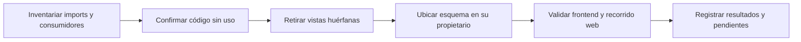

# Retirada de presentación web sin consumidores

## Auditoría y contrato de cambio

Alcance: versión web. La ruta pública /nova/command consume ITaskPlanner;
NovaAssistant sigue atendiendo propuestas/variables del editor. Se conservan ambas:
no existe evidencia para borrar esos caminos ni alterar su compatibilidad HTTP.

El grafo TypeScript desde main.tsx alcanza 52 de 54 fuentes. CommandDialog.tsx y
SemanticPlan.tsx no tienen imports entrantes, ni referencias consumidoras en
pruebas/harness web. Los seis selectores CSS exclusivos sólo aparecen en esas
vistas. La etiqueta de evento SemanticPlan en activity.ts sí está vigente y se
conserva. commands.ts mezcla un contrato sin consumidores con proposalSchema,
que sólo consume preparation.ts.

Propietario: PreparationClient posee la validación HTTP de propuestas del editor.
Se mueve proposalSchema a preparation.ts sin cambiar el esquema, firma del cliente,
endpoint, cabeceras, abort o manejo de errores. Se retiran las dos vistas huérfanas,
commands.ts y sus estilos exclusivos. El panel vivo y comandos AgentUiCommandRegistry
son los propietarios activos de presentación/ejecución del agente y no se modifican.

Entradas/salidas: AiProposal y contrato existente. Sin nuevos puertos/extensiones,
clases, dependencias, permisos, estado, bases o reflexión artificial. Cancelación,
aprobación y revisiones siguen bajo sus propietarios existentes.

Alternativas: conservar lo huérfano perpetúa una presentación que ya no corresponde
al flujo vigente; crear otra abstracción de comandos duplica el registro nuevo;
retirar sólo código sin consumidores y alojar el esquema en su consumidor existente
es el cambio mínimo coherente. No se cambia interpretación natural ni routing.

Compatibilidad: ningún endpoint/BD se elimina. Los exports internos CommandDialog,
SemanticPlan, LocalCommand y commandSchema se retiran tras inventariar consumidores
web; proposalSchema sigue exportado desde su propietario preparation.ts, sin
consumidores directos anteriores salvo éste. No son APIs publicadas de un paquete.
Rollback: restaurar juntos archivos/estilos/import desde before.json.



```text
recorrer imports/exports/import dinámico TypeScript desde main
contrastar archivos no alcanzables con pruebas y herramientas
preservar endpoints y etiquetas de evento aún consumidos
retirar sólo vistas sin consumidores, contrato muerto y CSS exclusivo
mover esquema de propuesta idéntico a preparation, conservando transporte
comparar grafo/esquema/estilos restantes y validar suite/typecheck/build
usar build web congelado con backend anterior por hashes en recorridos manuales
no convertir pruebas sin inferencia en aceptación del agente
```

Aceptación: cero fuentes TypeScript web no alcanzables, mismo esquema de propuesta,
CSS restante idéntico, suite frontend sin regresión, typecheck/build y recorrido web
real en SQLite sintético. Backend no cambia: no repetir matriz C#/Qwen. La matriz
canónica y OpenAPI deben conservar sus hashes; fallos semánticos y latencia siguen
abiertos. Sin pruebas nuevas que sólo repliquen una eliminación reversible.

## Resultado ejecutado

IMPLEMENTADO. Tres módulos retirados (dos vistas sin consumidores y el contrato
interno muerto), seis reglas CSS exclusivas retiradas y esquema idéntico en su
propietario. Grafo de imports: **51/51 fuentes web alcanzables**, cero huérfanas.

- Frontend **189/189** antes y después, 32 archivos, cero omitidas. No pruebas
  nuevas que imiten la eliminación. TypeScript y Vite PASS; warning retenido de
  chunk >500 kB (578,22 kB /178,43 kB gzip).
- Siete comprobaciones headed Edge PASS sobre build congelado y SQLite sintético:
  navegación/scroll y acceso NOVA, cards/rows/favoritos, cancelar borrado, edición,
  versiones/duplicado/borrado confirmado, configuración y móvil. Cero errores de
  browser; captura mobile-expanded inspeccionada. Backend reutilizado por hashes.
- Treinta controles estáticos PASS. Esquema y cuerpo del cliente conservados; CSS
  restante idéntico. OpenAPI y matriz canónica mantienen hashes.

No se ejecuta otra matriz backend ni campaña Qwen, porque no cambian. No se
proclama aceptación semántica, latencia o aislamiento múltiple DOM. El bloque
manual-experience sigue PARTIAL, la versión NO_CERRADA (34 cerrados/54 abiertos)
y la meta general activa. MAUI fuera del alcance autorizado.

Evidencia: [verification.json](../evidence/web-retired-command-20261020/verification.json).
