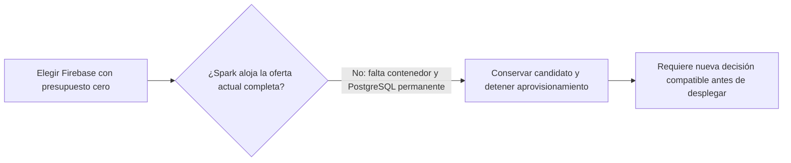
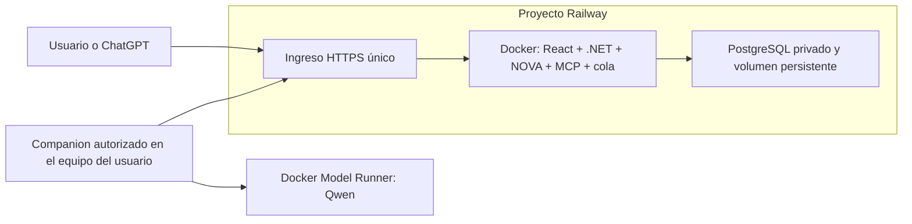

# Cloud gratuito para QuickPrompt — evaluación del 01/11/2026

Pedido vigente: servicios cloud gratuitos; sin Oracle ni servidor propio.
Preservar .NET, React, PostgreSQL, Qwen3:8b/DMR y las autorizaciones existentes.
Es investigación de R5, no otro roadmap ni aceptación de una migración.

## Consulta posterior: opciones sin pagar — 01/11/2026

Se contrastaron otra vez precios y límites oficiales para responder a la petición
de alternativas. Es una comparación: no cambia el destino elegido, no reanuda la
meta bloqueada, no crea cuentas ni autoriza migraciones.

La ruta de menor cambio a evaluar para una beta pública de $0 es **Render Free
sirviendo la imagen completa React/.NET/MCP + Neon Free para PostgreSQL**. Evita
un tercer proveedor de frontend y otro proxy. Requiere aceptar dos proveedores
de alojamiento, medir RAM y consumo y validar el ingreso del dominio Render.
Render publica 750 horas por workspace/mes, suspensión tras 15 minutos sin tráfico
y arranque aproximado de un minuto; el propio proveedor desaconseja producción
en Free. Puede suspender servicios con tráfico saliente elevado hacia bases
externas. Su PostgreSQL de 30 días no es la base propuesta.

Neon publica ahora 1 GB por proyecto, 100 CU-h/mes, 5 GB de transferencia y plan
sin límite de tiempo ni tarjeta. Al agotarse el cómputo se suspende hasta el
periodo siguiente; no es capacidad 24/7 garantizada. La cola actual consulta
incluso sin trabajos y espera 500 ms (`ExecutionWorker.cs`): **riesgo inferido de
consumo continuo**, respaldado por la guía Neon sobre procesos periódicos que
impiden suspender. Hace falta medir y, si procede, corregir el comportamiento en
reposo sin perder recepción de trabajos ni continuidad. No se ha ejecutado una
medición Neon ni una migración en esta consulta.

Alternativa de base: **Supabase Free**, 500 MB, dos proyectos activos y pausa tras
una semana inactiva. Conservar .NET/Identity; antes comprobar versión PostgreSQL,
TLS, roles/RLS y restauración. Sus servicios gratuitos no alojan por sí mismos
el contenedor actual. No se selecciona una base sólo por su etiqueta gratuita.

**Un proveedor:** Northflank Sandbox anuncia dos servicios, dos jobs, una base,
recursos hasta $20/mes, sin tarjeta ni suspensión. Es candidato conceptual que
mejor encaja, pero su estado oficial continúa **Security incident — Identified /
Major outage**, con indicaciones de rotar secretos. No se recomienda trasladar
ahora datos o credenciales del producto. Railway mantiene un crédito recurrente
de $1 tras el trial: no acredita sostener aplicación y PostgreSQL todo el mes, y
la cuenta observada anteriormente tampoco quedó habilitada. No se repite su alta.

Firebase Spark conserva el bloqueo del backend/PG durable; Vercel Hobby restringe
uso a personal no comercial. Koyeb Free ofrece 512 MB/0,1 vCPU y carece de volumen;
también desaconseja producción, por lo que no resuelve mejor el cierre actual.
Docker y las plataformas open source de administración requieren cómputo real:
su licencia gratuita no proporciona por sí misma un servidor cloud gratuito.
Ninguna de estas cuotas incluye inferencia Qwen en GPU: permanece en DMR del
equipo autorizado y requiere su disponibilidad.

Fuentes consultadas en esta continuación:
[Render Free](https://render.com/docs/free),
[Neon pricing](https://neon.com/pricing),
[Neon: procesos que impiden suspender](https://neon.com/docs/manage/computes),
[Supabase pricing](https://supabase.com/pricing),
[Northflank pricing](https://northflank.com/pricing),
[Northflank estado actual](https://status.northflank.com/),
[Railway pricing](https://railway.com/pricing),
[Koyeb Free](https://www.koyeb.com/docs/reference/instances) y
[Vercel Hobby](https://vercel.com/docs/plans/hobby).
Context7 contrastó el comportamiento de suspensión de Neon. Investigación y
lectura estática, sin pruebas de aceptación ni certificación de un despliegue.

## Proveedor solicitado ahora: Firebase, presupuesto estricto $0

El usuario sustituyó Railway por Firebase y ratificó que no tiene presupuesto
para pagar. Esa decisión no autoriza Blaze, vincular una cuenta de facturación,
crear recursos con coste ni reescribir el producto para cambiar su base de datos.
Se creó únicamente el proyecto vacío QuickPrompt Web en Spark; no se trasladaron
claves o bibliotecas ni se activó facturación. La configuración parcial observada
se detalla debajo; no constituye alojamiento funcional del sistema.

**Resultado comprobado documentalmente:** Firebase Spark puede alojar contenido
estático, pero no es alojamiento para el contenedor .NET existente. Cloud Run
acepta ese contenedor y requiere Cloud Billing; al asociarlo al proyecto Firebase,
éste pasa a Blaze. La cuota gratuita de Cloud Run no garantiza una factura cero.
SQL Connect publica una prueba PostgreSQL de 90 días en Spark, no persistencia
gratuita permanente; sin actualización, la instancia se archiva y después elimina.

La ruta técnica de menor cambio, **no autorizada financieramente ni desplegada**,
sería un proyecto Firebase/Google Cloud con acceso HTTPS directo a Cloud Run,
la imagen .NET/React existente y Cloud SQL PostgreSQL con roles/RLS/VerifyFull.
No se sustituye ASP.NET Identity por Firebase Auth ni PostgreSQL por Firestore
para aparentar el cierre. Companion y Qwen/DMR permanecen en el equipo autorizado.

No preparar un `firebase.json` que reenvíe todo el sistema a Cloud Run como si
fuera equivalente: Hosting filtra cookies del backend y sólo permite `__session`;
`AccountHost` usa cookies diferentes de sesión, externa y CSRF con prefijo
`__Host-`. Hosting también limita sus peticiones a 60 s. Son incompatibilidades
documentales respecto al contrato actual, **no fallos reproducidos en una cuenta
Firebase**. El ingreso directo a Cloud Run todavía requiere verificar su frontera
de confianza; no copiar direcciones de proxy supuestas ni relajar seguridad.

La cola .NET hace trabajo en segundo plano y consulta cada 500 ms. Cloud Run
documenta CPU fuera de peticiones con facturación por instancia; una instancia
mínima es otra consideración de continuidad y coste. No cambiar ese patrón ni
prometer suspensión gratuita sin comprobar el resultado original del usuario.



Algoritmo vigente: conservar $0 y contratos; inventariar proyectos sólo con acceso
autorizado; no vincular facturación; no publicar únicamente la web como MVP
completo; no migrar datos; mantener R5/aceptación final sin aprobar. Después de
instalarse el plugin oficial Firebase se verificaron sus skills y configuración
MCP. Las funciones MCP todavía no aparecieron en el inventario de herramientas
de esta sesión, por lo que se usó la CLI oficial conforme a `firebase-basics`:
Node 22.19.0, Firebase CLI 15.34.2, sin dependencias nuevas en el repositorio.
`login:list` confirmó cero cuentas autorizadas. El usuario autorizó expresamente
el alcance amplio de Firebase CLI para inventario con la cuenta de infraestructura
`jptorres.software@gmail.com`. Google devolvió el flujo oficial; se verificaron
state y session ID sin mostrar el código en chat. El intercambio CLI fue rechazado
antes de crear proceso por revisión automática («blocked by policy», sin detalle).
No se repitió por otra vía. La consola web existente permitió completar el
inventario inicial sin guardar una credencial CLI: Firebase y Google Cloud mostraron sólo
**CJC Informe Digital (`cjc-informe-digital`)**, sin QuickPrompt en esa cuenta.
No se seleccionó, alteró o reutilizó ese proyecto ajeno a QuickPrompt.

El código de un solo uso se había transferido a un archivo privado fuera de Git
antes del rechazo; su eliminación separada también fue rechazada. El usuario
completó después la limpieza manual y `Test-Path` confirmó el archivo ausente el
01/11/2026 a las 17:12:45 UTC, sin leer o copiar su contenido. La pestaña que
mostraba el código se cerró. CLI vuelve a confirmar cero cuentas autorizadas.
Recibo sin códigos/tokens y captura del inventario histórico:
`.playwright/firebase-access-20261101/`. No se instaló gcloud.

### Configuración ejecutada en consola — 01/11/2026

La petición posterior autorizó continuar la configuración y crear una meta
específica. Se creó **QuickPrompt Web (`quickprompt-web-54498`)** mediante la
sesión Google existente, sin repetir el intercambio CLI rechazado. El asistente
confirmó «Your Firebase project is ready» y la vista general mostró **Spark —
No-cost ($0/month)**. Gemini y Analytics se desmarcaron antes de crear. CJC no se
seleccionó ni alteró; no se crearon credenciales, vinculó facturación, habilitó una
base o desplegó código. Tampoco se registró una app SDK sin un consumidor definido.

Se inspeccionó App Hosting en el proyecto real. Su pantalla exige literalmente
«App Hosting requires a billing account (Blaze)» y ofrece «Upgrade project».
No se pulsó esa opción. Es una barrera observada de aprovisionamiento; la limitación
de PostgreSQL y las cookies se mantienen como hallazgos documentales, sin fingir
una reproducción de la aplicación desplegada en Firebase.

[Proyecto creado](https://console.firebase.google.com/project/quickprompt-web-54498/overview).
Recibo y capturas: `.playwright/firebase-configuration-20261101/`.
La nueva meta está activa, con los controles R1–R6 existentes y resultado parcial.
La elección de proveedor está registrada; el alojamiento completo a $0 sigue sin
una configuración compatible demostrada.

Fuentes primarias consultadas el 01/11/2026:
[Firebase con Cloud Run y requisito Blaze](https://firebase.google.com/docs/hosting/cloud-run),
[cookies de Hosting](https://firebase.google.com/docs/hosting/manage-cache),
[SQL Connect: coste y caducidad](https://firebase.google.com/docs/sql-connect/pricing),
[CPU y trabajo de fondo](https://docs.cloud.google.com/run/docs/configuring/billing-settings).
Context7 se usó para contrastar requisitos y comportamiento del proxy. No se
ejecutaron nuevas pruebas de producto porque esta revisión no modifica su código.

## Decisión vigente: un proveedor y una aplicación

La instrucción posterior del usuario exige maximizar lo existente en un solo
servicio/proveedor. **La propuesta Netlify + Render + Neon queda retirada como
destino**, aunque la comparación se conserva como evidencia. No iniciar sus altas
ni preparar tres despliegues. La [arquitectura propietaria](../ARCHITECTURE.md)
define una imagen .NET con React, API, NOVA, cola y MCP; PostgreSQL durable sería
un recurso privado del mismo proveedor. No se consolidan inferencia/Google/ChatGPT/
correo en un contenedor ni se cambian sus permisos o contratos por esta decisión.

Render fue el primer candidato para reutilizar la cuenta y el contenedor existentes.
La selección técnica anterior fue **Railway**; el usuario eligió después Firebase
con $0, según la revisión superior. Esto no modifica el piloto actual: su PostgreSQL
gratuito sigue teniendo caducidad. No meter PostgreSQL dentro del web service sin
volumen para sortearla. Todavía no hay evidencia de un plan único gratuito que
cumpla toda la oferta.

## Selección técnica: Railway — 01/11/2026

El pedido inicial de esta revisión autorizó comparar y escoger. Se escoge Railway por compatibilidad con la
aplicación existente; **la viabilidad operativa permanente a $0 no está aprobada**.

La petición siguiente autorizó configurar Railway y crear la meta de cierre. La
observación real de esa cuenta encontró prueba vencida, crédito $0, despliegues
pausados y una factura pendiente que impide cambiar de plan. CLI autenticada y
manifiesto preparado no levantan ese bloqueo. No se pagó ni se crearon recursos;
véase el [checklist vigente](../development/GO_TO_MARKET.md). Por tanto, la
selección técnica no constituye actualmente un destino operativo habilitado.

| Opción | Encaje con QuickPrompt | Decisión |
| --- | --- | --- |
| Railway | Puede alojar la imagen Docker existente y PostgreSQL en el mismo proyecto/proveedor. Conserva .NET, React, identidad, cola y MCP. | Seleccionado como destino técnico a validar. |
| Firebase | App Hosting requiere Blaze/facturación. Cloud Run permite contenedores, pero también requiere facturación; SQL Connect ofrece PostgreSQL de prueba durante 90 días. | No resuelve mejor el cierre actual ni acredita PostgreSQL gratuito permanente. |
| Supabase Cloud | Buen servicio PostgreSQL; sus Edge Functions usan Deno/TypeScript, no son alojamiento directo para el contenedor ASP.NET existente. | Requeriría otro alojamiento para .NET o una reescritura fuera del cierre solicitado. |

Topología propuesta, no desplegada:



Un proveedor puede contener dos recursos con responsabilidades distintas:
aplicación y base. La inferencia permanece en el equipo autorizado; no se promete
GPU cloud gratuita ni se trasladan los modelos. No se sustituye ASP.NET Identity
por Firebase Auth o Supabase Auth sólo para cambiar de alojamiento.

El plan Railway Free publica $5 de prueba durante 30 días y después $1 mensual,
con 0,5 GB RAM por servicio y 0,5 GB de volumen. Es crédito de consumo, no una
garantía de disponibilidad permanente de esta aplicación y su base.
`ExecutionWorker.ExecuteAsync` consulta la cola cada 500 ms sin trabajo; además,
el Companion conectado consulta cada cinco segundos. Railway documenta que el
tráfico saliente a bases/colas puede impedir la suspensión. **Inferencia:** este
patrón puede mantener el consumo en reposo. No se ha medido una factura Railway
ni se han modificado los workers para favorecer una prueba.

Algoritmo de preparación y aceptación antes de cualquier corte:

```text
1. Comprobar elegibilidad, cuotas y límites del plan sin activar pagos.
2. Validar con datos sintéticos la imagen actual y PostgreSQL 18 persistente.
3. Exigir TLS VerifyFull, roles limitados y RLS; no rebajar esos contratos.
4. Medir RAM, CPU, disco, consumo en reposo y latencia con la carga acordada.
5. Validar ingreso confiable, HTTPS, cookies, Google, MCP y Companion
   sobre un origen único; no omitir OriginProxy sin validar su reemplazo.
6. Comprobar respaldo cifrado, retención, restauración y rollback.
7. Si supera cuotas o falla un control crítico, conservar NO-GO de alojamiento;
   no migrar datos ni contratar un plan automáticamente.
```

Estado: **PASS** de comparación documental y selección técnica. **PENDIENTE** de
validación del servicio real. **BLOQUEADO** el cierre de R5 a $0 hasta demostrar
consumo, persistencia, recuperación y seguridad dentro del plan elegido. No se
ejecutaron pruebas de despliegue ni se cambiaron código, secretos u orígenes.

Fuentes primarias consultadas: [Railway pricing](https://railway.com/pricing),
[PostgreSQL](https://docs.railway.com/databases/postgresql),
[serverless y tráfico en reposo](https://docs.railway.com/deployments/serverless),
[Firebase App Hosting](https://firebase.google.com/docs/app-hosting/costs),
[Cloud Run con Firebase](https://firebase.google.com/docs/hosting/cloud-run),
[SQL Connect](https://firebase.google.com/docs/sql-connect/pricing),
[Supabase Edge Functions](https://supabase.com/docs/guides/functions) y
[planes Supabase](https://supabase.com/pricing). También se contrastó la
documentación con Context7. Esta evaluación conserva el checklist R1–R6 como
único roadmap de cierre.

## Comparación ampliada: sin servidor propio y sin pago — 01/11/2026

El usuario ratificó $0: no se propone contratar un VPS ni exigir un servidor que
no tiene. Docker sigue siendo el formato de la aplicación; el proveedor cloud
debe aportar el cómputo y el almacenamiento. Una plataforma abierta para
autohospedarse no equivale a infraestructura cloud gratuita.

| Oferta verificada | Gratuidad publicada | Encaje y límite para este MVP |
| --- | --- | --- |
| Northflank Sandbox | 2 servicios, 2 jobs y una base, hasta $20/mes de recursos; sin tarjeta ni suspensión por inactividad | Es la mayor oferta recurrente examinada que reúne contenedores/base en un proveedor. Su incidente de seguridad sigue Identified/Major outage: no se eligió ni recibió claves/datos. No se atribuye aprobación comercial por su pricing. |
| Railway Free | Trial de $5 por 30 días; después $1 mensual no acumulable, 0,5 GB RAM por servicio y 0,5 GB de volumen | Permite evaluar el stack Docker/PostgreSQL sin servidor propio. La memoria/CPU/almacenamiento consumen el crédito. No se ha medido que el host y PG actuales quepan en $1; las políticas de expiración de volúmenes impiden prometer continuidad por la etiqueta Free. |
| Google Cloud Free Trial | $300 de crédito durante 90 días, sin cobro automático de uso durante el trial | Mayor crédito inicial de esta comparación; puede evaluar infraestructura del mismo proveedor. Exige elegibilidad nueva y medio de pago para verificar identidad. Si no se actualiza, los recursos paran al agotarse crédito/plazo. No se ha comprobado elegibilidad ni aprobado una cuenta de facturación. |
| Firebase SQL Connect | PostgreSQL de prueba 90 días en Spark; posterior Cloud SQL de pago | No soluciona PostgreSQL gratuito permanente. Integrar sus otros servicios tampoco equivale a alojar el contenedor .NET vigente sin comprobarlo. |
| Supabase Free | Dos proyectos activos; 500 MB de base, 1 GB de archivos y 5 GB de egress; pausa por una semana sin actividad | Oferta útil de PostgreSQL, no destino completo comprobado para este contenedor .NET. Sustituir la identidad/dominio para acomodarse al plan excedería el cierre. |
| Vercel Hobby | Sin coste con cuotas; uso personal no comercial | No es el plan comercial gratuito requerido. No se retira el piloto ni se activa Pro en esta revisión. |

Qwen continúa en DMR del equipo autorizado: estos precios no prometen GPU cloud
ni ejecución de modelos para todos los usuarios. No se crearon cuentas, movieron
datos, cambiaron orígenes/callbacks o contrataron planes. Estado: destino final
todavía no validado. Antes de migrar, medir recursos y comprobar persistencia,
restauración, permisos y HTTPS del proveedor/plan realmente seleccionado.

Fuentes primarias consultadas el 01/11/2026:
[Northflank pricing](https://northflank.com/pricing),
[incidente](https://status.northflank.com/cmvv0rn5a092f14rutwccodpp),
[Railway pricing](https://railway.com/pricing),
[planes y retención](https://docs.railway.com/pricing/plans),
[trial Railway](https://docs.railway.com/pricing/free-trial),
[programa gratuito Google](https://docs.cloud.google.com/free/docs/free-cloud-features),
[Firebase SQL Connect](https://firebase.google.com/docs/sql-connect/pricing),
[Supabase](https://supabase.com/pricing) y
[Vercel Hobby](https://vercel.com/docs/plans/hobby).

## Alternativa distribuida examinada, retirada

Para la siguiente evaluación de compatibilidad: **Netlify Free para la web,
conservar Render Free para el backend .NET y evaluar Neon Free para PostgreSQL 18**.
Reutiliza la arquitectura existente. No está seleccionado ni desplegado un destino
final: no trasladar datos o secretos antes de resolver los límites de operación.
Una alternativa de base es Supabase Free, condicionada a verificar la versión
PostgreSQL disponible y una migración compatible; no reemplaza nuestro backend.

**Resultado de la revisión posterior:** la combinación anterior queda condicionada,
no recomendada como traslado inmediato. Netlify documenta un timeout de proxy de
26 segundos; nuestros feeds NOVA/ejecución renuevan a los 30 segundos en
`AccountNovaFeed.Events` y `AccountExecutionFeed.Events`. Es una incompatibilidad
estática de límites que exige prueba HTTP; no se reprodujo un corte en Netlify.
Render documenta cerca de un minuto de arranque en frío, también mayor que ese
timeout. No generar otra receta de proxy ni cambiar los tiempos sólo para
sortear la evaluación: antes demostrar recuperación, cookies y MCP sin repetir
efectos. Netlify sigue siendo candidato para contenido estático.

No presentar esta combinación como producción comercial certificada. Netlify admite
uso comercial; Render desaconseja producción en sus instancias Free y sus pausas
afectan disponibilidad. El PostgreSQL de Render actual conserva su vencimiento.
Un proveedor gratuito no cierra por sí solo correo, recuperación, agente o permisos.

## Comparación pertinente

| Servicio | Oferta gratuita publicada | Relación con QuickPrompt / límite |
| --- | --- | --- |
| Netlify Free | 300 créditos mensuales; permite proyectos comerciales | Candidato para React y el ingreso público. No ejecuta directamente nuestro backend persistente .NET. Verificar proxy, secretos, cookies, OAuth, MCP y SSE antes de sustituir Vercel. Las cuotas actuales son las de pricing, no las del anuncio de 2024. |
| Render Free | Un servicio consume parte de 750 horas gratuitas/mes del workspace; pausa tras 15 min sin tráfico | Reutiliza el contenedor .NET y los workers actuales. Arranque en frío del orden de un minuto según su guía; disco efímero. El fabricante desaconseja producción. Su PostgreSQL Free caduca a los 30 días. |
| Neon Free | PostgreSQL 18; 1 GB por proyecto, 100 CU-h/mes y 5 GB de salida | Conserva Npgsql/PostgreSQL y roles propios. La cuota equivale a 400 horas a 0,25 CU; no cubre un mes completo siempre activo. Hay que resolver el consumo en reposo antes de elegirlo. |
| Supabase Free | PostgreSQL dedicado pequeño, 500 MB de base y 5 GB de salida; dos proyectos activos | Su base y roles personalizados son compatibles conceptualmente con Npgsql y RLS. Puede pausarse por baja actividad durante siete días. La versión/CA/conexión y migración concretas siguen sin comprobar; no asumir que admite nuestro corte PG18. |
| Cloud Run | Capa gratuita recurrente según CPU/RAM/requests; exige cuenta de facturación | Acepta contenedores. El modo por petición no garantiza CPU para nuestros workers en segundo plano. El modo por instancia también consume mientras está inactivo. Los spend caps tienen latencia y no garantizan gasto exactamente cero. No es una migración directa demostrada. |
| Northflank Sandbox | Publicita dos servicios, dos jobs, una base y recursos hasta $20/mes, sin suspensión | Compatible conceptualmente con contenedores y PG18. No elegir ahora: incidente de seguridad oficial abierto desde el 30/10. Además, pricing dice sin tarjeta mientras la guía exige método de pago y desaconseja producción Free. |

Coolify queda como alternativa autogestionada, no como un cloud gratuito que
proporcione servidor. Su [configuración preparada](../../deploy/cloud/COOLIFY.md)
se conserva; no hay instalación activa. ClawCloud Run anuncia créditos mensuales
condicionados a antigüedad de GitHub, pero su web/docs no pudieron comprobarse en
vivo aquí (HTTP 502 y DNS sin resolver). No tomar el índice del buscador como
prueba de disponibilidad actual ni crear allí credenciales con esa evidencia.

## Restricción encontrada en nuestro código

`ExecutionWorker.ExecuteAsync` consulta la cola cada 500 ms en reposo.
`CompanionRunner.RunLoop` vuelve a consultar cada cinco segundos cuando no hay trabajo.
Son lecturas de código, no un benchmark de consumo facturado.

Una instancia que consulta PostgreSQL permanentemente puede impedir que Neon
alcance cinco minutos de inactividad. A 0,25 CU, 24 horas × 30 días son **180 CU-h**,
superiores a las 100 incluidas. El número de prompts guardados no mide ese consumo.
Medir uso real y corregir las consultas vacías en sus propietarios antes de migrar;
conservar admisión, revisión de permisos, recuperación y revocación. No simular
tráfico para evitar políticas de inactividad.

Cloud Run por petición plantea otra frontera: `AccountNovaCoordinator` y
`ExecutionWorker` son servicios de fondo .NET. No considerar que terminan sus tareas
cuando no hay una petición abierta sin demostrarlo bajo la política de CPU real.
Las sesiones SSE también cuentan como peticiones activas. Evitar cambiar a ese
alojamiento sólo porque pueda construir la imagen.

## Qué habilita la siguiente decisión

La decisión exige una prueba con datos sintéticos del proxy, PostgreSQL 18/roles/TLS,
persistencia, latencias en frío, continuidad del worker y consumo bajo la carga
acordada. Los controles originales siguen en R1–R6, sin añadir otra certificación.
La base sintética local no aparece en `docker ps` al observarla en esta revisión;
no se inició por una vía alternativa al arranque anteriormente rechazado.

No se crearon cuentas, contrataron planes, cambiaron DNS/callbacks ni copiaron
datos o secretos. No hay GO de alojamiento. La aplicación y su inferencia siguen
siendo portables; usar un cloud gestionado no convierte a su plataforma en software
abierto ni permite prometer una GPU gratuita para Qwen.

El inventario de pestañas conectadas no mostró paneles Netlify/Neon; esto no
demuestra que el usuario carezca de cuentas. No se iniciaron sesiones ni se
completaron altas. Ninguna opción comparada acredita todavía toda la oferta
actual de QuickPrompt con disponibilidad continua y coste cero.

## Fuentes primarias

- [Netlify: precios actuales](https://www.netlify.com/pricing/) y [permiso de uso comercial](https://www.netlify.com/blog/introducing-netlify-free-plan/) (2024, sólo para esa política).
- [Netlify: límite del proxy de 26 segundos](https://docs.netlify.com/manage/routing/redirects/rewrites-proxies/).
- [Render: límites Free](https://render.com/docs/free).
- [Render: contenedores](https://render.com/docs/docker) y [PostgreSQL administrado/versiones](https://render.com/docs/postgresql-creating-connecting).
- [Neon: planes](https://neon.com/docs/introduction/plans) y [versiones PostgreSQL](https://neon.com/docs/postgresql/postgres-version-support).
- [Supabase: precios](https://supabase.com/pricing), [pausas](https://supabase.com/docs/guides/platform/free-project-pausing), [roles](https://supabase.com/docs/guides/troubleshooting/custom-role-inherits-privileges-that-were-not-explicitly-granted-ddaa1c) y [TLS](https://supabase.com/docs/guides/platform/ssl-enforcement).
- [Cloud Run: CPU y facturación](https://docs.cloud.google.com/run/docs/configuring/billing-settings), [cuotas gratuitas](https://docs.cloud.google.com/free/docs/free-cloud-features) y [latencia de spend caps](https://docs.cloud.google.com/billing/docs/how-to/budgets-spend-caps).
- [Northflank: precios](https://northflank.com/pricing), [guía de facturación](https://northflank.com/docs/v1/application/billing/pricing-on-northflank) e [incidente oficial abierto](https://status.northflank.com/cmvv0rn5a092f14rutwccodpp).

Se consultó Context7 para compatibilidad de Neon, Supabase y Cloud Run. La
documentación demuestra capacidades publicadas; no sustituye las pruebas del
servicio/cuenta final ni garantiza precios futuros.
